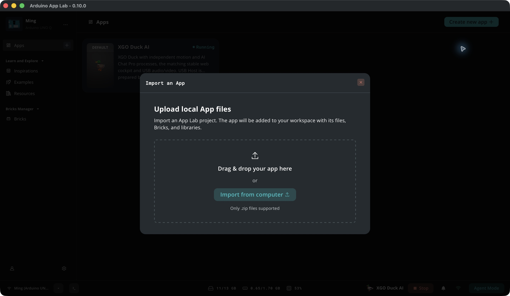
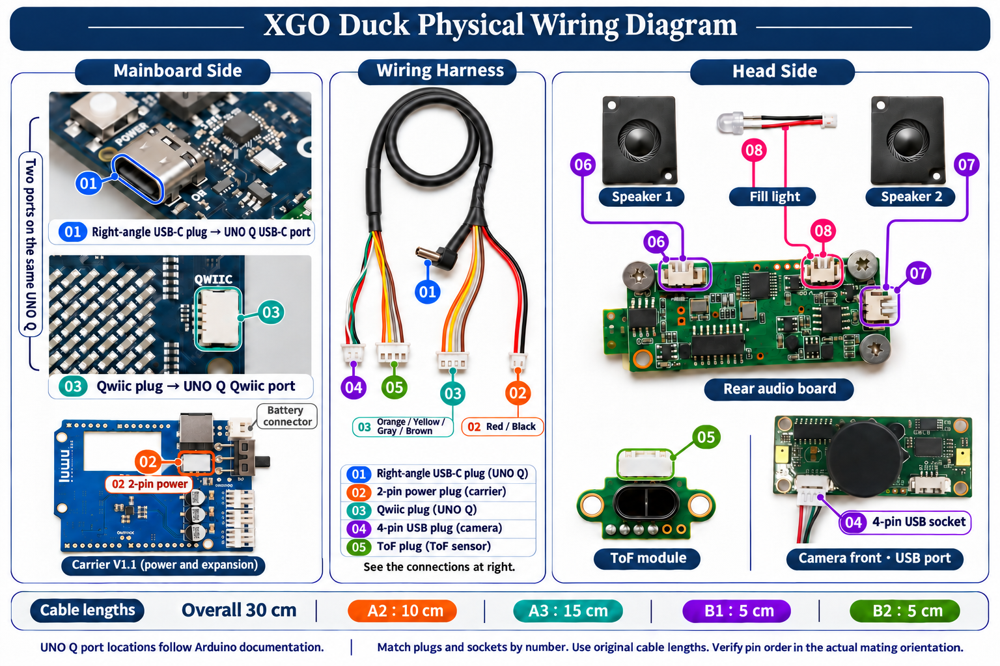
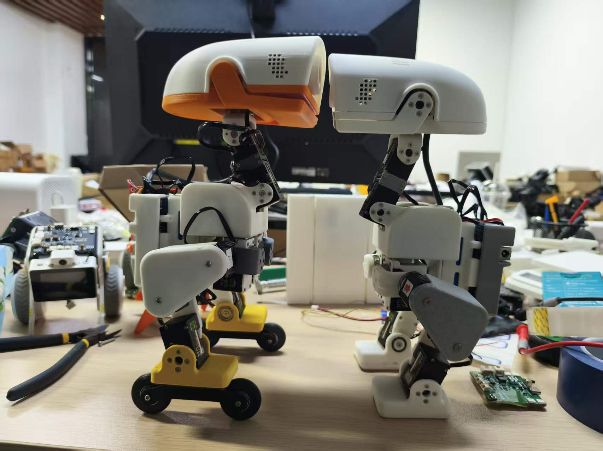
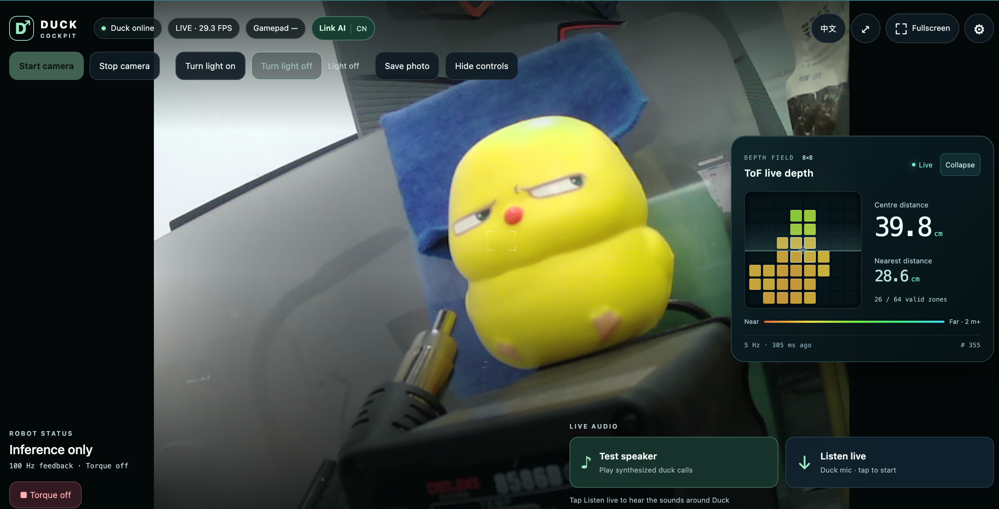
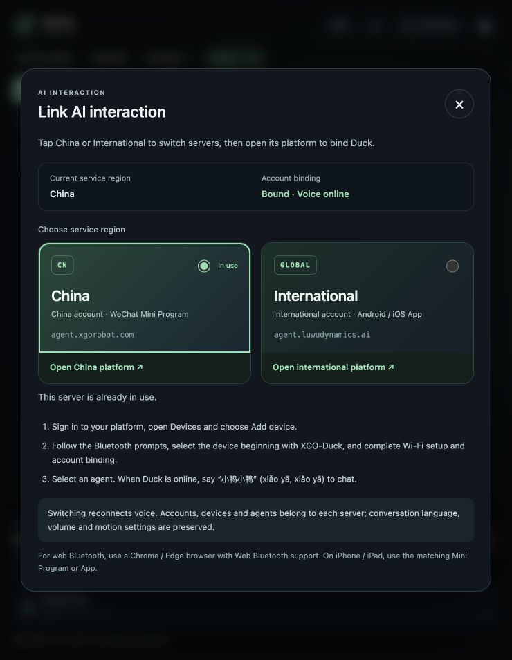

# XGO Duck AI

English · [简体中文](README_CN.md) · [XGO Duck Wiki](https://wiki.xgorobot.com/kb/the-xgo-series-robot/models/duck) · [FAQ](https://wiki.xgorobot.com/kb/the-xgo-series-robot/duck-troubleshooting?model=duck) · [Changelog](docs/CHANGELOG.md)

Voice chat, motion control, USB audio/video and ToF ranging for XGO Duck on Arduino UNO Q. Use a browser for everyday operation; Duck does not need a display.

Prepare an Arduino UNO Q running official Debian 13, a carrier board, a USB data cable, a battery and servos. Voice chat needs a USB microphone and speaker. A USB camera and a VL53L5CX ToF sensor on the onboard Qwiic port are optional.

The first seven steps follow the official developer guide, with this repository’s XGO Duck AI packages and startup commands.

## 1. Set up Wi-Fi

Connect the UNO Q to your computer with a USB data cable. In Arduino App Lab, choose the keyboard layout, name the board, join Wi-Fi and set the board’s Linux password. Let the update check finish. Disconnect USB, fit the carrier as shown in the guide, then reopen App Lab and reconnect. [Illustrated guide](https://www.xgorobot.com/duck-developer-guide/index.html)

## 2. Find the board’s IP address

In Arduino App Lab, click the Wi-Fi icon in the lower-right corner, open **Network Info**, and note the board’s IP address. Connect your computer and the board to the same local network for installation.

Once you know the IP, you can give this prompt to an AI assistant with terminal access to check SSH.

```text
My board IP is [fill in]. Check whether my computer can reach the board over Wi-Fi SSH as arduino.
After login, check the Debian version, CPU architecture, free disk space and Arduino App CLI.
I will enter the password at the terminal prompt.
```

## 3. Import XGO Duck AI

> **Want AI to handle the installation?** Complete steps 1–2, then use the [AI prompt for steps 3–4](#ai-assisted-install).

| Package | When to use it | What it includes |
| --- | --- | --- |
| [Full first-install ZIP (Release)][duck-full] · [SHA-256][duck-full-sha] | **A new board or a board with a freshly flashed OS** | About 470 MB. Includes the precompiled App, ARM64 Docker base image, board dependencies and STM32 upload tools. Once the package is on the board, installation can run over the local network. |
| [Precompiled .ard (Release)][duck-ard] · [SHA-256][duck-ard-sha] | **Updates** or a first install on a board with the runtime environment ready | About 80 MB. Includes STM32 firmware and the built Python environment. Startup uploads the bundled firmware. The board may still need internet access for missing system packages, container images or upload tools. |
| [App Lab source ZIP (repository)][duck-zip] · [SHA-256][duck-zip-sha] | **Boards that cannot install .ard** or editing the App | About 35 MB. Uses the existing `packages/xgoduck_ai.zip` link. Import it in App Lab, then prepare the dependencies and build the STM32 sketch on the board. |

Once the assets are published, both direct links point to the latest release. For a specific version or a missing asset, pick the appropriate XGO Duck AI version in [GitHub Releases][duck-releases]. Download the matching checksum for each package.

### Full first-install ZIP

Complete UNO Q initial setup and connect over Wi-Fi SSH to the official Debian 13 ARM64 image. Allow at least **2.5 GiB** of free space on the reference system. Verify the ZIP with its checksum, transfer it to UNO Q with SCP and extract it into a new directory on the board. If the servos are wired, support Duck and confirm torque is off. Stop any running Apps, then follow `INSTALL.txt` and run `bash install.sh` as `arduino`. The installer configures the 2 Mbps Bridge, enables autostart and launches the App. Continue with the checks in step 4. On the reference image, the board can install over the local network once it has the ZIP. Account binding and cloud voice need internet access.

The full package installs the App and its dependencies without reflashing the OS. Its extraction directory is separate from the fixed App destination: `/var/lib/arduino-app-cli/releases/xgoduck-ai-0-3-6-unoq` for 0.3.6. If that destination exists, the installer reuses it only when `.xgoduck-full-install.sha256` exactly matches the SHA-256 of the bundled `.ard`. A separately installed `.ard`, or a repacked file with the same version, may not meet this condition. Keep a verified working installation, or handle its directory and data under an explicit reinstall request before proceeding. Do not fabricate a receipt or overwrite the directory. [Full-package instructions](docs/full-install.txt)

To retain settings, first save this Duck's persistent data using the update procedure. After the full installer finishes, stop the new App and `xgoduck-ai-hardware.service`, restore the saved settings with their permissions and ownership, then start the hardware service and the new App before verification. [Migration and rollback notes (Chinese)](docs/deployment.md#更新与回退)

### Precompiled .ard

The board needs **Arduino App CLI and daemon 0.14 or newer**. In App Lab 0.11 or newer, select **Create new App ＋ → Import or install App** and choose the `.ard`. If your desktop App Lab is older and the board supports `arduino-app-cli app install`, install it over Wi-Fi SSH. [Arduino App Lab installation guide](https://docs.arduino.cc/software/app-lab/apps/manage-apps)

Transfer the `.ard` and `.ard.sha256` files to the same directory on the board. Run the commands as `arduino`, using the actual downloaded filenames.

```sh
sha256sum -c xgoduck-ai-unoq.ard.sha256 && \
  arduino-app-cli app install --yes xgoduck-ai-unoq.ard
```

Use the new App directory printed by the installer. For an update, migrate the settings for this Duck, then continue with step 4. If the board CLI or daemon is too old, update the board components or use the source ZIP below.

### App Lab source ZIP

Download and verify `xgoduck_ai.zip`. In App Lab, select **Apps → ＋ → Import App** or **Import or install App** in newer versions, then choose the ZIP. Locate the imported **XGO Duck AI** directory and leave the App stopped for step 4. [Illustrated import guide](https://www.xgorobot.com/duck-developer-guide/03-import-app.html)



## 4. Configure the board and start the App

**Full first-install ZIP.** The installer handles configuration and startup. Continue with the checks below.

**Precompiled .ard and source ZIP.** Use Wi-Fi SSH for the configuration below because USB detection can interrupt the computer’s USB/ADB connection.

1. For an update, support Duck and unload the servos. Stop the old App and back up its directory and `data/`. With both Apps stopped, migrate this Duck’s persistent settings, including calibration, binding and service region. [Deployment notes (Chinese)](docs/deployment.md#更新与回退)
2. Make sure the other Apps are stopped and the board has internet access, then run the commands below as `arduino` from the actual new App directory. Use the installer output or the App CLI list to find the directory.

   ```sh
   bash tools/install-ai-support.sh && \
     sudo bash tools/router-2m.sh && \
     arduino-app-cli app start "$PWD"
   ```

   The first script sets up hardware support, the cockpit and autostart. The second sets the shared Router serial link to **2 Mbps**. Startup uploads the matching STM32 firmware. The source ZIP builds it on the board, and the `.ard` uses its bundled firmware. Once configured, you can also start the App with **Run** in App Lab.

**Verify the installation.** Open `http://<board-ip>/` and `http://<board-ip>:9527/` and check the running version and default App. After dependency preparation and the first startup finish, keep servo torque off and reboot the board once. Reconnect over Wi-Fi SSH, wait for the web pages/API, and confirm that the default App starts automatically with the correct version. Check servo and IMU feedback for connected hardware and preserve existing calibration and settings. Record unwired or uncalibrated hardware as unfinished setup.

A first installation may not have an account binding or a USB microphone and speaker yet, so **online voice is not a prerequisite for a successful installation**. Check `/api/voice/status` and the logs: record pending network, binding or audio setup, while still investigating process crashes and dependency errors. Require voice cloud connectivity and audio readiness only when the account is bound, audio hardware is connected and internet access is available. Continue with steps 5–8. An offline cold-boot test can follow once provisioning and the required setup are complete.

<a name="ai-assisted-install"></a>

### Let AI handle steps 3–4

The source ZIP installation workflow has been tested with Codex, DeepSeek Harness and Cursor. Allow 30–60 minutes for a first source install, depending on download speed. The full package includes dependencies, so board setup time mostly depends on transfer, extraction and local installation.

Copy the prompt and fill in the **board IP, SSH username and password** for an assistant with terminal access. If you already use an SSH key, the assistant can sign in with it.

```text
Install, start and verify XGO Duck AI on my Arduino UNO Q.
Board IP: [fill in]. SSH username: [fill in, usually arduino]. SSH password: [board's Linux login password].
Installation: [first install / update / detect]. Version: [latest XGO Duck AI / specific, e.g. 0.3.6].
Service region: [auto-detect or keep existing / China cn / International global].
Path to any package I already downloaded: [optional].

1. Sign in over Wi-Fi SSH. Use the password only for SSH or sudo and keep it out of files, shell history
   and logs. Confirm UNO Q, official Debian 13 ARM64, free space, the arduino account (UID 1000), and
   the App CLI and daemon versions. Use arduino-app-cli app list for installed Apps,
   app details <App ID> for the actual path, app ps for running status, and
   arduino-app-cli properties get default for the startup App.
   Check command help on older CLIs. Resolve the target version first. For “latest XGO Duck AI”, read the
   version from the latest GitHub Release. If I requested the master walking pose, compare the installed
   python/rl_core.py SHA-256 with the target build-manifest.json before reusing an App. Both builds can report 0.3.6.
   If an App is running, check the cockpit, /api/version and /api/status without changing its state.
   If the requested version and build are running normally, report that installation was skipped and finish here.
   If the target version is installed but unhealthy, inspect its App and service logs before deciding how to repair it.
   For an installation, keep Wi-Fi SSH available. USB detection can interrupt USB/ADB.

2. Use the full ZIP for the target version by default for both first installs and upgrades from an older
   version (item 4). Reuse a verified copy on my computer when available.
   - The full ZIP includes the .ard, runtime image and dependencies. Only download the full ZIP and its .sha256.
     https://github.com/LuwuDynamics/xgoduck_runtime_arduino/releases/latest/download/xgoduck-ai-unoq-full.zip
   - If I request a lightweight install or the target version has no full package, use its precompiled
     .ard on a board that supports Releases (item 5).
     https://github.com/LuwuDynamics/xgoduck_runtime_arduino/releases/latest/download/xgoduck-ai-unoq.ard
   - Use the source ZIP (item 6) for editing, for a board that cannot install Releases, or when only the
     source ZIP is available for the target version. If I request the master walking pose, use
     packages/xgoduck_ai.zip and its .sha256 from the master checkout. The AI branch source ZIP is here.
     https://github.com/LuwuDynamics/xgoduck_runtime_arduino/raw/ai-chat-audio-video-tof/packages/xgoduck_ai.zip
   For a specific version or missing direct links, look for the matching XGO Duck AI version here.
   https://github.com/LuwuDynamics/xgoduck_runtime_arduino/releases
   Get each package and .sha256 from the same Release. For the source ZIP, get both from the branch
   above. Verify on my computer, transfer the files with SCP, and run sha256sum -c again on the board.
   Download again if the checksum fails. Verify version.txt and the UNO Q target. For the full package,
   inspect its bundled .ard. If the requested version is missing or the candidate is older than the
   installed version, keep the existing installation and report the versions.

3. If the servos are wired, have me support Duck and confirm torque is off. For an update, stop the old
   App, record its path and the default App, and back up the old App and data/. Keep the old App for
   rollback. Install a .ard or source ZIP into a separate directory. With both Apps stopped,
   migrate this Duck's persistent IMU calibration, servo center records, identity, binding, region and
   gamepad settings. Follow the legacy center migration in docs/ai-chat-en.md. Skip old .cache,
   data/native/ and runtime sockets. Confirm that other Apps can stop and have stopped before running the
   installer or configuring the shared Router. The full package starts automatically: follow item 4
   to stop services before migrating data and handle any existing destination first. Use only one route in items 4–6.

4. For the full ZIP, allow at least 2.5 GiB for a first install on the reference image. Extract on the board
   into a new directory. Read INSTALL.txt and the fixed app_root in install.sh; the extraction directory
   does not change that destination. If it exists, compare .xgoduck-full-install.sha256 with the exact
   SHA-256 of the bundled .ard. Only a match permits stopping the App and rerunning the installer.
   If the receipt is missing or differs, retain a verified working installation and report the conflict.
   If I have explicitly requested a reinstall, save the data to retain, stop the related services and
   handle the old directory first. Do not fabricate a receipt or overwrite the directory.
   Run bash install.sh as arduino, using sudo when prompted. It uses bundled system packages, ARM64
   images and upload tools, installs the App, sets the 2 Mbps Bridge and autostart, then launches it.
   When upgrading or restoring saved settings, stop the new App, then run sudo systemctl stop xgoduck-ai-hardware.service.
   Migrate the persistent settings from item 3 and check their content, permissions and ownership;
   retain the new native files. Run sudo systemctl start xgoduck-ai-hardware.service, then
   arduino-app-cli app start --no-prepare <new-directory>. The full package does not reflash the OS.
   Complete migration and the region handling in item 7 before verification.
   If this board image needs a component outside the bundle, identify it before trying to supply it.

5. For a .ard, check arduino-app-cli version and arduino-app-cli app install --help. The CLI and daemon
   need Release support (0.14+). Run arduino-app-cli app install --yes <verified-file.ard> over SSH.
   App Lab 0.11+ can also install it via Import or install App. An older desktop App Lab can use the SSH
   route when the board supports it. Find the actual path in the installer output or App list.
   If install reports a dependency download failure or an existing release, check the path, version and
   logs before retrying. Reuse the matching installed release and supply any missing Docker image or
   STM32 upload tools. Use the bundled Python environment and firmware for normal startup. If the
   firmware is missing or fails verification, follow “Precompiled UNO Q release” in docs/ai-chat-en.md.
   If the board is too old and I want to use the .ard, check with me before updating board components.

6. For the source ZIP, check arduino-app-cli app import --help. Run arduino-app-cli app import <ZIP>
   if supported, or guide me through the App Lab import. Locate the imported directory.
   Read sketch/sketch.yaml, provenance/toolchain.json and python/requirements.txt. Run arduino-cli core list
   as arduino, install the core pinned in sketch/sketch.yaml if it is missing or differs, and verify it.
   For 0.3.6, use arduino-cli core install arduino:zephyr@1.0.0. The sketch uses
   Arduino_RouterBridge 0.4.3, Arduino_RPClite 0.3.1 and the Linux ARM64
   arm-zephyr-eabi 1.0.1 toolchain. The upload also needs the matching core. If the toolchain download
   fails, download the official archive from provenance/toolchain.json on my computer, verify its size
   and SHA-256 and transfer it with SCP. From the App directory, run
   python3 tools/prepare-ai-sketch.py --toolchain-archive <official-archive-on-board>.
   For slow Python downloads in China, keep any existing custom index. If needed, run
   python3 tools/configure-ai-python.py --index-url https://pypi.tuna.tsinghua.edu.cn/simple/
   If board-side Python downloads remain slow, use a container on my computer matching the board's
   container image, Linux ARM64 architecture and Python version. Download or build all wheels and
   dependencies from python/requirements.txt, verify them, transfer them with SCP and install offline
   in the App's Python environment. Check pinned versions and SDK imports before continuing. Do not
   use native macOS wheels or write an installation-success marker before validation.
   For failed core, Docker image or system package downloads, use the logs to identify the missing
   dependency. Temporarily use my computer's existing proxy if needed and restore the original settings afterward.

7. For automatic region selection, leave the region unset on a fresh install and keep the saved region
   or custom endpoint on an update. If I select a region, set it in the cockpit after startup, or run
   python3 tools/configure-ai.py --region cn or python3 tools/configure-ai.py --region global
   before starting the .ard or source App.
   For the .ard and source ZIP, keep internet access and use the actual new App directory after
   migrating data. Run bash tools/install-ai-support.sh, then sudo bash tools/router-2m.sh, then
   arduino-app-cli app start "$PWD". Continue after each command succeeds. Startup uploads the STM32
   firmware. Reference versions from the full bundle are Router 0.11.0, App CLI 0.14.1, Arduino CLI
   1.5.1 and ARM64 Python base image 0.13.1. Check the selected package and reuse compatible components.
   Confirm Router ExecStart uses 2000000 and the default App points to the new directory.

8. Keep the servos unloaded during verification. Check the cockpit, the port 9527 control page and
   /api/version. After preparation and the first startup finish, run sudo systemctl reboot. Reconnect
   over Wi-Fi SSH and wait for the web pages/API. Confirm a changed boot ID, automatic startup of the
   default App and the correct version. After an upgrade, check the servo centers, IMU calibration,
   device identity and any existing account binding against the old App.
   Check Bridge in /api/status and servo/IMU feedback for connected hardware. Record unwired or
   uncalibrated hardware as unfinished setup. Check /api/voice/status and logs. On an unbound first
   install, with no USB audio, or without internet, do not require bound, cloud_connected and
   audio_ready to all be true. Record the missing setup and still investigate crashes or dependency errors.
   Require voice cloud connectivity and audio readiness when binding, audio hardware and internet
   access are all available. Pending binding is not an installation failure. Keep internet available
   for this normal reboot if it was available before; offline cold boot can be tested after setup. If ToF is attached,
   poll /api/tof/status for state=ranging, fresh=true, increasing seq and valid_zones > 0.
   If needed, compare against python /app/tools/read-tof.py --seconds 4 inside the App container.
   If the connected ToF sensor is still undetected after the verification reboot, mark it as pending a retest.
   Just tell me, “Turn Duck’s power switch off and back on once. After Duck starts, check /api/tof/status again.”
   If voice reports a libopus.so.0 permission error, check the container user's access to the native
   library and its parent directories. On failure, inspect App, Router and hardware service logs.
   To roll back, stop the new App, follow docs/deployment.md to restore hardware support and the default
   App from the old directory, then run the old version and keep the backup. Report the chosen package,
   checksum, running version, path and checks.
   Once installed, send me back to README steps 5–8: number the servos, assemble Duck, calibrate all
   15 servo centers together (including ID 30), calibrate the IMU, then check Default pose, bind an
   account and select an agent. Point me to the next unfinished step.
```

[duck-releases]: https://github.com/LuwuDynamics/xgoduck_runtime_arduino/releases
[duck-full]: https://github.com/LuwuDynamics/xgoduck_runtime_arduino/releases/latest/download/xgoduck-ai-unoq-full.zip
[duck-full-sha]: https://github.com/LuwuDynamics/xgoduck_runtime_arduino/releases/latest/download/xgoduck-ai-unoq-full.zip.sha256
[duck-ard]: https://github.com/LuwuDynamics/xgoduck_runtime_arduino/releases/latest/download/xgoduck-ai-unoq.ard
[duck-ard-sha]: https://github.com/LuwuDynamics/xgoduck_runtime_arduino/releases/latest/download/xgoduck-ai-unoq.ard.sha256
[duck-zip]: https://github.com/LuwuDynamics/xgoduck_runtime_arduino/raw/ai-chat-audio-video-tof/packages/xgoduck_ai.zip
[duck-zip-sha]: https://github.com/LuwuDynamics/xgoduck_runtime_arduino/raw/ai-chat-audio-video-tof/packages/xgoduck_ai.zip.sha256

## 5. Configure and number the servos

[Follow the official guide to configure and number the servos](https://www.xgorobot.com/duck-developer-guide/05-servo-setup.html)

## 6. Assemble XGO Duck

[Follow the official illustrated assembly guide](https://www.xgorobot.com/duck-developer-guide/06-assembly.html)

[Audio/video installation guide (PDF)](docs/xgo-duck-av-installation.pdf) · [Download the bilingual assembly PPTX (about 69 MB)](https://github.com/LuwuDynamics/xgoduck_runtime_arduino/raw/ai-chat-audio-video-tof/assembly/xgo-duck-assembly-zh-en-20261016.pptx)



## 7. IMU and servo calibration

Open `http://<board-ip>:9527/` and check that all **15/15** servos are online. Support Duck before opening **Calibration**. Wait for the page to confirm that the servos are unloaded.

1. **Calibrate all 15 servos.** Position Duck as shown in the four photos, keeping cables clear of the joints. Click **Calibrate all 15 servos** and wait for confirmation. This includes the neck servo (ID 30).
2. **Calibrate the IMU.** With the servos unloaded, hold the UNO Q upright with its battery connector pointing up and its bottom edge against a level table. Click **Calibrate IMU** and hold still for about **1.5 seconds**. [IMU calibration details](docs/imu-calibration.md)
3. **Check the default pose.** Support Duck on a level surface and click **Default pose** at the bottom of **Calibration**. Once the servos engage, compare its neck, legs and feet with the photo. If the pose differs, support Duck and click **Unload all** before rechecking its placement and servo calibration.



[Calibration controls and status messages](docs/calibration-guide.md)

## 8. Bind an account and select an agent

1. Connect your computer or phone to Duck's network and open **`http://<board-ip>/`**. No port number or page suffix is needed.

   

2. Open the platform where you want to bind Duck. To choose the region in advance, open **Link AI** in the cockpit and tap **China** or **International**. This saves the choice and reconnects voice.

   | Device region | Wake word | Binding and agent platform |
   | --- | --- | --- |
   | `global` International | **Hey Ducky** | [agent.luwudynamics.ai](https://agent.luwudynamics.ai/) |
   | `cn` China | **小鸭小鸭** (xiǎo yā, xiǎo yā) | [agent.xgorobot.com/devices](https://agent.xgorobot.com/devices) |

3. Sign in, open **Devices → Add device**, follow the Bluetooth prompts, and select the device beginning with `XGO-Duck`. Complete Wi-Fi setup and account binding, then select an agent.
4. Return to **Link AI** to check the device server, binding and voice connection. Once voice is online, say the wake word shown for the selected region.



Web Bluetooth requires a compatible Chrome / Edge browser. On iPhone / iPad, add the device using the matching Mini Program or App:

| International App | China WeChat Mini Program |
| --- | --- |
|  |  |
| [Open the App download page](https://agent.luwudynamics.ai/download) | Scan with WeChat |

China and international accounts and bindings are separate. If no region is saved, Duck checks both services after connecting to Wi-Fi. It uses the service where it is bound, choosing China when both have a binding. A saved region takes precedence. Switching servers preserves conversation language, volume and motion settings. Bind separately when switching to another service for the first time. If the device belongs to another account, unbind it from that account first.

If voice stays offline after binding, copy this prompt to an AI assistant.

```text
Board IP: [fill in]. My service region: [China cn / International global].
Read the cockpit binding status and /api/voice/status on port 9527. Check the region and voice connection.
Tell me whether setup is waiting for Wi-Fi, binding or the voice service, and guide me to the next step.
I will sign in, grant Bluetooth access, bind Duck and change regions myself.
```

### Startup sounds

Later power-ups detect USB audio and video and start the cockpit, chat and motion services automatically. **You do not need to open App Lab or click Run each time.** With Wi-Fi, account binding and USB audio ready, two startup duck sounds play in order:

| Order | Meaning | Example |
| --- | --- | --- |
| 1 | Network connected | [Listen to the first duck sound](assets/startup-network.wav?raw=true) |
| 2 | Voice service connected; chat ready | [Listen to the second duck sound](assets/startup-voice.wav?raw=true) |

If Duck is unpaired, it says “Please open [current IP address] in your browser to complete AI pairing” three times after the network sound. Once Duck has a Wi-Fi IP address at startup, the UNO Q LED matrix shows its last segment for about one minute. For example, `192.168.31.20` appears as `20`.

After the voice service sound, say the wake word shown under **Link AI → Automatic startup & wake**. Speak after Duck’s wake-up call. You can play the startup examples there on your phone or computer. The actual startup sounds play through Duck’s speaker.

## Everyday use

- **Interface language:** Opening or refreshing follows the accessing browser’s system language: Chinese for Chinese locales, English otherwise. The language button changes only the current page.
- **Audio check:** Under Live audio, Test speaker plays about three seconds of synthesized duck calls; tap again to stop. Listen live plays Duck’s microphone on your phone/computer.
- On a phone, the driving view shows both joysticks in portrait and landscape. Use **More** for additional actions and duck calls, or **View → Show all** for device settings.
- On a computer, hold **W/S** to move forward or back, **A/D** to strafe and **Q/E** to turn. Release the keys or press **Space** to stop moving.
- Say “Hey Ducky” for International or “小鸭小鸭” for China to start chatting. Manage the agent on the platform and adjust volume in **Settings → Speaker**.
- **Audio/video:** start or stop the camera, control its light, save photos and listen live to Duck's microphone from the cockpit.
- On power-up, Duck tries USB Host for up to 5 seconds of device detection. It keeps Host if a USB camera or audio device is detected and switches to Device otherwise. For accessories plugged in after boot, use the **USB Host** switch at the top of the cockpit over Wi-Fi after stopping Duck. Switching interrupts the current USB connection.
- The cockpit displays an 8×8 distance map with a working ToF sensor. Forward travel slows within 15 cm and stops at 10 cm by default. If ToF is absent or offline, you can issue a new forward command without distance-based avoidance. Stale or invalid readings while the sensor reports ranging still pause forward travel. [Avoidance settings](docs/forward-avoidance.md)

## FAQ

### 1. Duck shakes or walks unsteadily

1. Stop moving, support Duck, and release servo torque. Use **Servo setup → Single-servo installation check** to verify IDs, mounting positions and order. Check the servo horns and retaining screws for looseness.
2. Open **Calibration** on port 9527. Follow [step 7](#7-imu-and-servo-calibration) to calibrate all 15 servos, then the IMU, and check the default pose.
3. Open **Servo setup** and click **Scan all IDs**. Select each servo, set **KP to 5** and **KD to 10**, then click **Set KpKd** and **Read** to verify the saved and runtime values. Power-cycling reloads the saved values.

Based on Pollen Robotics' [Microduck](https://github.com/pollen-robotics/microduck). [Hardware](https://github.com/LuwuDynamics/xgoduck_hardware) · [Training](https://github.com/LuwuDynamics/xgoduck_rl)
