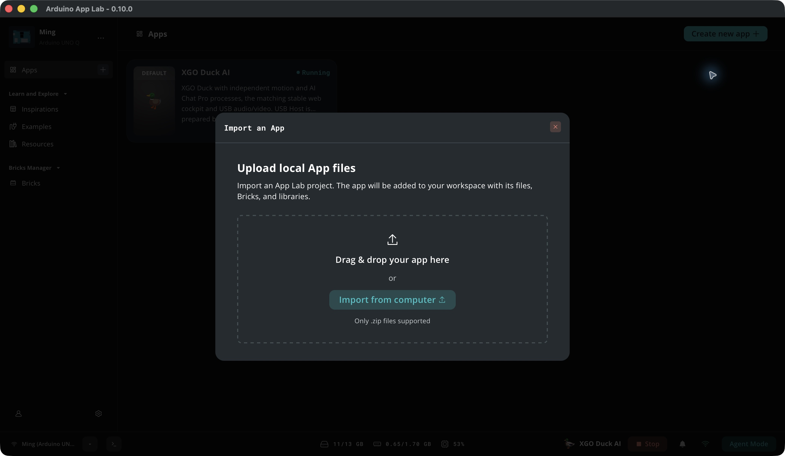
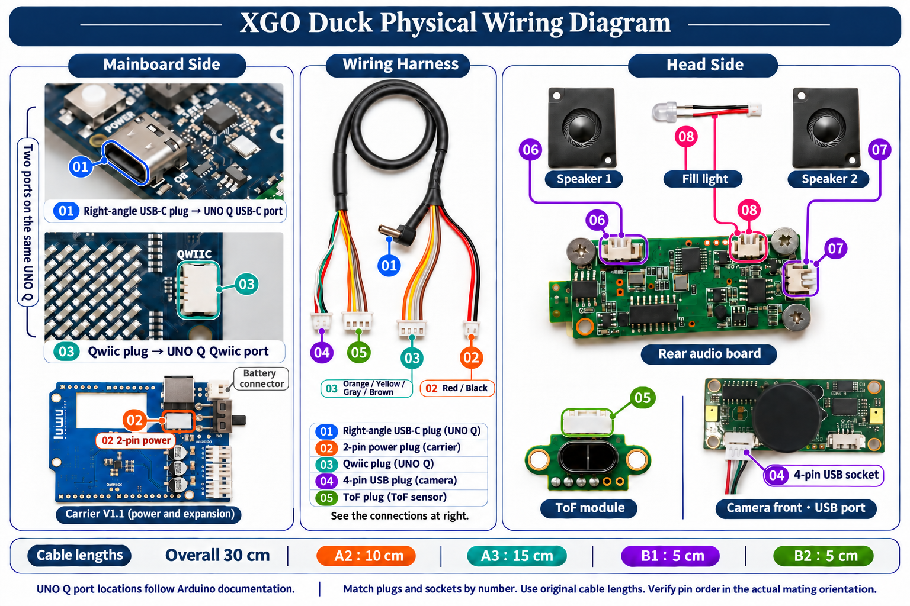
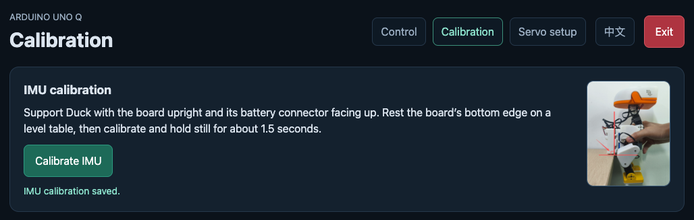
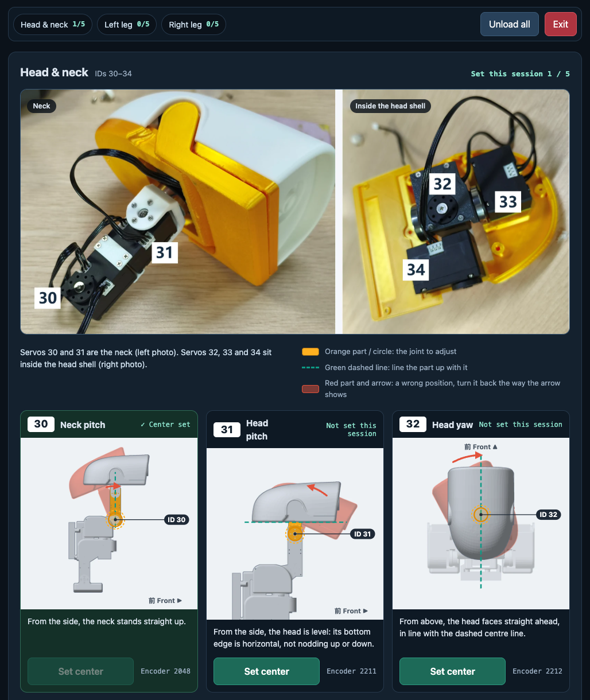
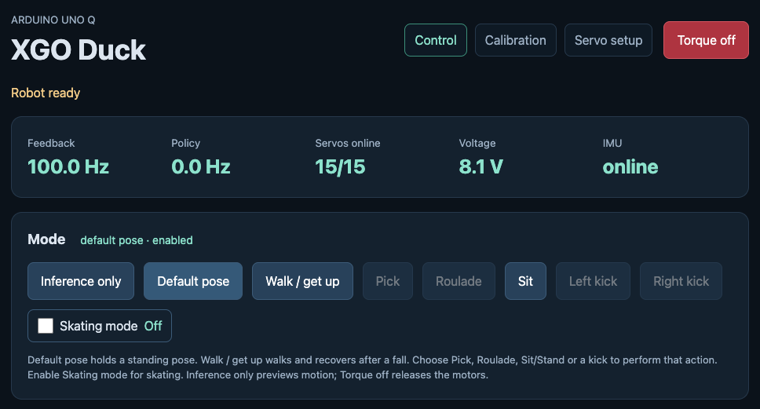
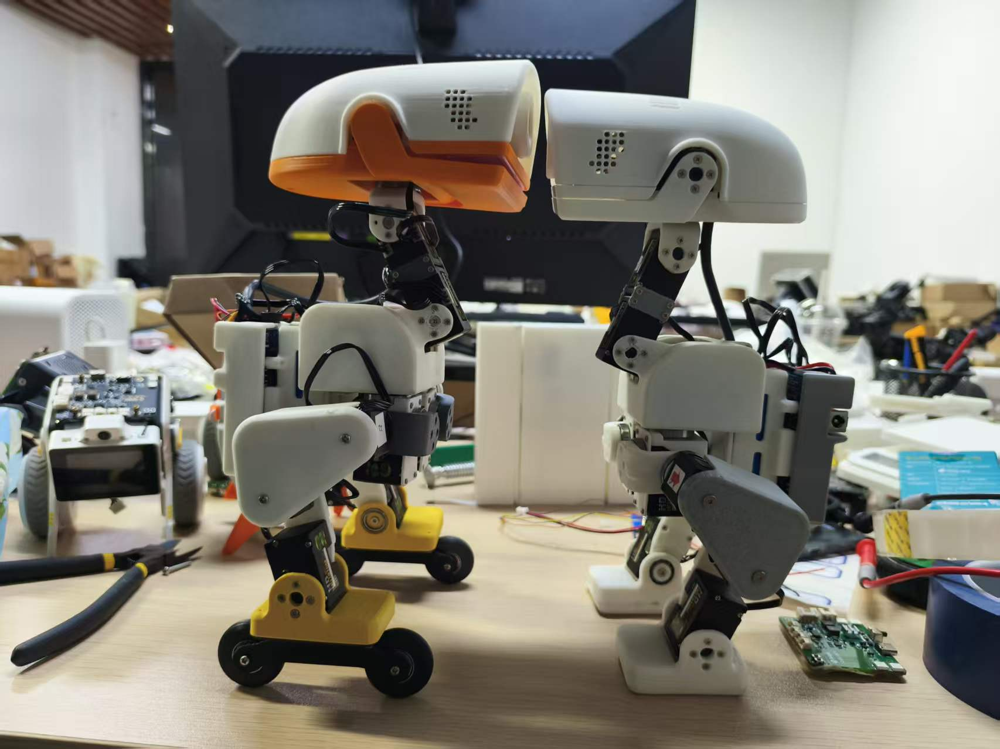
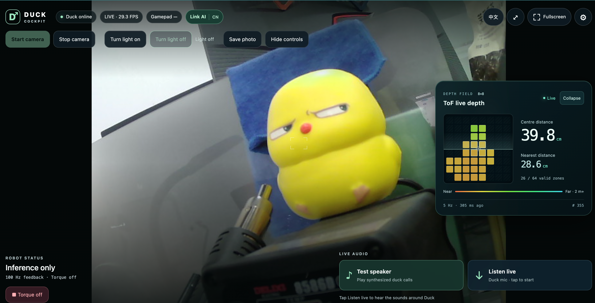

# XGO Duck AI

English · [简体中文](README_CN.md) · [Changelog](docs/CHANGELOG.md)

Voice chat, motion control, USB audio/video and ToF ranging for XGO Duck on Arduino UNO Q. Use a browser for everyday operation; Duck does not need a display.

Prepare an Arduino UNO Q running official Debian 13, a carrier board, a USB data cable, a battery and servos. Voice chat needs a USB microphone and speaker. A USB camera and a VL53L5CX ToF sensor on the onboard Qwiic port are optional.

The first seven steps follow the official developer guide, with this repository’s XGO Duck AI ZIP and startup commands.

## Choose XGO Duck or XGO Duck AI

Choose **XGO Duck (master)** for browser motion control, servo setup and calibration. Choose **XGO Duck AI (this branch)** if you also want voice chat, a USB camera view or ToF ranging. [Read the master branch guide](https://github.com/LuwuDynamics/xgoduck_runtime_arduino/blob/master/README.md)

| Feature | XGO Duck (master) | XGO Duck AI (this branch) |
| --- | --- | --- |
| Motion control | Browser controls, servo setup, calibration and actions such as walking | Browser motion controls, servo setup and calibration |
| Voice chat | — | Bind an account and choose an agent. Say “Hey Ducky” for International or “小鸭小鸭” for China. |
| Media and ranging | — | USB camera preview, snapshots, live microphone monitoring, speaker test, and optional ToF ranging and forward obstacle avoidance |
| Web access | `http://<board-ip>:9527/` for motion control | `http://<board-ip>/` for the cockpit and Link AI, with motion control on port `9527` |

Both apps use a 2 Mbps Bridge. For XGO Duck AI, download `xgoduck_ai.zip` in step 3 and follow step 4 to set up USB detection, the cockpit and automatic startup.

## 1. Set up Wi-Fi

Connect the UNO Q to your computer with a USB data cable. In Arduino App Lab, choose the keyboard layout, name the board, join Wi-Fi and set the board’s Linux password. Let the update check finish. Disconnect USB, fit the carrier as shown in the guide, then reopen App Lab and reconnect. [Illustrated guide](https://www.xgorobot.com/duck-developer-guide/index.html)

## 2. Test the LEDs and record the board IP

1. Open **Inspirations → Color your LEDs** in App Lab and click **Run**.
2. Open its control page from the bottom status bar. Toggle the LEDs and change their colors to check that the matching lights respond on the board.
3. Click **Stop**. Open **Network Info** from the Wi-Fi icon at the bottom right and record your board’s IP. Use the same network for your computer and the board. [Illustrated guide](https://www.xgorobot.com/duck-developer-guide/02-led-ip.html)

Once you know the IP, you can give this prompt to an AI assistant with terminal access to check SSH.

```text
My board IP is [fill in]. Check whether my computer can reach the board over Wi-Fi SSH as arduino.
After login, check the Debian version, CPU architecture, free disk space and Arduino App CLI.
I will enter the password at the terminal prompt.
```

## 3. Import XGO Duck AI

> **Want AI to handle the installation?** Jump to the [AI prompt for steps 3–4](#ai-assisted-install). It starts with downloading the ZIP and covers importing, configuring and launching the App.

### Import manually

1. Download and keep the [XGO Duck AI App Lab ZIP](https://github.com/LuwuDynamics/xgoduck_runtime_arduino/raw/ai-chat-audio-video-tof/packages/xgoduck_ai.zip). The [matching SHA-256 file](https://github.com/LuwuDynamics/xgoduck_runtime_arduino/raw/ai-chat-audio-video-tof/packages/xgoduck_ai.zip.sha256) lets you verify the download.
2. In App Lab, select **＋ next to Apps → Import App → Import from computer** and choose the ZIP.
3. Open the imported **XGO Duck AI** card and leave the App stopped. Step 4 prepares the board libraries and Bridge before the first **Run**. [Illustrated import guide](https://www.xgorobot.com/duck-developer-guide/03-import-app.html)



## 4. Configure the board and start the App

1. Check that Wi-Fi SSH works. For an update, support Duck, unload the servos, stop the old App and back up its directory and `data/`. Stop any running Apps before configuring the shared Router.
2. SSH into the UNO Q over Wi-Fi. Use `arduino-app-cli app list` to find the actual App directory. The commands below use `~/ArduinoApps/xgoduck_ai` as an example.

   ```sh
   cd ~/ArduinoApps/xgoduck_ai
   bash tools/install-ai-support.sh
   sudo bash tools/router-2m.sh
   ```

3. The first script installs host dependencies, sets up USB detection, the cockpit and autostart, and precompiles the MCU sketch. The second sets the shared Router Bridge serial rate to **2 Mbps**. Use Wi-Fi SSH because the USB probe may interrupt computer USB/ADB access.
4. Stay online. Connect through **Network** in App Lab, open **XGO Duck AI**, and click **Run**. The first run may compile and upload the STM32 sketch while it prepares dependencies. Later power-ups start the App automatically. [XGO Duck AI installation and update details](docs/ai-chat-en.md)

<a name="ai-assisted-install"></a>

### Let AI handle steps 3–4

The App installed successfully with this prompt in Codex, DeepSeek Harness, and Cursor. The Cursor test on a 2 GB board used single-job compilation. Allow 30 minutes to 1 hour, depending on download speed.

Copy the prompt and fill in the **board IP, SSH username and password** in your own AI session. An assistant with terminal access can then sign in directly over Wi-Fi SSH. If you already imported the App, it can continue from the actual installation directory.

```text
Import and start XGO Duck AI on my Arduino UNO Q.
Board IP: [fill in]. SSH username: [fill in, usually arduino]. SSH password: [board's Linux login password].
Installation: [first install / update]. Service region: [China cn / International global].
Sign in to the board over Wi-Fi SSH with the credentials above. Keep the password out of files,
shell history and logs. Run App CLI commands as the arduino user.
Check the OS, disk space, installed Apps and their actual paths. If needed, download the dedicated ZIP:
https://github.com/LuwuDynamics/xgoduck_runtime_arduino/raw/ai-chat-audio-video-tof/packages/xgoduck_ai.zip
Verify it against the same URL with .sha256 appended. If needed, download on my computer and use SCP.
Check arduino-app-cli app import --help. Import as arduino if supported, or guide me through App Lab.
Reuse a verified import. For an update, have me support Duck and confirm torque is off before stopping
the old App. Back up its directory and data/, then follow the migration notes in docs/ai-chat-en.md.
Confirm other running Apps can be stopped. Keep Wi-Fi SSH available and stop all Apps.
Use sketch/sketch.yaml, provenance/toolchain.json and python/requirements.txt for dependencies.
Recorded board reference: Router 0.11.0, App CLI 0.13.0 and Python base image 0.12.0. Reuse compatible versions.
Before the first start, run arduino-cli core list as arduino and check the installed arduino:zephyr core.
If it is missing or differs from sketch/sketch.yaml, run arduino-cli core install arduino:zephyr@1.0.0
and check again. Upload can pick up options from the older board core even if the sketch compiled successfully.
Verify that the ARM64 toolchain is version 1.0.1 as pinned in provenance/toolchain.json.
If the toolchain download fails on the board, download the official Linux ARM64 archive on my computer
from the URL in that file, check its size and SHA-256, and transfer it to the board with SCP.
From the App directory, run python3 tools/prepare-ai-sketch.py --toolchain-archive <path-on-board>
as arduino to verify and stage the archive in the download cache.
If downloading the board core or pulling the Docker base image fails, check the error and connectivity.
If needed, temporarily forward my computer's existing proxy over Wi-Fi SSH for the affected download.
Remove the forwarding and temporary proxy settings after installation.
For Python downloads in China, keep any existing custom index. If needed, run from the App directory:
python3 tools/configure-ai-python.py --index-url https://pypi.tuna.tsinghua.edu.cn/simple/
From the App directory, run bash tools/install-ai-support.sh and then sudo bash tools/router-2m.sh.
Verify the Router ExecStart uses 2000000 and check the default App, then run arduino-app-cli app start "$PWD".
The first start may upload the STM32 sketch. Check the cockpit and port 9527's /api/status and /api/voice/status.
If ToF is connected, poll port 9527's /api/tof/status and verify state=ranging, fresh=true,
an advancing seq and valid_zones > 0. HTTP 200 alone only verifies access. If the status is
unexpected, compare it with python /app/tools/read-tof.py --seconds 4 inside the App container
to distinguish backend, Bridge and sensor failures. Record an absent sensor as not installed
when confirmed, or mark the hardware check as pending.
If servos are not wired yet, mark feedback as pending. On failure, inspect logs. Report the actual results.
After the App installs and starts successfully, point me back to this README for steps 5–8.
Guide me through configuring and numbering the servos, assembling XGO Duck, calibrating the IMU
and servos, checking Default pose, then binding an account and selecting an agent. If I have already
completed any of these steps, point me to the next unfinished one.
```

## 5. Configure and number the servos

[Follow the official guide to configure and number the servos](https://www.xgorobot.com/duck-developer-guide/05-servo-setup.html)

## 6. Assemble XGO Duck

[Follow the official illustrated assembly guide](https://www.xgorobot.com/duck-developer-guide/06-assembly.html)

[Audio/video installation guide (PDF)](docs/xgo-duck-av-installation.pdf) · [Download the bilingual assembly PPTX (about 69 MB)](https://github.com/LuwuDynamics/xgoduck_runtime_arduino/raw/ai-chat-audio-video-tof/assembly/xgo-duck-assembly-zh-en-20261016.pptx)



## 7. IMU and servo calibration

Open `http://<board-ip>:9527/` and check that **15/15** servos are online. Support Duck on a table or in a calibration stand, then click **Calibration** in the top bar. Opening this page releases the servos.

### Calibrate the IMU first

1. Use the pose photo in **IMU calibration** at the top of the page. Support Duck with the UNO Q upright, the battery connector pointing up, and the board’s bottom edge against a level table. If you have started setting servo centers, click **Unload all** first.
2. Click **Calibrate IMU** and hold still for about **1.5 seconds**, until **IMU calibration saved** appears. The app saves the accelerometer offsets and gyro bias together and loads them on restart. [IMU calibration details](docs/imu-calibration.md)



If the IMU card is missing, use **Calibrate IMU** at the bottom of **Control** and refer to the official diagrams for the servo poses. [Official calibration guide](https://www.xgorobot.com/duck-developer-guide/07-calibration-control.html)

### Set each servo’s mechanical center

1. The page groups the servos into **Head & neck (30–34)**, **Left leg (10–14)** and **Right leg (20–24)**. Left and right are from Duck’s perspective. Find the joint by its white ID tag in the photo.
2. Position the joint by hand to match its zero-pose diagram, using the green dashed line for alignment. Click **Set center** and wait for **Center set** before moving to the next joint. Click any photo or diagram to enlarge it.
3. Once the session count reaches **15/15**, click **Unload all**, then **Exit**. If you are using a calibration stand, take Duck out after unloading. The centers stay saved in the servos. [Joint diagrams and controls](docs/calibration-guide.md)



### Check Default pose on the Control page

After both calibrations, place Duck on a level surface and support it. Return to **Control** and click **Default pose** under **Mode**. Once the servos engage and Duck stands steadily, compare its neck, legs and feet with the photo below.



Default standing pose for Duck with roller feet and standard feet.



## 8. Bind an account and select an agent

1. Connect your computer or phone to Duck's network and open **`http://<board-ip>/`**. No port number or page suffix is needed.

   

2. Tap **Link AI**, tap **China** or **International** to save the region and reconnect voice immediately. The window shows the current region and binding state; open its matching platform:

   | Device region | Wake word | Binding and agent platform |
   | --- | --- | --- |
   | `global` International | **Hey Ducky** | [agent.luwudynamics.ai](https://agent.luwudynamics.ai/) |
   | `cn` China | **小鸭小鸭** (xiǎo yā, xiǎo yā) | [agent.xgorobot.com/devices](https://agent.xgorobot.com/devices) |

3. Sign in, open **Devices → Add device**, follow the Bluetooth prompts, and select the device beginning with `XGO-Duck`. Complete Wi-Fi setup and account binding, then select an agent.
4. Return to **Link AI** to check the device server, binding and voice connection. Once voice is online, say the wake word shown for the selected region.


Web Bluetooth requires a compatible Chrome / Edge browser. On iPhone / iPad, add the device using the matching Mini Program or App:

| International App | China WeChat Mini Program |
| --- | --- |
|  |  |
| [Open the App download page](https://agent.luwudynamics.ai/download) | Scan with WeChat |

China and international accounts and bindings are separate. Selecting a region saves it and reconnects voice, preserving conversation language, volume and motion settings. Bind separately when switching to another service for the first time. Opening a platform link alone does not switch servers. If the device belongs to another account, unbind it from that account first.

If voice stays offline after binding, copy this prompt to an AI assistant.

```text
Board IP: [fill in]. My service region: [China cn / International global].
Read the cockpit binding status and /api/voice/status on port 9527. Check the region and voice connection.
Tell me whether setup is waiting for Wi-Fi, binding or the voice service, and guide me to the next step.
I will sign in, grant Bluetooth access, bind Duck and change regions myself.
```

### Startup sounds

Later power-ups detect USB audio and video and start the cockpit, chat and motion services automatically. **You do not need to open App Lab or click Run each time.** With Wi-Fi, account binding and USB audio ready, two startup duck sounds play in order:

| Order | Meaning | Example |
| --- | --- | --- |
| 1 | Network connected | [Listen to the first duck sound](assets/startup-network.wav?raw=true) |
| 2 | Voice service connected; chat ready | [Listen to the second duck sound](assets/startup-voice.wav?raw=true) |

If Duck is unpaired, it says “Please open the Duck cockpit to pair your device” three times after the network sound.

After the voice service sound, say the wake word shown under **Link AI → Automatic startup & wake**. Speak after Duck’s wake-up call. You can play the startup examples there on your phone or computer. The actual startup sounds play through Duck’s speaker.

## Everyday use

- **Interface language:** Opening or refreshing follows the accessing browser’s system language: Chinese for Chinese locales, English otherwise. The language button changes only the current page.
- **Audio check:** Under Live audio, Test speaker plays about three seconds of synthesized duck calls; tap again to stop. Listen live plays Duck’s microphone on your phone/computer.
- The cockpit shows two rows of actions and a row of seven duck calls. Tap a call to play it through Duck’s speaker. On a phone, rotate to landscape to use these controls.
- On a computer, hold **W/S** to move forward or back, **A/D** to strafe and **Q/E** to turn. Release the keys or press **Space** to stop moving.
- Say “Hey Ducky” for International or “小鸭小鸭” for China to start chatting. Manage the agent on the platform and adjust volume in **Settings → Speaker**.
- **Audio/video:** start or stop the camera, control its light, save photos and listen live to Duck's microphone from the cockpit.
- On power-up, Duck tries USB Host for up to 5 seconds of device detection. It keeps Host if a USB camera or audio device is detected and switches to Device otherwise. For accessories plugged in after boot, use the **USB Host** switch at the top of the cockpit over Wi-Fi after stopping Duck. Switching interrupts the current USB connection.
- The cockpit displays an 8×8 distance map with a working ToF sensor. Forward travel slows within 15 cm and stops at 10 cm by default. If ToF is absent or offline, you can issue a new forward command without distance-based avoidance. Stale or invalid readings while the sensor reports ranging still pause forward travel. [Avoidance settings](docs/forward-avoidance.md)

## FAQ

### 1. Duck shakes or walks unsteadily

1. Stop moving, support Duck, and release servo torque. Check each servo's ID, mounting position, and order against the diagrams on the Calibration page. Check the servo horns and retaining screws for looseness.
2. Open **Calibration** on port 9527. Follow [step 7](#7-imu-and-servo-calibration) to recalibrate the IMU and all 15 servos. The page has IMU calibration at the top and photos with servo IDs and joint reference poses below.
3. Open **Servo setup** and click **Scan all IDs**. Select each servo, set **KP to 5** and **KD to 10**, then click **Set KpKd** and **Read** to verify the saved and runtime values. Power-cycling reloads the saved values.

Based on Pollen Robotics' [Microduck](https://github.com/pollen-robotics/microduck). [Hardware](https://github.com/LuwuDynamics/xgoduck_hardware) · [Training](https://github.com/LuwuDynamics/xgoduck_rl)
