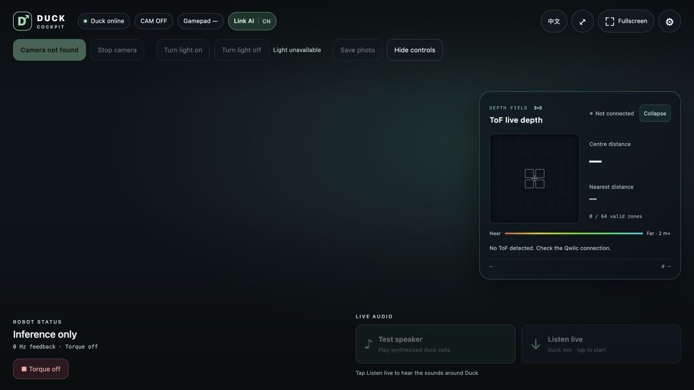
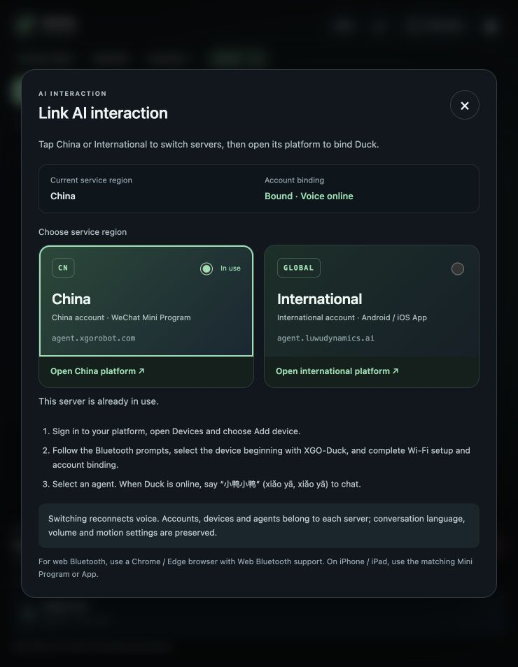

# XGO Duck AI

English · [简体中文](README_CN.md)

Voice chat, motion control, USB audio/video and ToF ranging for XGO Duck on Arduino UNO Q. Use a browser for everyday operation; Duck does not need a display.

Prepare an Arduino UNO Q running official Debian 13, a carrier board, a USB data cable, a battery and servos. Voice chat needs a USB microphone and speaker. A USB camera and a VL53L5CX ToF sensor on the onboard Qwiic port are optional.

The first seven steps follow the official developer guide, with this repository’s XGO Duck AI ZIP and startup commands.

## 1. Set up Wi-Fi

Connect the UNO Q to your computer with a USB data cable. In Arduino App Lab, choose the keyboard layout, name the board, join Wi-Fi and set the board’s Linux password. Let the update check finish. Disconnect USB, fit the carrier as shown in the guide, then reopen App Lab and reconnect. [Illustrated guide](https://www.xgorobot.com/duck-developer-guide/index.html)

## 2. Test the LEDs and record the board IP

1. Open **Inspirations → Color your LEDs** in App Lab and click **Run**.
2. Open its control page from the bottom status bar. Toggle the LEDs and change their colors to check that the matching lights respond on the board.
3. Click **Stop**. Open **Network Info** from the Wi-Fi icon at the bottom right and record your board’s IP. Use the same network for your computer and the board. [Illustrated guide](https://www.xgorobot.com/duck-developer-guide/02-led-ip.html)

Once you know the IP, you can give this prompt to an AI assistant with terminal access to check SSH.

```text
My board IP is [fill in]. Check whether my computer can reach the board over Wi-Fi SSH as arduino.
After login, check the Debian version, CPU architecture, free disk space and Arduino App CLI.
I will enter the password at the terminal prompt.
```

## 3. Import XGO Duck AI

> **Want AI to handle the installation?** Jump to the [AI prompt for steps 3–4](#ai-assisted-install). It starts with downloading the ZIP and covers importing, configuring and launching the App.

### Import manually

1. Download and keep the [XGO Duck AI App Lab ZIP](https://github.com/LuwuDynamics/xgoduck_runtime_arduino/raw/ai-chat-audio-video-tof/packages/xgoduck_ai.zip). The [matching SHA-256 file](https://github.com/LuwuDynamics/xgoduck_runtime_arduino/raw/ai-chat-audio-video-tof/packages/xgoduck_ai.zip.sha256) lets you verify the download.
2. In App Lab, select **＋ next to Apps → Import App → Import from computer** and choose the ZIP.
3. Open the imported **XGO Duck AI** card and leave the App stopped. Step 4 prepares the board libraries and Bridge before the first **Run**. [Illustrated import guide](https://www.xgorobot.com/duck-developer-guide/03-import-app.html)


## 4. Configure the board and start the App

1. Check that Wi-Fi SSH works. For an update, support Duck, unload the servos, stop the old App and back up its directory and `data/`. Stop any running Apps before configuring the shared Router.
2. SSH into the UNO Q over Wi-Fi. Use `arduino-app-cli app list` to find the actual App directory. The commands below use `~/ArduinoApps/xgoduck_ai` as an example.

   ```sh
   cd ~/ArduinoApps/xgoduck_ai
   bash tools/install-ai-support.sh
   sudo bash tools/router-2m.sh
   ```

3. The first script installs host dependencies, prepares USB Host, the cockpit and autostart, and precompiles the MCU sketch. The second sets the shared Router Bridge serial rate to **2 Mbps**. Switching to USB Host disconnects computer USB/ADB access.
4. Stay online. Connect through **Network** in App Lab, open **XGO Duck AI**, and click **Run**. The first run may compile and upload the STM32 sketch while it prepares dependencies. Later power-ups start the App automatically. [XGO Duck AI installation and update details](docs/ai-chat-en.md)

<a name="ai-assisted-install"></a>

### Let AI handle steps 3–4

Copy this prompt to an AI assistant with terminal access. If you already imported the App, it can continue from the actual installation directory.

```text
Import and start XGO Duck AI on my Arduino UNO Q.
Board IP: [fill in]. Installation: [first install / update]. Service region: [China cn / International global].
Connect over Wi-Fi SSH as arduino. I will enter passwords at terminal prompts.
Check the OS, disk space, installed Apps and their actual paths. If needed, download the dedicated ZIP:
https://github.com/LuwuDynamics/xgoduck_runtime_arduino/raw/ai-chat-audio-video-tof/packages/xgoduck_ai.zip
Verify it against the same URL with .sha256 appended. If needed, download on my computer and use SCP.
Check arduino-app-cli app import --help. Import as arduino if supported, or guide me through App Lab.
Reuse a verified import. For an update, have me support Duck and confirm torque is off before stopping
the old App. Back up its directory and data/, then follow the migration notes in docs/ai-chat-en.md.
Confirm other running Apps can be stopped. Keep Wi-Fi SSH available and stop all Apps.
Use sketch/sketch.yaml, provenance/toolchain.json and python/requirements.txt for dependencies.
Recorded board reference: Router 0.10.0, App CLI 0.13.0 and Python base image 0.12.0. Reuse compatible versions.
From the App directory, run bash tools/install-ai-support.sh and then sudo bash tools/router-2m.sh.
Verify the Router ExecStart uses 2000000 and check the default App, then run arduino-app-cli app start "$PWD".
The first start may upload the STM32 sketch. Check the cockpit and port 9527's /api/status and /api/voice/status.
If servos are not wired yet, mark feedback as pending. On failure, inspect logs. Report the actual results.
```

## 5. Configure and number the servos

1. Open the **Network URL** shown in App Lab’s Python log, or use `http://<board-ip>:9527/`. Open **Servo setup**.
2. Connect one servo at a time. Scan and select it, then click **Reset Mid**. Write KP = 5 and KD = 10 with **Set KpKd**, enable voltage and overcurrent protection, and set the protection current to **1.5 A**.
3. Change its ID last. Use **10–14, 20–24 and 30–34** for the positions shown in the assembly guide. After **verified** appears, label the servo. Switch off servo power before replacing it with the next one. For an assembled Duck, check the existing IDs and settings. [Official servo setup guide](https://www.xgorobot.com/duck-developer-guide/05-servo-setup.html)

## 6. Assemble XGO Duck

Check the servo labels and mounting directions before assembling the base, legs, feet, head and neck, battery bracket and circuit board. Connect cables before securing parts. Check left and right orientation, cable routing and screws before closing the housing. [Official assembly steps](https://www.xgorobot.com/duck-developer-guide/06-assembly.html) · [Download the bilingual assembly PPTX (about 69 MB)](https://github.com/LuwuDynamics/xgoduck_runtime_arduino/raw/ai-chat-audio-video-tof/assembly/xgo-duck-assembly-zh-en-20261016.pptx)

To get help checking the assembly, attach the PPTX and photos of your Duck and copy this prompt.

```text
Use this illustrated guide to help me check servo IDs, left/right orientation, cable routing and screw sizes:
https://github.com/LuwuDynamics/xgoduck_runtime_arduino/raw/ai-chat-audio-video-tof/assembly/xgo-duck-assembly-zh-en-20261016.pptx
Slide 1 shows the IDs. Slides 3–15 cover the base, legs and feet. Slides 16–25 cover the upper assembly
and circuit board. Cite the slide number and ask me to check anything unclear on the physical Duck.
```

## 7. Calibrate, stand and try walking

1. Connect the assembled Duck and open `http://<board-ip>:9527/`. Confirm feedback from all 15 servo IDs, then open **Calibration**.
2. Use a calibration stand or set the servo centers by hand using the front and side views. Move one joint at a time to its mechanical center and click **Set center & hold**. Exit Calibration when all joints are done, then remove Duck from the stand if used.
3. On first setup, calibrate gravity alignment and stationary gyro bias on a level surface and check KP/KD. Use the troubleshooting prompt at the end if you want AI assistance. [IMU calibration guide](docs/imu-calibration.md)
4. Support Duck on a level surface and try **Default Pose** first. Once it stands steadily, choose **Walk / get up** and try a short straight walk. Start at **0.10 m/s** and keep the test at or below **0.15 m/s**. Stop if Duck shakes, veers or loses balance. [Official calibration and walking guide](https://www.xgorobot.com/duck-developer-guide/07-calibration-control.html)

## 8. Bind an account and select an agent

1. Connect your computer or phone to Duck's network and open **`http://<board-ip>/`**. No port number or page suffix is needed.

   

2. Tap **Link AI**, tap **China** or **International** to save the region and reconnect voice immediately. The window shows the current region and binding state; open its matching platform:

   | Device region | Binding and agent platform |
   | --- | --- |
   | `global` International | [agent.luwudynamics.ai](https://agent.luwudynamics.ai/) |
   | `cn` China | [agent.xgorobot.com/devices](https://agent.xgorobot.com/devices) |

3. Sign in, open **Devices → Add device**, follow the Bluetooth prompts, and select the device beginning with `XGO-Duck`. Complete Wi-Fi setup and account binding, then select an agent.
4. Return to **Link AI** to check the device server, binding and voice connection. Once voice is online, say **“小鸭小鸭” (xiǎo yā, xiǎo yā)** to start chatting.



Web Bluetooth requires a compatible Chrome / Edge browser. On iPhone / iPad, add the device using the matching Mini Program or App:

| International App | China WeChat Mini Program |
| --- | --- |
|  |  |
| [Open the App download page](https://agent.luwudynamics.ai/download) | Scan with WeChat |

China and international accounts and bindings are separate. Selecting a region saves it and reconnects voice, preserving conversation language, volume and motion settings. Bind separately when switching to another service for the first time. Opening a platform link alone does not switch servers. If the device belongs to another account, unbind it from that account first.

If voice stays offline after binding, copy this prompt to an AI assistant.

```text
Board IP: [fill in]. My service region: [China cn / International global].
Read the cockpit binding status and /api/voice/status on port 9527. Check the region and voice connection.
Tell me whether setup is waiting for Wi-Fi, binding or the voice service, and guide me to the next step.
I will sign in, grant Bluetooth access, bind Duck and change regions myself.
```

### Startup sounds

Later power-ups prepare USB Host and start the cockpit, chat and motion services automatically. **You do not need to open App Lab or click Run each time.** With Wi-Fi, account binding and USB audio ready, two startup duck sounds play in order:

| Order | Meaning | Example |
| --- | --- | --- |
| 1 | Network connected | [Listen to the first duck sound](assets/startup-network.wav?raw=true) |
| 2 | Voice service connected; chat ready | [Listen to the second duck sound](assets/startup-voice.wav?raw=true) |

After both sounds, say **“小鸭小鸭” (xiǎo yā, xiǎo yā)** to wake Duck, then speak after its wake-up duck call. You can also listen under **Link AI → Automatic startup & wake**. Examples play on your phone/computer; real startup sounds play through Duck’s speaker.

## Everyday use

- **Interface language:** Opening or refreshing follows the accessing browser’s system language: Chinese for Chinese locales, English otherwise. The language button changes only the current page.
- **Audio check:** Under Live audio, Test speaker plays about three seconds of synthesized duck calls; tap again to stop. Listen live plays Duck’s microphone on your phone/computer.
- **Chat:** say “小鸭小鸭” to wake Duck. Manage its agent on the platform; adjust volume in **Settings → Speaker**.
- **Audio/video:** start or stop the camera, control its light, save photos and listen live to Duck's microphone from the cockpit.
- **ToF:** a connected sensor displays an 8×8 live distance map. Default forward avoidance slows within 15 cm and stops at 10 cm; missing or stale data pauses forward travel. Chat still works without ToF; see [avoidance configuration](docs/forward-avoidance.md) to disable the guard.

## Updates and troubleshooting

- Support Duck and turn torque off before updating. **Run may compile and flash the STM32 sketch again.**
- Keep the existing App's `data/` when updating the same robot: it contains identity, volume, calibration and controller settings. Do not copy another robot's identity or calibration. Repeat one-time setup if the App directory or host support scripts change.
- For first-Run download failures, check the board's internet connection. For missing audio, test the speaker and microphone in cockpit settings.
- See the [installation guide](docs/ai-chat-en.md) for migration and toolchain help, and the [hardware guide](https://github.com/LuwuDynamics/xgoduck_hardware) for assembly and calibration.

To build the package yourself, run `python3 tools/package-ai-app.py` in the repository on your computer. Import the resulting `dist/xgoduck_ai.zip` using the same App Lab steps.

## AI prompt for unstable walking

Use this for shaking, veering, or loss of balance. Stop Duck first and stay beside it to support it. The assistant can read status and logs while you check the posture, handle the joints and walk-test Duck.

```text
My XGO Duck walks unsteadily. Board IP: [fill in]. Symptom: [cannot stand / shakes / veers / other].
First read /api/status on port 9527 and the relevant logs. Check for fresh Bridge feedback,
all 15 servo IDs, protection events and ToF speed limiting. Tell me what the data shows.
I will handle the physical Duck during the checks.

1. Servo centers. Confirm calibration with a stand or by hand. Use the official diagrams
   to check for misoriented joints or incorrect centers:
   https://www.xgorobot.com/duck-developer-guide/07-calibration-control.html
   If needed, I will reposition each joint and use Set center & hold in Calibration.
2. Gravity alignment. Have me keep Duck upright and still on a level surface in Default Pose
   for about 30 seconds. Follow docs/imu-calibration.md and run tools/calibrate-imu.py in the
   actual App environment. Reuse a valid data/imu-calibration.json for this Duck and back up
   the existing file before recalibrating.
3. Gyro bias. The same stationary sample measures the bias. Have me support Duck before
   restarting the motion process to load the result. With Duck upright and still, check
   that gravity is near [0, 0, -1] and the corrected gyro rates are near zero.
4. Gains. With torque off, read all 15 servos in Servo setup. Use KP=5 and KD=10 as the
   baseline. List the IDs and old values for any differences, then write and verify only
   after I confirm.

Once I confirm the walk test, check Default Pose and steady standing first. Then try a
short straight walk on a level surface at 0.10 m/s, with a 0.15 m/s linear speed limit.
Stop if Duck shakes, veers or loses balance. Report what you observed and what to check next.
```

Based on Pollen Robotics' [Microduck](https://github.com/pollen-robotics/microduck). [Hardware](https://github.com/LuwuDynamics/xgoduck_hardware) · [Training](https://github.com/LuwuDynamics/xgoduck_rl)
