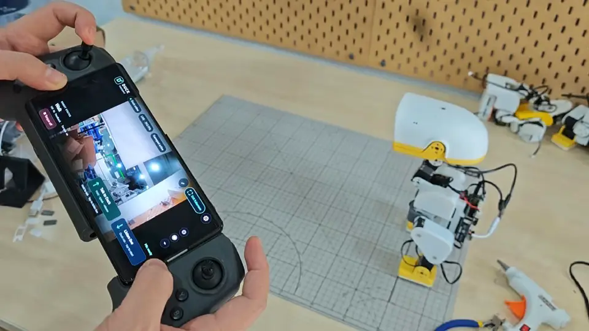
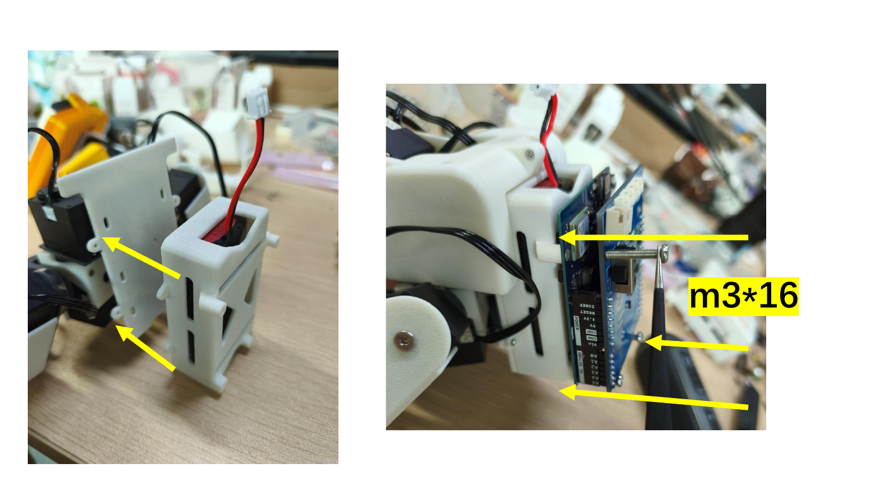
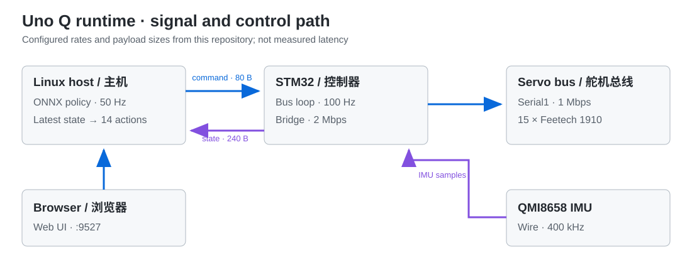

# Arduino Uno Q 上的 XGO Duck


> **运动部分已同步 master `b401d85`（2026-10-31）：** 主机控制、8 个运动模型、控制网页、STM32 协议和 Bridge 准备脚本均对应[此提交](https://github.com/LuwuDynamics/xgoduck_runtime_arduino/commit/b401d85d20bb5bfd0237242a8a5ab6847fc962a2)。原有 AI/音频、手机端、手柄、硬件中点迁移和独立 ToF 接入保留。详见[检查记录](docs/ai-validation.md)；旧软件零位仍需按[迁移说明](docs/ai-chat.md#0233-配套网页与硬件中点校准)处理。
[English](README.md) · [简体中文](README_CN.md)

**新增运动 MCP 与前向避障：** `Duck.Sit`、`Duck.LeftKick`、`Duck.RightKick`、
`Duck.SetWalkingMode` 接入现有坐站、左右踢球及滚轮模型；原起身、行走、抓取、翻滚入口保留。
前进默认按 ToF 减速/停止；测距掉线、过期或前方有效区域不足时暂停前进，保持平衡。
数据恢复后要重新发指令，遥控需先松开再前进；后退、侧移、原地转向和聊天继续可用。
传感器须朝向正前方并避免照到自身/地面。见[模型映射、阈值与验收](docs/forward-avoidance.md)。

`Duck.GetToF` 可单独读取前方距离、有效性、帧龄和 8×8 阵列，不启动运动。
普通前进口令统一用 `Duck.Forward`，默认速度目标 0.1 m/s，明确快走使用 `pace=fast` 的 0.15 m/s，省略时长默认 3 秒；
MCP 线速度最高 0.15 m/s。明确慢走或指定速度继续使用 `Duck.Move`，范围内的数值和原手机遥控速度保留。
前进遇到障碍或测距暂不可用时，MCP 返回正常的 `blocked` 执行结果并说明原因，
而非“工具调用错误”；无效参数、权限或真正的运动通信故障仍报告错误。

`0.2.27` 将 ToF 明确作为可选外设：未连接或测距中拔出只报告
`absent` / `offline`，聊天和音视频继续运行；当前启用前向避障时会暂停前进。开机检查中断构建残留的
损坏 MCU 目标/依赖文件，避免编译缓存导致默认 App 无法启动。
更新后需要重跑一次硬件支持安装，装上这项自启检查。

`0.2.26` 新增主板 Qwiic 口的 SparkFun VL53L5CX 可选测距支持：STM32
`Wire1` 独立采集 8×8、5 Hz 距离阵列，通过只读 Bridge 工具取数。
详见 [ToF 接线和读取](docs/tof.md)。

**XGO Duck AI App（`ai-chat-audio-video-tof`）。** 一个 App，两个业务进程：运动与原网页、无屏 AI Chat Pro 对话。支持开机自启、蓝牙配网和账号绑定；遥控走云端 MCP。9527 使用配套稳定版网页，原音视频/豆包功能保留，STM32 固件需随 App 配套更新。用户自行购买 UNO Q，按下面步骤首次安装；不需要显示器。

`0.2.25` 将中文唤醒词改为“小鸭小鸭”，使用随包附带的最终版 `xiaoya.onnx`，阈值 0.80、2 秒窗口、80 ms 检测步长；输入幅值与训练库一致，完全相同的特征窗口有界复用以减少板端计算。检测唤醒后固定播放同一段约 0.92 秒的鸭叫，不随机切换，也不触发嘴型。英文唤醒、服务器选择、发送/回答完成提示音及保存的音量/增益保留。

`0.2.24` 让发送/唤醒等提示音和本地鸭叫不再触发 TTS 嘴型，只让真正的语音回答驱动嘴部。按实际播放样本区分提示音与语音，衔接到同一声卡帧时也分别处理；提示音的声音、音量、延迟与正常语音嘴型保留。

`0.2.23` 修复 `Duck.Quack` 在等待 MCP 结果时误报扬声器占用的问题。采集参考处理移出声卡回调，App 请求 200 ms 输入缓冲，并报告实际延迟、回调间隔与队列丢块。原有播放缓冲与增益保留；USB 断连或链路降速仍需单独排查。

历史 `0.2.22` 临时通信排查设置（已由顶部所述 master 运动栈替代）：配套 STM32 关闭命令 250 ms、IMU 100 ms 超时触发的暂停；Linux 不再因反馈超过 150 ms 或 IMU 无效而锁定暂停，MCP 同步放行这些时效条件。超时保留日志，断流/无效采集时保持上一个运动目标，收到有效数据后可接续原运动目标；不会把旧数据推理成默认姿态。普通网页 1 秒心跳检查此前已移除。**必须同步上传本版 sketch**，`timeout_checks_disabled=true` 才表示这套行为生效；只更新 Python 时旧固件的保护继续有效。明确停止/卸力、首次使能所需 IMU、数据格式/序号与所需舵机反馈检查保留，原网页与已保存配置不变。

`0.2.21` 按本次 MCP 动作所需的关节检查反馈，无关 ID 缺失不再拦截正常关节。`SetHead` 可只传一个轴，省略轴保持原目标；排队入口不再重复检查反馈，真正执行时统一检查，错误说明具体可观测问题。原网页、ONNX、STM32 和已保存配置保留。

`0.2.20` 调整 TTS 嘴型：叠加 20/80/320 ms 能量窗口、能量变化量与轻微节奏，持续说话时保持可见开合，并适当加大说话时的张口；仍限制 0–12°、90°/秒，身体已使能时才动嘴。原网页、运动策略和 STM32 保留。

`0.2.18` 在联网成功后播放 `greet` 鸭叫，在语音服务实际连接成功后播放 `wheee` 鸭叫；每次启动各一次，这两个提示音额外采用 3 倍软件增益并限幅。联网提示不要求先绑定账号，缺少 USB 扬声器时继续运行、接入后补播；聊天和普通 `Duck.Quack` 增益保留。

`0.2.17` 合并本地鸭叫 `Duck.Quack`、TTS 说话动嘴与保扭矩暂停。反馈/IMU/命令超时、App 退出和手柄断连会停动作、保持位置，不主动卸力；明确的 TorqueOff/Off 才关闭扭矩。暂停后明确要求“站起来”或选择 Policy/Hold 再恢复。动嘴改用私有本地单向消息，减少 HTTP 往返负载。原网页、ONNX 和校准数据保留，需配套更新 STM32。详见[运动与音视频说明](docs/ai-chat.md#日常网页聊天和遥控)和[检查记录](docs/ai-validation.md)。

## AI App 首次安装

**先在板端选服务器，手机不会自动改区。** 两套服务的账号、绑定和智能体配置分别保存；聊天语言与区域独立。

| 板端选择 | 使用客户端 | OTA 地址 |
| --- | --- | --- |
| `cn` | 国内微信小程序 | `https://xl-api.xgorobot.com/xiaolu/ota/` |
| `global` | 国际版 Android / iOS App | `https://xl-api.luwudynamics.ai/xiaolu/ota/` |

| 国内微信小程序（微信识别小程序码） | 国际版 App（扫码下载） |
| --- | --- |
|  |  |
| 对应 `cn` | 对应 `global`；[打开下载页面](https://agent.luwudynamics.ai/download) |

二维码来自现有 Luwu-OS AI Chat Pro，见[资源来源](provenance/onboarding-assets.json)。MCP 遥控需包含 `XGO-Duck` 专用适配的客户端版本；二维码入口不代表本地客户端改动已发布。

1. **USB 初始设置。** 安装 [Arduino App Lab](https://www.arduino.cc/en/uno-q)，用数据线连接 UNO Q，完成 Wi-Fi 和 Linux 密码设置。确认能通过 `ssh arduino@<板子IP>` 登录。首次安装需联网下载依赖。
2. **下载并打包。** 在电脑执行：

   ```sh
   git clone --branch ai-chat-audio-video-tof https://github.com/LuwuDynamics/xgoduck_runtime_arduino.git
   cd xgoduck_runtime_arduino
   python3 tools/package-ai-app.py
   ```

   将 `dist/xgoduck_ai.zip` 在 App Lab **导入为新 App**，使用新的 `xgoduck_ai` 目录，停止旧 Duck App。完整步骤包含[板端直接 Git 安装和校准迁移](docs/ai-chat.md#3-获取-app并保留旧机器人的数据)。

   可选用**含工具链的 App ZIP**，首次安装时不用从 GitHub 下载这个大文件。普通包约 9.5 MB，含工具链版约 107 MB；其他系统、容器和 Python 依赖仍需联网。打包方式及下载失败恢复见[工具链说明](docs/ai-chat.md#工具链与含工具链安装包)。
3. **板端选区和安装支持。** 在 UNO Q 主机终端执行，路径按实际导入目录替换；以下是国内示例：

   ```sh
   cd ~/ArduinoApps/xgoduck_ai
   python3 tools/configure-ai.py --region cn --language cn
   # 国际版改用：python3 tools/configure-ai.py --region global --language en
   bash tools/install-ai-support.sh
   sudo bash tools/router-2m.sh
   ```

   **通过 Wi-Fi/SSH 执行，先停止所有 App。** 安装脚本自动准备固定 MCU 工具链和库、编译并检查 ELF，再设置默认 App、开机服务及 **USB Host**；电脑 USB/ADB 会断开，后续使用带供电的 Host Hub。脚本不烧 MCU，也不启动 App。用户不需要自己判断工具链版本。`router-2m.sh` 会重启 MCU 通信路由，应在 App 停止时执行。
4. **首次 Run。** 在 App Lab 通过 Network 连接运行，等待依赖和两个进程就绪。Run 可能编译/上传 sketch。之后每次开机都先准备 USB Host，再自动启动 App，聊天单独重启不切换 USB。
5. **手机添加。** 用对应客户端搜索 `XGO-DuckABCD` 这类设备名，配 Wi-Fi、绑定账号并选择智能体。没有麦克风/扬声器也能配网和连接 MCP，音频接入后恢复对话。手机蓝牙只用于配网，原手柄功能保留。
6. **验证自启。** 首次联网运行成功后重启板子，不需要每次点击 Run。升级保留整个 `data/`；换区在板端停止 App 后显式配置，再在目标区域客户端绑定。未选区不会访问聊天云端。
7. **先站立再遥控。** 完成校准并放好鸭子后，先明确开启语音运动、说“站起来”，或通过原网页 Policy 启动平衡。方向键只控制已经使能并站稳的鸭子，不会自动起身。`Duck.GetStatus.movement_ready` 为 true 后再移动；详见[运动流程](docs/ai-chat.md#日常网页聊天和遥控)。

详细配置、状态日志、换区、更新和回滚边界见 [AI App 安装说明](docs/ai-chat.md)；自动测试和待实机验收项目见[检查记录](docs/ai-validation.md)。下文保留原网页、硬件、舵机设置与运行说明。



**把 Duck 的视角放到手柄上。** 手机夹在手柄中间，打开移动驾驶页面，一边观看机载摄像头实时画面，一边用摇杆遥控 Duck。上方实机演示展示了这种类似穿越机的手持操作方式；WebP 动图保留完整片段，循环播放、不带声音。

**下一版本开发：音视频与 ToF。** 本分支集中开发 USB 摄像头视频流、手机全屏驾驶页面、Duck 麦克风实时监听、手机向 Duck 发送语音片段、手柄配置及手动 USB Host 开关。可选 ToF 已完成测距采集，尚未接入自动避障，见 [ToF 说明](docs/tof.md)。使用说明见[移动驾驶页面](docs/mobile-cockpit.md)和 [USB 摄像头 / 音频配置](docs/usb-camera.md)。

在装配好的 XGO Duck 上运行仓库附带的行走、轮滑、起身、坐站、地面抓取、翻滚和左右踢腿 ONNX 策略。

本仓库包含 Uno Q 应用、STM32 固件、网页控制界面和八个运动模型；AI App 另含五个唤醒及特征提取相关 ONNX。实体制作请看[硬件仓库](https://github.com/LuwuDynamics/xgoduck_hardware/blob/master/README_CN.md)；只有想自行训练策略时才需要 [XGO Duck RL](https://github.com/LuwuDynamics/xgoduck_rl/blob/main/README_CN.md)。



*真实 Uno Q 安装与走线照片，取自[硬件装配指南](https://github.com/LuwuDynamics/xgoduck_hardware/blob/master/Assembly_Guide.pdf)第 23 页。它是装配照片，不是运行中应用的截图。*

| 一眼看懂 | 数值 |
| --- | --- |
| 执行器 | 15 个 Feetech 1910 舵机；14 个策略关节加 1 个嘴部舵机 |
| 策略循环 | Uno Q Linux 侧，50 Hz |
| 舵机与 IMU 循环 | Uno Q STM32 侧，100 Hz |
| 网页界面 | 9527 端口；控制、舵机设置、校准 |
| 运动模型 | [`xgoduck_walk.onnx`](python/xgoduck_walk.onnx)、[`xgoduck_getup.onnx`](python/xgoduck_getup.onnx)、[`xgoduck_pick.onnx`](python/xgoduck_pick.onnx)、[`xgoduck_roulade.onnx`](python/xgoduck_roulade.onnx)、[`xgoduck_roller.onnx`](python/xgoduck_roller.onnx)、[`xgoduck_sitstand.onnx`](python/xgoduck_sitstand.onnx)、[`xgoduck_ballkick_left.onnx`](python/xgoduck_ballkick_left.onnx)、[`xgoduck_ballkick_right.onnx`](python/xgoduck_ballkick_right.onnx) |

## 仓库中实际有什么

| 层级 | 已包含 | 首次检查 |
| --- | --- | --- |
| 网页控制 | [`assets/index.html`](assets/index.html)、[`servo.html`](assets/servo.html)、[`calibrate.html`](assets/calibrate.html) | 打开 `:9527`，上扭矩前先确认状态持续更新 |
| Linux 策略主机 | [`python/`](python/) 和八个运动 ONNX 模型 | 应用以仅推理模式启动 |
| STM32 固件 | [`sketch/`](sketch/) | 确认 15 个舵机 ID 唯一且 QMI8658 有读数 |
| 设置与诊断 | [`tools/`](tools/) | 准备 Bridge、设置路由速率，再只读采集状态 |

顶部动图为实机遥控演示，不是延迟基准测试。下方速率是源码配置值，不作为实测性能宣称。

## 从这里开始

**给舵机供电前：**先阅读[硬件 BOM 与装配指南](https://github.com/LuwuDynamics/xgoduck_hardware/blob/master/README_CN.md)。15 个舵机 ID 必须各不相同。设置和校准时请支撑住机器人。

1. **准备 Uno Q 应用。**安装 Arduino App CLI 和 Uno Q Zephyr 内核。仓库使用 Zephyr core 1.0.0、RouterBridge 0.4.3、RPClite 0.3.1、MsgPack 0.4.2；库清单在 [`sketch/sketch.yaml`](sketch/sketch.yaml)，Python 依赖在 [`python/requirements.txt`](python/requirements.txt)。
2. **连接扩展板与电源。**舵机总线接 D0/D1（`Serial1`，1 Mbps）；QMI8658 接 D20/D21（`Wire`，400 kHz，地址 `0x6A` 或 `0x6B`）。接电前按[硬件板卡设计](https://github.com/LuwuDynamics/xgoduck_hardware/tree/master/PCBA)核对电池接头极性。
3. **在 Uno Q 上从本仓库目录启动应用：**

   ```bash
   python3 tools/prepare-ai-sketch.py
   sudo bash tools/router-2m.sh
   arduino-app-cli app start "$PWD"
   ```

4. **打开网页** `http://<uno-q-ip>:9527/`。应用默认进入 **Inference only（仅推理）**，舵机扭矩关闭。新舵机装入结构件前先完成 **Servo setup（舵机设置）**，装配后完成 **Calibration（校准）**，最后再选择上扭矩的控制模式。

准备脚本自动解析 `sketch/sketch.yaml`、修补 Bridge 缓存、仅编译并检查 ELF，不上传 MCU；AI 支持安装脚本已包含此步骤。`router-2m.sh` 会把 Bridge 速率全局设为 2 Mbps；换用 115200 baud 的其他 Bridge 应用前，按[技术参考](docs/technical_reference.md#running)切回。

## 首次设置

### 1. 舵机装入结构件前分配 ID

**每次只连接一个舵机。**打开 **Servo setup**（`/servo.html`），扫描并选择当前舵机，依次分配 **10–14**、**20–24**、**30–34**。总线上两个舵机若共用 ID，会同时响应写入。把卸力的关节手动摆到机械中点后点击 **Reset Mid**；页面 KP/KD 输入默认 **5 / 10**，读取参数不会覆盖手动输入。断开当前舵机后再连接下一个。

| ID | 用途 |
| --- | --- |
| 10–14 和 20–24 | 腿部 |
| 30–33 | 颈部与头部，属于 14 维策略动作 |
| 34 | 嘴部，由网页界面控制，不在策略动作中 |

全部编号完成后，按[图解装配指南](https://github.com/LuwuDynamics/xgoduck_hardware/blob/master/Assembly_Guide.pdf)安装舵机并走线。

### 2. 完成接线后校准

确认每个舵机都能应答，再打开 **Calibration**（`/calibrate.html`）。进入页面后所有舵机卸力。用手逐个把关节摆到机械中点，点击对应的 **Set center & hold**；只有该关节设置硬件中点后保持在 2048，其余尚未校准关节保持卸力。完成 15 个关节后退出，所有舵机卸力。

中点保存在各舵机中，角度换算固定以编码器 **2047** 为中心，不再启动加载 `data/zero_pos.json`。旧文件保留备份；如果检测到非 2047 的旧软件零位，App 会拒绝 Default pose / Walk 和语音起身，直到全部硬件中点回执完成。迁移进度保存在本机 `data/hardware-centers.json`，不随安装包分发。

Servo setup 还提供全总线电压/过流保护开关和保护电流设置，两者是分开的广播操作，不自动改动舵机保护配置。

### 3. 选择控制模式

| 模式 | 行为 |
| --- | --- |
| Inference only（仅推理） | 策略运行，舵机扭矩关闭 |
| Default pose（默认姿态） | MCU 和 IMU 数据新鲜时保持初始姿态 |
| Walk / get up（行走 / 起身） | 开启位置控制和自动恢复 |
| Pick（抓取） | 直立行走时运行 4 秒抓取策略，再返回行走 |
| Sit / Stand（坐下 / 站起） | 保持坐姿；站起运行 1 秒后返回行走策略 |
| left_kick / right_kick（左右踢腿） | 运行对应策略 0.4 秒后返回行走 |
| Torque off（关闭扭矩） | 停止位置控制 |

网页关闭或后台发送零运动；超过 1 秒无新输入也清零行走速度，维持平衡模式。有效语音动作只在原截止时间内续期输入。普通 MCU 命令不再按 TTL 过期；Bridge 断开或 IMU 超过 500 ms 未更新时卸力。Linux 在反馈超过 150 ms、IMU 无效或总 IMU 年龄超过 500 ms 时切到仅推理并卸力。App 退出、手柄断连和明确 Torque off 会卸力。校准/舵机设置另有 MCU 250 ms 主机心跳、主机 2 秒网页心跳保护。重连后需要明确重新使能。

普通行走前进最高 0.2、后退最高 0.18 m/s，侧移 ±0.3 m/s、转向 ±1 rad/s；Roller 前后 ±0.4 m/s、无侧移、转向 ±0.25 rad/s。手柄与语音入口同步遵循普通行走范围。所有舵机（包括嘴部 ID 34）的 KP/KD 由用户自行调整；应用或语音启动、语音重启、使能、进出校准和 Servo setup 均保留现有值。需要修改时，在 Servo setup 使用 **Set KpKd** 手动保存所选舵机的参数；运行值仍可按需读取。`/api/status.runtime_gains` 返回 `state: manual`、`auto_apply: false`。原先统一写入 5/10 的 Python 和 STM32 逻辑都已移除，仅更新 Python 无法去掉旧 STM32 程序中的覆盖。已保存的参数不会被重置。

## 工作原理

Linux 主机以 50 Hz 运行 ONNX 推理并提供网页界面。STM32 以 100 Hz 驱动 15 舵机总线并读取 QMI8658。`duck_command` 发往 MCU，`duck_state` 返回最新状态；主机只使用最新快照，不堆积旧动作。八个运动模型的输入均为 `[1, 61]`，输出均为 `[1, 14]`。



| 配置值 | 数值 | 作用 |
| --- | ---: | --- |
| Linux 策略周期 | 20 ms（50 Hz） | 推理与动作更新 |
| STM32 总线周期 | 10 ms（100 Hz） | 舵机与 IMU 通信 |
| `duck_command` | 80 字节 | 主机发给 MCU 的动作包 |
| `duck_state` | 240 字节 | MCU 返回的状态快照 |
| 舵机总线 | 1 Mbps，ID 10–14 / 20–24 / 30–34 | 15 个舵机共用总线 |
| Bridge | 2 Mbps | Linux 和 MCU 两端速率必须一致 |

### 首次让机器人运动前

| 检查 | 预期结果 |
| --- | --- |
| 舵机设置 | 每个 ID 只出现一次，没有两个舵机共用 ID |
| 校准 | 中点保存在舵机中；迁移记录为本机 `data/hardware-centers.json` |
| 仅推理模式 | 状态持续更新，电机仍不受力 |
| 默认姿态 | 支撑住机器人，并确认 MCU/IMU 数据新鲜后再选择 |
| 关闭扭矩 | 改动接线或重启路由器前，确认电机已释放 |

### 某一步失败时

| 现象 | 先检查 |
| --- | --- |
| 应用找不到被修改的 Bridge 库 | 停止 App，运行 `python3 tools/prepare-ai-sketch.py` 后再启动 |
| 舵机无响应 | 电源、D0/D1 接线、1 Mbps 总线速率、ID 是否唯一 |
| 没有 IMU 状态 | D20/D21 上的 QMI8658 接线及 `0x6A` / `0x6B` 地址 |
| 换应用后 Bridge 不通 | 两端速率需一致，见[路由器操作](docs/technical_reference.md#running) |
| 运行中自动关闭扭矩 | 查 MCU 命令时间、IMU 与主机反馈的新鲜度；校准和舵机设置还需检查会话心跳，见[技术参考](docs/technical_reference.md#running) |

协议字节数、关节顺序、滤波、起身阈值、路由器速率与 ELF 检查见[技术参考](docs/technical_reference.md)。在机器人上只读采集状态可运行：

```bash
for i in $(seq 1 60); do curl -s http://127.0.0.1:9527/api/status; echo; sleep 1; done
```

该循环只读取 `/api/status`，不会启用电机；可重定向到文件保存。

## 来源与相关仓库

机器人沿用 [Pollen Robotics 的 Microduck](https://github.com/pollen-robotics/microduck) 的 15 舵机布局和关节顺序。本运行时针对 Uno Q、Feetech 1910 舵机和 QMI8658 扩展板进行了适配。

| 仓库 | 分工 |
| --- | --- |
| [XGO Duck 硬件](https://github.com/LuwuDynamics/xgoduck_hardware/blob/master/README_CN.md) | BOM、可打印零件、PCB、装配 |
| [XGO Duck RL](https://github.com/LuwuDynamics/xgoduck_rl/blob/main/README_CN.md) | 仿真、训练、ONNX 导出 |
