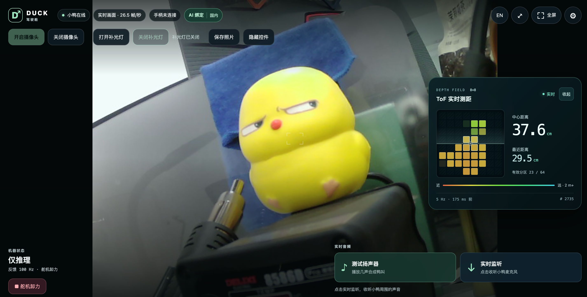
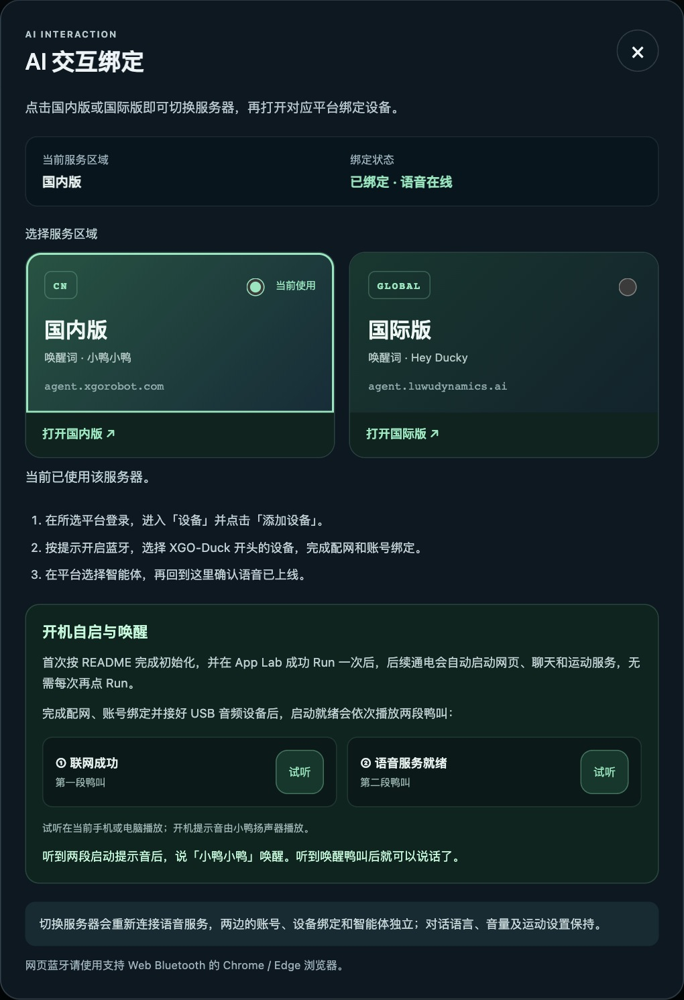

# XGO Duck AI

[English](README.md) · 简体中文 · [更新记录](docs/CHANGELOG.md)

在 Arduino UNO Q 上运行小鸭的语音聊天、运动控制、USB 音视频和 ToF 测距。日常操作使用浏览器，不需要给小鸭连接屏幕。

先准备 Arduino UNO Q（官方 Debian 13）、扩展板、USB 数据线、电池和舵机。聊天需要 USB 麦克风和扬声器，摄像头和板载 Qwiic 接口上的 VL53L5CX ToF 可按需安装。

下面按官方开发者指南的七步顺序配置，使用本仓库的 XGO Duck AI 安装包和启动命令。

## XGO Duck 和 XGO Duck AI 怎么选

只需要网页遥控、舵机设置和标定，可以选 **XGO Duck（master）**。想让小鸭语音聊天、查看 USB 摄像头或使用 ToF 测距，选 **XGO Duck AI（本分支）**。 [查看 master 说明](https://github.com/LuwuDynamics/xgoduck_runtime_arduino/blob/master/README.md)

| 功能 | XGO Duck（master） | XGO Duck AI（本分支） |
| --- | --- | --- |
| 运动控制 | 网页遥控、舵机设置、标定和行走等动作 | 同样提供网页运动控制、舵机设置和标定 |
| 语音聊天 | — | 绑定账号并选择智能体后，国内版说「小鸭小鸭」，国际版说「Hey Ducky」。 |
| 音视频与测距 | — | USB 摄像头预览、拍照、麦克风监听、扬声器测试，以及可选 ToF 测距和前向避障 |
| 网页入口 | `http://<板子IP>:9527/` 打开运动控制 | `http://<板子IP>/` 打开驾驶舱和 AI 语音交互绑定，`:9527` 打开运动控制 |

两个版本都使用 2 Mbps Bridge。AI 版按第 3～4 步安装，并配置 USB 探测、驾驶舱入口和开机自启。

## 1. 设置并连接 Wi-Fi

用 USB 数据线把 UNO Q 连到电脑，在 Arduino App Lab 完成首次设置。选择键盘布局、设置设备名、连接 Wi-Fi 并设置板端 Linux 登录密码。等待检查和更新完成，断开 USB 后按指南接好扩展板，再重开 App Lab 并连接开发板。 [官方图文步骤](https://www.xgorobot.com/duck-developer-guide/index.html)

## 2. 测试 LED，记录板子 IP

1. 在 App Lab 打开 **Inspirations → Color your LEDs**，点 **Run**。
2. 从底部状态栏打开示例网页，切换 LED 的开关和颜色，观察板上的对应 LED 是否响应。
3. 测试结束后点 **Stop**。打开右下角 Wi-Fi 图标里的 **Network Info**，记录自己的板子 IP。后续电脑与板子使用同一网络。 [官方图文步骤](https://www.xgorobot.com/duck-developer-guide/02-led-ip.html)

拿到 IP 后，可把下面这段交给有终端权限的 AI，检查后续安装需要的 SSH 连接。

```text
板子 IP 是 [填写]。请从我的电脑验证能否通过 Wi-Fi SSH 登录 arduino 用户。
登录后检查 Debian 版本、CPU 架构、可用空间和 Arduino App CLI 是否可用。
密码由我在终端提示中输入。
```

## 3. 导入 XGO Duck AI App

> **想让 AI 代装？** 完成第 1～2 步后，直接使用[第 3～4 步的 AI 代装提示词](#ai-assisted-install)。

| 安装包 | 什么时候用 | 包内有什么 |
| --- | --- | --- |
| [全量首装 ZIP（Release）][duck-full] · [SHA-256][duck-full-sha] | **新板或重刷系统后首装** | 约 470 MB。包含预编译 App、ARM64 Docker 基础镜像、板端依赖和 STM32 上传工具。下载并传到板子后，可在局域网内完成安装。 |
| [预编译 .ard（Release）][duck-ard] · [SHA-256][duck-ard-sha] | **已有安装时更新**，也可在环境已准备好的板子上首装 | 约 80 MB。包含预编译 STM32 固件和 Python 环境。启动时直接上传固件。板上缺少的系统依赖、Docker 镜像或上传工具仍可能需要联网获取。 |
| [App Lab 源码 ZIP（代码仓库）][duck-zip] · [SHA-256][duck-zip-sha] | **板端无法安装 .ard**，或需要编辑源码 | 约 35 MB。沿用原来的 `packages/xgoduck_ai.zip` 下载地址。在 App Lab 导入后，由板子准备依赖并编译 STM32。 |

两个 Release 直链在附件发布后指向最新版本。需要指定版本，或最新发布缺少对应附件时，到 [GitHub Releases][duck-releases] 选择所需的 XGO Duck AI 版本。下载时请配套取同一版本的校验文件。

### 全量首装 ZIP

完成 UNO Q 的初始设置，通过 Wi-Fi SSH 登录官方 Debian 13 ARM64 系统。参考首装环境预留至少 **2.5 GiB** 可用空间。下载 ZIP 和校验文件，校验后通过 SCP 传到 UNO Q，在板上解压到新目录。若已接舵机，先扶稳小鸭并确认卸力。停止正在运行的 App，以 `arduino` 用户按包内 `INSTALL.txt` 执行 `bash install.sh`。脚本会配置 2 Mbps Bridge、设置开机自启并启动 App。完成后直接做第 4 步的验收。参考系统上，包传到板子后即可断开公网完成安装。账号绑定和云端语音需要互联网。

全量包是应用及依赖安装包，不会重刷系统。解压目录与 App 安装目录不同：0.3.6 固定安装到 `/var/lib/arduino-app-cli/releases/xgoduck-ai-0-3-6-unoq`。该目录已存在时，只有其中的 `.xgoduck-full-install.sha256` 与当前包内 `.ard` 的 SHA-256 完全相同，安装器才会复用；单独安装过同版本 `.ard` 或同版本重新打包后，也可能不满足这一条件。保留已核实可用的安装，或按明确的重装要求处理旧目录及数据后再安装。不要手工伪造收据或直接覆盖目录。[全量包说明](docs/full-install.txt)

需要迁回旧配置时，先按更新流程保存同一只鸭子的持久数据。全量安装器结束后，停止新 App 和 `xgoduck-ai-hardware.service`，迁回配置并保留权限及归属，然后启动硬件服务和新 App，再进行验收。[数据迁移和回退](docs/deployment.md#更新与回退)

### 预编译 .ard

板端需要 **Arduino App CLI 和 daemon 0.14 或更新版本**。使用 App Lab 0.11 或更新版本时，从 **Create new App ＋ → Import or install App** 选择 `.ard`。如果电脑上的 App Lab 较旧，但板端支持 `arduino-app-cli app install`，可通过 Wi-Fi SSH 安装。 [Arduino App Lab 安装说明](https://docs.arduino.cc/software/app-lab/apps/manage-apps)

将 `.ard` 和 `.ard.sha256` 传到板子同一目录，以 `arduino` 用户执行。使用实际下载的文件名。

```sh
sha256sum -c xgoduck-ai-unoq.ard.sha256 && \
  arduino-app-cli app install --yes xgoduck-ai-unoq.ard
```

安装命令会给出新 App 目录。更新时从旧 App 迁移同一只鸭子的配置，再进入第 4 步。板端 CLI 或 daemon 版本过低时，可更新板端组件，或直接使用下方的源码 ZIP。

### App Lab 源码 ZIP

下载并校验 `xgoduck_ai.zip`。在 App Lab 的 **Apps → ＋ → Import App**（新版显示 **Import or install App**）中选择 ZIP。确认导入的 **XGO Duck AI** App 目录，保持 App 停止，进入第 4 步。 [导入界面图解](https://www.xgorobot.com/duck-developer-guide/03-import-app.html)


## 4. 终端配置与启动

**全量首装 ZIP** 已由安装脚本完成本节的配置和启动，直接检查下方的网页和状态。

**预编译 .ard 和源码 ZIP** 通过 Wi-Fi SSH 完成下面的配置。USB 探测期间电脑的 USB/ADB 连接可能中断。

1. 更新时先扶稳小鸭并卸力。停止旧 App，备份旧 App 及 `data/`。保持新旧 App 都停止，再迁移这只鸭子的标定、绑定和服务区域等持久设置。 [数据迁移和回退](docs/deployment.md#更新与回退)
2. 确认其他 App 已停止，保持板子联网，再在实际的新 App 目录以 `arduino` 用户执行下面的命令。用安装输出或 App CLI 列表核对目录。

   ```sh
   bash tools/install-ai-support.sh && \
     sudo bash tools/router-2m.sh && \
     arduino-app-cli app start "$PWD"
   ```

   安装脚本配置硬件支持、驾驶舱和开机自启。第二条命令设置共享 Router 的串口速率为 **2 Mbps**。启动会上传配套的 STM32 固件，源码 ZIP 还需要编译，`.ard` 使用随包固件。已完成配置时也可在 App Lab 点击 **Run**。

**验收**时在浏览器打开 `http://<板子IP>/` 和 `http://<板子IP>:9527/`，核对 App 版本和默认启动项。依赖准备及首次启动完成后，保持舵机卸力，执行一次整机重启；重新连接 Wi-Fi SSH，等待网页/API 就绪，确认默认 App 自动运行且版本正确。已接线的板子检查舵机与 IMU 反馈；已有标定和配置应保留。未接线、未标定时记录待完成项。

首次安装可能还未绑定账号或接 USB 麦克风、扬声器，**语音在线不是安装通过的前提**。检查 `/api/voice/status` 和日志：等待联网、绑定或音频设备时，记录对应待完成项；进程崩溃、依赖错误仍需处理。仅在已绑定、已接好音频设备且互联网可用时，检查语音云连接和音频就绪。完成后继续第 5～8 步。断网冷启动可在完成配网及所需配置后另行测试。

<a name="ai-assisted-install"></a>

### 让 AI 代装第 3～4 步

源码 ZIP 的安装流程已在 Codex、DeepSeek Harness 和 Cursor 中跑通，首装通常预留 30～60 分钟，实际取决于下载速度。全量包提前准备了依赖，板端耗时主要取决于传输、解压和本地安装。

复制下面的提示词，填入 **板子 IP、SSH 用户名和密码**，交给能执行终端命令的 AI。若已配置 SSH 密钥，也可直接使用密钥登录。

```text
请在我的 Arduino UNO Q 上完成 XGO Duck AI 的安装、启动和验收。
板子 IP：[填写]。SSH 用户名：[填写，通常是 arduino]。SSH 密码：[填写板子的 Linux 登录密码]。
安装方式：[首次安装 / 更新 / 自动判断]。目标版本：[最新 AI 版 / 指定版本，例如 0.3.6]。
服务区域：[自动识别或保留现有 / 国内 cn / 国际 global]。本地已下载的安装包路径：[可选]。

1. 通过 Wi-Fi SSH 登录目标板。密码只用于登录或 sudo，避免写入文件、命令历史或日志。
   核对 UNO Q、官方 Debian 13 ARM64、可用空间、arduino 用户（UID 1000）、App CLI 和 daemon 版本。
   用 arduino-app-cli app list 查看已装 App，用 app details <App ID> 核对实际目录，用 app ps 查看运行状态，
   用 arduino-app-cli properties get default 查看开机默认 App。旧版 CLI 的状态查询以帮助为准。
   已安装正确版本时从实际目录继续，避免重复导入。保持 Wi-Fi SSH，USB 探测可能中断 USB/ADB。

2. 按板子现状选包。优先复用已下载且校验通过的同版本文件。
   - 新板或刚重刷系统，优先用全量首装 ZIP。
     https://github.com/LuwuDynamics/xgoduck_runtime_arduino/releases/latest/download/xgoduck-ai-unoq-full.zip
   - 已有 XGO Duck AI，更新优先用预编译 .ard。已准备好运行环境的板子也可用它首装。
     https://github.com/LuwuDynamics/xgoduck_runtime_arduino/releases/latest/download/xgoduck-ai-unoq.ard
   - 全量包缺失时，板端环境允许就用同版本 .ard。若需要编辑源码、板端 CLI/daemon 无法支持 Release，
     或同版本 .ard 也不可用，用源码 ZIP。
     https://github.com/LuwuDynamics/xgoduck_runtime_arduino/raw/ai-chat-audio-video-tof/packages/xgoduck_ai.zip
   Release 链接缺失或需指定版本时，到这里选对应 AI 版本。
   https://github.com/LuwuDynamics/xgoduck_runtime_arduino/releases
   从同一 Release 取包和 .sha256。源码 ZIP 与其 .sha256 都从上面的分支地址取。
   优先在电脑下载并校验，再用 SCP 传到板上，用 sha256sum -c 再核对。
   校验失败时重新下载。核对包内 version.txt 和 UNO Q 目标。全量包以其中的 .ard 为准。
   指定版本缺包或候选包比已装版本旧时，保留已装版本并告诉我。

3. 已接舵机时，先让我扶稳小鸭并确认卸力。更新时停止旧 App，记下默认 App 和旧目录，备份旧 App 及 data/。
   保留旧 App 用于回退。.ard 和源码 ZIP 装到独立目录，在两个 App 都停止时迁移这只鸭子的持久配置。
   全量包会自动启动，涉及旧数据时按第 4 项停服后迁移；已有目标目录时先处理安装冲突。
   保留 IMU 标定、舵机中位记录、设备身份、绑定、区域和手柄配置。按 docs/deployment.md 的「更新与回退」
   处理历史零位文件，跳过旧 .cache、data/native/ 和运行时 socket。确认其他 App 可停止并停妥，再运行安装器
   或改共享 Router。第 4～6 项只做所选的安装路线。

4. 全量首装 ZIP 在板上解压到新目录。参考首装环境预留至少 2.5 GiB，按 INSTALL.txt 以 arduino
   用户运行 bash install.sh，按需提供 sudo。先从 install.sh 核对固定的 app_root；解压到新目录不会改变它。
   目标目录已存在时，核对 .xgoduck-full-install.sha256 是否与包内 .ard 的 SHA-256 完全一致。
   相同才可停掉 App 后重跑安装器。收据缺失或不同时，保留已核实可用的安装并报告冲突；若我已明确要求
   重装，则先保存需保留的数据、停止相关服务并处理旧目录，再运行安装器。不要伪造收据或覆盖旧目录。
   安装器使用包内系统依赖、ARM64 镜像和上传工具，安装预编译 App、设置 2 Mbps Bridge 和开机自启，
   然后启动。有旧数据要迁回时，停止新 App，再执行 sudo systemctl stop xgoduck-ai-hardware.service，
   迁移第 3 项的持久配置并核对内容、权限和归属，保留新生成的 native 文件。
   依次执行 sudo systemctl start xgoduck-ai-hardware.service 和 arduino-app-cli app start --no-prepare <新目录>。
   全量包不会重刷系统。完成配置迁移及第 7 项选区处理后再验收。
   全量包针对参考官方 Debian 13 镜像。若本机缺少包外组件，先定位缺的组件，再决定如何补齐。

5. .ard 路线先执行 arduino-app-cli version 和 arduino-app-cli app install --help，确认 CLI 和 daemon
   支持 Release（0.14+）。电脑 App Lab 较旧但板端支持时，直接用 SSH 执行
   arduino-app-cli app install --yes <已校验的.ard>。也可用 App Lab 0.11+ 的 Import or install App。
   从安装输出或 App 列表确认新目录。若提示依赖下载失败或已安装，先核对实际目录、版本和日志，
   复用已经安装的同版本 Release，补齐缺失的 Docker 镜像或 STM32 上传工具。正常使用包内固件和
   Python 环境，跳过源码 ZIP 的工具链和 PyPI 准备。固件缺失或校验失败时，按 docs/ai-chat.md 的
   「UNO Q 预编译版」重建。板端版本过低且希望继续用 .ard 时，先确认是否更新板端组件。

6. 源码 ZIP 路线先检查 arduino-app-cli app import --help，支持时用 arduino-app-cli app import <ZIP>，
   否则指导我在 App Lab 导入。用实际导入目录，避免直接解压覆盖旧 App。
   核对 sketch/sketch.yaml、provenance/toolchain.json 和 python/requirements.txt。以 arduino 用户执行
   arduino-cli core list。若安装的 arduino:zephyr 缺失或版本不符，按 sketch/sketch.yaml 安装并复查。
   0.3.6 对应 arduino-cli core install arduino:zephyr@1.0.0，
   使用 Arduino_RouterBridge 0.4.3、Arduino_RPClite 0.3.1 和 Linux ARM64
   arm-zephyr-eabi 1.0.1。上传时也要用对应 core。工具链下载失败时，用电脑从 provenance/toolchain.json
   的官方 URL 下载，校验大小和 SHA-256，SCP 到板上，再在 App 目录执行
   python3 tools/prepare-ai-sketch.py --toolchain-archive <板上的官方压缩包路径>。
   国内下载 Python 依赖慢且没有自定义源时，可在 App 目录执行
   python3 tools/configure-ai-python.py --index-url https://pypi.tuna.tsinghua.edu.cn/simple/
   板端 Python 下载仍慢时，可用电脑上匹配板端容器镜像、Linux ARM64 架构和 Python 版本的容器，
   按 python/requirements.txt 下载或构建全部 wheel 及其依赖，校验后 SCP 到板上，在 App 的 Python
   环境中离线安装并核对锁定版本和 SDK 导入。不要使用 Mac 原生 wheel，也不要提前写入安装成功标记。
   下载 core、Docker 镜像或系统包失败时，根据日志只补缺失项。必要时临时使用我电脑已有的代理，
   下载完成后恢复原配置。

7. 服务区域选自动识别时，首装保留未选区，更新保留原选区或自建地址。我明确选区时，启动后从驾驶舱选择，
   或在 .ard / 源码 ZIP 启动前运行对应命令：python3 tools/configure-ai.py --region cn
   或 python3 tools/configure-ai.py --region global。
   对 .ard 和源码 ZIP，在实际 App 目录迁移数据后，保持联网，依次执行 bash tools/install-ai-support.sh、
   sudo bash tools/router-2m.sh、arduino-app-cli app start "$PWD"。每条成功后再继续。启动会上传 STM32 程序。
   参考全量包的环境为 Router 0.11.0、App CLI 0.14.1、Arduino CLI 1.5.1、ARM64 Python 基础镜像
   0.13.1。核对包内要求，复用兼容的现有组件。确认 Router ExecStart 使用 2000000，默认 App 指向新目录。

8. 验收时保持舵机卸力。检查驾驶舱、9527 控制页和 /api/version，确认实际运行版本。
   首次启动及依赖准备完成后，执行 sudo systemctl reboot。重新连接 Wi-Fi SSH，等待网页/API 就绪，
   确认 boot ID 已改变、默认 App 自动运行且版本正确；已有配置和标定应保留。
   检查 /api/status 的 Bridge；按实际接线情况检查舵机和 IMU。未接线或未标定时记录待完成项。
   检查 /api/voice/status 和日志。首次未绑定、缺少 USB 音频或没有公网时，不要求 bound、
   cloud_connected、audio_ready 全为 true；记录待联网、待绑定或待接设备。进程崩溃或依赖错误需处理。
   已绑定、音频设备齐全且公网可用时，才要求语音云连接和音频就绪；不要把待绑定当作安装失败。
   本次正常重启不要求断开公网；断网冷启动可在配置完成后另测。已接 ToF 时轮询 /api/tof/status，确认 state=ranging、
   fresh=true、seq 递增且 valid_zones > 0。若异常，用容器内 python /app/tools/read-tof.py --seconds 4 对照。
   若语音日志提示 libopus.so.0 权限错误，检查新 App 的 native 库和目录对容器运行用户是否可读及可遍历。
   启动失败先查 App、Router 和硬件服务日志。若需回退，停止新 App，按 docs/deployment.md 从旧目录
   恢复硬件服务和默认项，再启动旧 App，保留备份。汇报所用安装包、校验结果、版本、实际目录和验收结果。
   安装成功后提醒我按 README 完成第 5～8 步。依次设置舵机编号、组装、统一标定 15 个舵机（含 30 号）、
   标定 IMU，再检查默认姿势，最后绑定账号并选择智能体。已完成的步骤跳过，告诉我下一项。
```

[duck-releases]: https://github.com/LuwuDynamics/xgoduck_runtime_arduino/releases
[duck-full]: https://github.com/LuwuDynamics/xgoduck_runtime_arduino/releases/latest/download/xgoduck-ai-unoq-full.zip
[duck-full-sha]: https://github.com/LuwuDynamics/xgoduck_runtime_arduino/releases/latest/download/xgoduck-ai-unoq-full.zip.sha256
[duck-ard]: https://github.com/LuwuDynamics/xgoduck_runtime_arduino/releases/latest/download/xgoduck-ai-unoq.ard
[duck-ard-sha]: https://github.com/LuwuDynamics/xgoduck_runtime_arduino/releases/latest/download/xgoduck-ai-unoq.ard.sha256
[duck-zip]: https://github.com/LuwuDynamics/xgoduck_runtime_arduino/raw/ai-chat-audio-video-tof/packages/xgoduck_ai.zip
[duck-zip-sha]: https://github.com/LuwuDynamics/xgoduck_runtime_arduino/raw/ai-chat-audio-video-tof/packages/xgoduck_ai.zip.sha256

## 5. 设置舵机并编号

[按官方图文完成舵机设置与编号](https://www.xgorobot.com/duck-developer-guide/05-servo-setup.html)

## 6. 组装 XGO Duck

[按官方图文组装 XGO Duck](https://www.xgorobot.com/duck-developer-guide/06-assembly.html)

[音视频安装教程（PDF）](docs/xgo-duck-av-installation.pdf) · [下载中英装配 PPTX（约 69 MB）](https://github.com/LuwuDynamics/xgoduck_runtime_arduino/raw/ai-chat-audio-video-tof/assembly/xgo-duck-assembly-zh-en-20261016.pptx)


## 7. IMU 标定和舵机标定

打开 `http://<板子IP>:9527/`，确认 **15/15** 个舵机在线。扶稳小鸭后点顶部 **标定**，等页面确认舵机已卸力。

1. **统一标定舵机。** 按四张图摆好小鸭，避开线束。点 **标定 15 个舵机**，等页面确认中位已保存。30 号颈部舵机一并标定。
2. **标定 IMU。** 保持舵机卸力，让 UNO Q 竖直、电池接口朝上、板子下边缘贴住水平桌面。点 **标定 IMU**，静止约 **1.5 秒**，等页面显示已保存。[IMU 标定细节](docs/imu-calibration.md)
3. **检查默认姿势。** 把小鸭放到平坦处扶稳，点标定页底部的 **默认姿势**。等舵机上力，再对照实拍检查头颈、腿和脚的位置。如果姿势不对，先扶稳并点 **全部卸力**，再复查摆位和舵机标定。


[标定按钮和状态说明](docs/calibration-guide.md)

## 8. 绑定账号，选择智能体

1. 电脑或手机与小鸭连接同一网络，打开 **`http://<板子IP>/`**，无需端口和页面后缀。

   

2. 打开准备使用的绑定平台。也可在驾驶舱顶部的 **AI 语音交互绑定** 里提前选择 **国内版** 或 **国际版**，点击即保存选区并重连语音。

   | 设备选区 | 唤醒词 | 绑定与管理平台 |
   | --- | --- | --- |
   | `cn` 国内版 | **小鸭小鸭** | [agent.xgorobot.com/devices](https://agent.xgorobot.com/devices) |
   | `global` 国际版 | **Hey Ducky** | [agent.luwudynamics.ai](https://agent.luwudynamics.ai/) |

3. 登录平台，在「设备」中点击「添加设备」。按提示开启蓝牙，选择 `XGO-Duck` 开头的设备，完成配网和账号绑定，再选择要使用的智能体。
4. 回到驾驶舱打开 **AI 语音交互绑定**，确认语音在线后，说页面上当前选区对应的唤醒词。



网页蓝牙需使用支持 Web Bluetooth 的 Chrome / Edge。iPhone / iPad 可用对应的小程序或 App 完成添加：

| 国内微信小程序 | 国际版 App |
| --- | --- |
|  |  |
| 用微信扫码 | [打开 App 下载页](https://agent.luwudynamics.ai/download) |

国内、国际账号和设备绑定相互独立。若小鸭还未选区，联网后会自动检查两边的绑定，只绑定一边就使用该服务，两边都绑定则使用国内版。已保存的选区优先。切换服务器会保留对话语言、音量和运动设置。首次切到另一侧需要在那里单独绑定。设备已绑定其他账号时，应先在原账号中解绑。

如果绑定后语音没上线，可以复制这段提示词让 AI 协助排查。

```text
板子 IP：[填写]，我选择的服务区域：[国内 cn / 国际 global]。
请读取驾驶舱的绑定状态和 9527 的 /api/voice/status，检查服务区域和语音连接。
告诉我卡在配网、绑定还是语音连接，并引导我在相应平台完成下一步。
账号登录、蓝牙授权、绑定和换区由我操作。
```

### 开机提示音

后续通电会自动探测 USB 音视频设备，启动网页、聊天和运动服务，**无需每次打开 App Lab 或点击 Run**。完成配网、账号绑定并接好 USB 音频设备后，会依次听到两段启动鸭叫：

| 顺序 | 含义 | 示例音效 |
| --- | --- | --- |
| ① | 联网成功 | [试听第一段鸭叫](assets/startup-network.wav?raw=true) |
| ② | 语音服务已连接，聊天就绪 | [试听第二段鸭叫](assets/startup-voice.wav?raw=true) |

如果还未绑定，联网鸭叫之后会播报三遍「请在浏览器打开［当前 IP 地址］，完成 AI 绑定」。开机连上 Wi-Fi 后，UNO Q 的板载点阵会显示 IP 的最后一段约 1 分钟，例如 `192.168.31.20` 显示 `20`。

听到语音服务就绪的鸭叫后，说 **AI 语音交互绑定 → 开机自启与唤醒** 中显示的唤醒词。听到唤醒鸭叫后就可以说话。启动音示例可在当前手机或电脑上试听，实际启动音由小鸭扬声器播放。

## 日常使用

- **界面语言：**每次打开或刷新时跟随访问设备的浏览器系统语言，中文显示中文，其余显示英文；顶部切换按钮仅临时生效。
- **音频测试：**首页「实时音频」中，左侧「测试扬声器」播放约 3 秒合成鸭叫，播放时可点击停止；右侧「实时监听」收听小鸭麦克风。
- 手机横屏、竖屏默认都显示双摇杆。「更多」里有其他动作和鸭叫，「视图 → 显示全部」可打开设备设置。
- 电脑上按住 **W/S** 前进或后退、**A/D** 侧移、**Q/E** 转向。松开按键或按 **空格** 停止移动。
- 国内版说「小鸭小鸭」，国际版说「Hey Ducky」唤醒聊天。在平台中管理智能体，在驾驶舱「设置 → 扬声器」调整音量。
- **音视频：**驾驶舱可开启/关闭摄像头、控制补光灯、保存照片和实时监听麦克风。
- 开机先开启 USB Host，最多等待 5 秒识别 USB 摄像头或音频设备。识别到就保留 Host，否则切回 Device，方便用 USB 连接电脑。开机后才插入外设时，先让小鸭停止运动，再通过 Wi-Fi 打开驾驶舱，用顶部的 **USB Host** 开关手动开启。切换会中断当前 USB 连接。
- ToF 正常测距时显示 8×8 实时距离，默认在 15 cm 内减速、10 cm 停止。未接 ToF 或 ToF 已离线时，可以重新发出前进指令，此时没有测距避障。传感器仍显示测距中但读数过期或无效时，暂停前进。[避障说明](docs/forward-avoidance.md)

## 常见问题

### 1. 小鸭走不稳或发抖

1. 先停止移动，扶稳小鸭并卸力。在舵机设置的单舵机安装检查中核对舵机 ID、安装位置和顺序，检查舵盘和固定螺丝是否松动。
2. 打开 9527 的 **标定** 页，按[第 7 步](#7-imu-标定和舵机标定)统一标定全部 15 个舵机，再标定 IMU、检查默认姿势。
3. 打开 **舵机设置**，点 **扫描所有 ID**。逐个选中舵机，将 **KP 设为 5、KD 设为 10**，点 **写入 KP/KD（Set KpKd）**，再点 **读取** 核对保存值和运行值。断电重启后，舵机会加载保存值。

本项目基于 Pollen Robotics 的 [Microduck](https://github.com/pollen-robotics/microduck)。[硬件](https://github.com/LuwuDynamics/xgoduck_hardware) · [训练代码](https://github.com/LuwuDynamics/xgoduck_rl)
