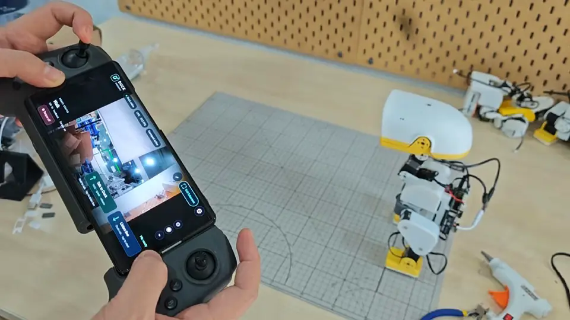
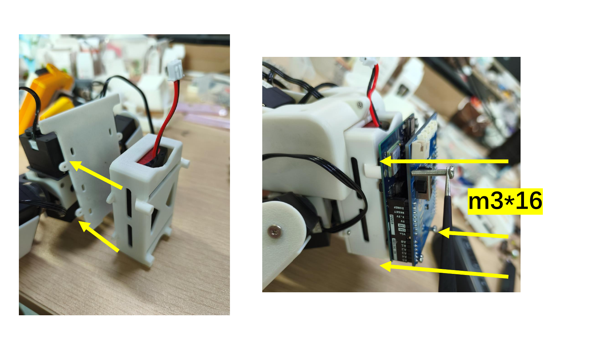
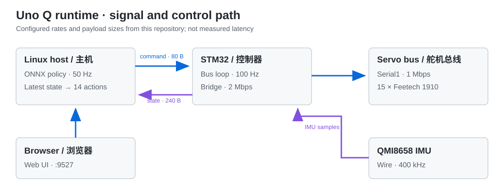

# Arduino Uno Q 上的 XGO Duck

[English](README.md) · [简体中文](README_CN.md)



**把 Duck 的视角放到手柄上。** 手机夹在手柄中间，打开移动驾驶页面，一边观看机载摄像头实时画面，一边用摇杆遥控 Duck。上方实机演示展示了这种类似穿越机的手持操作方式；WebP 动图保留完整片段，循环播放、不带声音。

**下一版本开发：音视频与 ToF。** 本分支集中开发 USB 摄像头视频流、手机全屏驾驶页面、Duck 麦克风实时监听、手机向 Duck 发送语音片段、手柄配置及手动 USB Host 开关。ToF 测距列入后续规划，传感器接入尚未实现。使用说明见[移动驾驶页面](docs/mobile-cockpit.md)和 [USB 摄像头 / 音频配置](docs/usb-camera.md)。

在装配好的 XGO Duck 上运行仓库附带的行走、起身和地面抓取 ONNX 策略。本仓库包含 Uno Q 应用、STM32 固件、网页控制界面和三个模型。实体制作请看[硬件仓库](https://github.com/LuwuDynamics/xgoduck_hardware/blob/master/README_CN.md)；只有想自行训练策略时才需要 [XGO Duck RL](https://github.com/LuwuDynamics/xgoduck_rl/blob/main/README_CN.md)。



*真实 Uno Q 安装与走线照片，取自[硬件装配指南](https://github.com/LuwuDynamics/xgoduck_hardware/blob/master/Assembly_Guide.pdf)第 23 页。它是装配照片，不是运行中应用的截图。*

| 一眼看懂 | 数值 |
| --- | --- |
| 执行器 | 15 个 Feetech 1910 舵机；14 个策略关节加 1 个嘴部舵机 |
| 策略循环 | Uno Q Linux 侧，50 Hz |
| 舵机与 IMU 循环 | Uno Q STM32 侧，100 Hz |
| 网页界面 | 9527 端口；控制、舵机设置、校准 |
| 附带模型 | [`xgoduck_walk.onnx`](python/xgoduck_walk.onnx)、[`xgoduck_getup.onnx`](python/xgoduck_getup.onnx)、[`xgoduck_pick.onnx`](python/xgoduck_pick.onnx) |

## 仓库中实际有什么

| 层级 | 已包含 | 首次检查 |
| --- | --- | --- |
| 网页控制 | [`assets/index.html`](assets/index.html)、[`servo.html`](assets/servo.html)、[`calibrate.html`](assets/calibrate.html) | 打开 `:9527`，上扭矩前先确认状态持续更新 |
| Linux 策略主机 | [`python/`](python/) 和三个 ONNX 模型 | 应用以仅推理模式启动 |
| STM32 固件 | [`sketch/`](sketch/) | 确认 15 个舵机 ID 唯一且 QMI8658 有读数 |
| 设置与诊断 | [`tools/`](tools/) | 准备 Bridge、设置路由速率，再只读采集状态 |

顶部动图为实机遥控演示，不是延迟基准测试。下方速率是源码配置值，不作为实测性能宣称。

## 从这里开始

**给舵机供电前：**先阅读[硬件 BOM 与装配指南](https://github.com/LuwuDynamics/xgoduck_hardware/blob/master/README_CN.md)。15 个舵机 ID 必须各不相同。设置和校准时请支撑住机器人。

1. **准备 Uno Q 应用。**安装 Arduino App CLI 和 Uno Q Zephyr 内核。仓库使用 Zephyr core 1.0.0、RouterBridge 0.4.3、RPClite 0.3.1、MsgPack 0.4.2；库清单在 [`sketch/sketch.yaml`](sketch/sketch.yaml)，Python 依赖在 [`python/requirements.txt`](python/requirements.txt)。
2. **连接扩展板与电源。**舵机总线接 D0/D1（`Serial1`，1 Mbps）；QMI8658 接 D20/D21（`Wire`，400 kHz，地址 `0x6A` 或 `0x6B`）。接电前按[硬件板卡设计](https://github.com/LuwuDynamics/xgoduck_hardware/tree/master/PCBA)核对电池接头极性。
3. **在 Uno Q 上从本仓库目录启动应用：**

   ```bash
   python3 tools/prepare-bridge.py
   sudo bash tools/router-2m.sh
   arduino-app-cli app start "$PWD"
   ```

4. **打开网页** `http://<uno-q-ip>:9527/`。应用默认进入 **Inference only（仅推理）**，舵机扭矩关闭。新舵机装入结构件前先完成 **Servo setup（舵机设置）**，装配后完成 **Calibration（校准）**，最后再选择上扭矩的控制模式。

如果第一次运行 `prepare-bridge.py` 时找不到已解析的库，可先让 App CLI 解析一次 `sketch/sketch.yaml`，再重跑脚本并启动应用。`router-2m.sh` 会把 Bridge 速率全局设为 2 Mbps；换用 115200 baud 的其他 Bridge 应用前，按[技术参考](docs/technical_reference.md#running)切回。

## 首次设置

### 1. 舵机装入结构件前分配 ID

**每次只连接一个舵机。**打开 **Servo setup**（`/servo.html`），进入设置模式，依次分配 **10–14**、**20–24**、**30–34**。总线上两个舵机若共用 ID，会同时响应写入。对每个舵机，先移动到原始中心位置 **2047**，再保存 KP = **5**、KD = **20**。页面在居中时使用临时运行增益。断开当前舵机后再连接下一个。

| ID | 用途 |
| --- | --- |
| 10–14 和 20–24 | 腿部 |
| 30–33 | 颈部与头部，属于 14 维策略动作 |
| 34 | 嘴部，由网页界面控制，不在策略动作中 |

全部编号完成后，按[图解装配指南](https://github.com/LuwuDynamics/xgoduck_hardware/blob/master/Assembly_Guide.pdf)安装舵机并走线。

### 2. 完成接线后校准

确认每个舵机都能应答，再打开 **Calibration**（`/calibrate.html`）。开始校准会停止策略和姿态控制，以临时 KP = 3、KD = 0 命令所有舵机到原始中心 **2047**。逐一调节滑块，让连杆达到机械零位，然后按 **Finish**。测得的编码器零位保存在本机 `data/zero_pos.json`；该文件已被 Git 忽略，启动时会自动加载。迁移安装时请保留这个属于当前机器人的文件。

### 3. 选择控制模式

| 模式 | 行为 |
| --- | --- |
| Inference only（仅推理） | 策略运行，舵机扭矩关闭 |
| Default pose（默认姿态） | MCU 和 IMU 数据新鲜时保持初始姿态 |
| Walk / get up（行走 / 起身） | 开启位置控制和自动恢复 |
| Pick（抓取） | 直立行走时运行 4 秒抓取策略，再返回行走 |
| Torque off（关闭扭矩） | 停止位置控制 |

控制页面不会因网页心跳丢失、切到后台或关闭而关闭扭矩；切到后台或关闭页面时会发送零运动指令，并保留当前模式。需要停止时请使用 Torque off。传感器反馈丢失和 MCU 命令看门狗仍会关闭扭矩。舵机设置与校准保留独立的 2 秒会话心跳，离开页面时退出相应模式。详情见[控制细节](docs/technical_reference.md#running)。

## 工作原理

Linux 主机以 50 Hz 运行 ONNX 推理并提供网页界面。STM32 以 100 Hz 驱动 15 舵机总线并读取 QMI8658。`duck_command` 发往 MCU，`duck_state` 返回最新状态；主机只使用最新快照，不堆积旧动作。三个模型的输入均为 `[1, 61]`，输出均为 `[1, 14]`。



| 配置值 | 数值 | 作用 |
| --- | ---: | --- |
| Linux 策略周期 | 20 ms（50 Hz） | 推理与动作更新 |
| STM32 总线周期 | 10 ms（100 Hz） | 舵机与 IMU 通信 |
| `duck_command` | 80 字节 | 主机发给 MCU 的动作包 |
| `duck_state` | 240 字节 | MCU 返回的状态快照 |
| 舵机总线 | 1 Mbps，ID 10–14 / 20–24 / 30–34 | 15 个舵机共用总线 |
| Bridge | 2 Mbps | Linux 和 MCU 两端速率必须一致 |

### 首次让机器人运动前

| 检查 | 预期结果 |
| --- | --- |
| 舵机设置 | 每个 ID 只出现一次，没有两个舵机共用 ID |
| 校准 | 完成所有关节后，本机生成 `data/zero_pos.json` |
| 仅推理模式 | 状态持续更新，电机仍不受力 |
| 默认姿态 | 支撑住机器人，并确认 MCU/IMU 数据新鲜后再选择 |
| 关闭扭矩 | 改动接线或重启路由器前，确认电机已释放 |

### 某一步失败时

| 现象 | 先检查 |
| --- | --- |
| 应用找不到被修改的 Bridge 库 | 先让 App CLI 解析 `sketch.yaml`，再运行 `prepare-bridge.py` 并重新启动 |
| 舵机无响应 | 电源、D0/D1 接线、1 Mbps 总线速率、ID 是否唯一 |
| 没有 IMU 状态 | D20/D21 上的 QMI8658 接线及 `0x6A` / `0x6B` 地址 |
| 换应用后 Bridge 不通 | 两端速率需一致，见[路由器操作](docs/technical_reference.md#running) |
| 运行中自动关闭扭矩 | 查 MCU 命令时间、IMU 与主机反馈的新鲜度；校准和舵机设置还需检查会话心跳，见[技术参考](docs/technical_reference.md#running) |

协议字节数、关节顺序、滤波、起身阈值、路由器速率与 ELF 检查见[技术参考](docs/technical_reference.md)。在机器人上只读采集状态可运行：

```bash
python tools/measure.py --seconds 60
```

该命令只读取 `/api/status`，不会启用电机。

## 来源与相关仓库

机器人沿用 [Pollen Robotics 的 Microduck](https://github.com/pollen-robotics/microduck) 的 15 舵机布局和关节顺序。本运行时针对 Uno Q、Feetech 1910 舵机和 QMI8658 扩展板进行了适配。

| 仓库 | 分工 |
| --- | --- |
| [XGO Duck 硬件](https://github.com/LuwuDynamics/xgoduck_hardware/blob/master/README_CN.md) | BOM、可打印零件、PCB、装配 |
| [XGO Duck RL](https://github.com/LuwuDynamics/xgoduck_rl/blob/main/README_CN.md) | 仿真、训练、ONNX 导出 |
