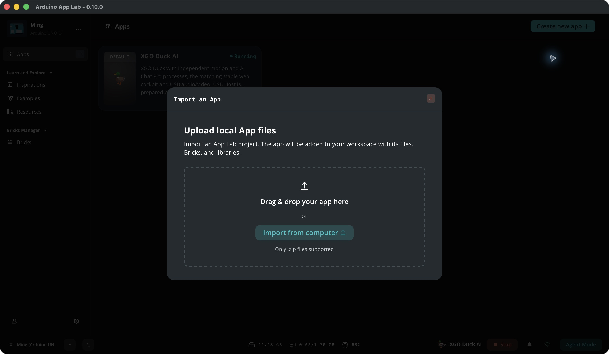
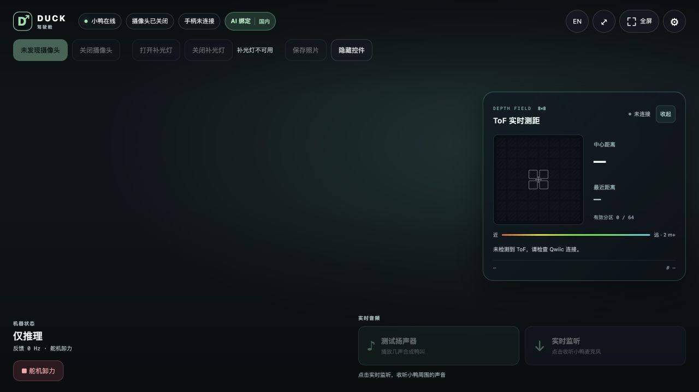
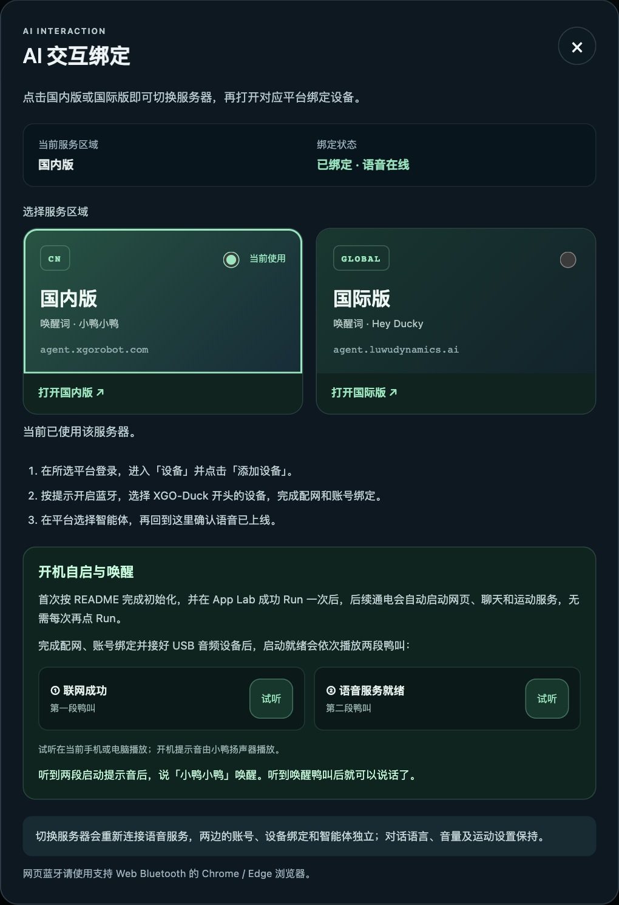

# XGO Duck AI

[English](README.md) · 简体中文

在 Arduino UNO Q 上运行小鸭的语音聊天、运动控制、USB 音视频和 ToF 测距。日常操作使用浏览器，不需要给小鸭连接屏幕。

先准备 Arduino UNO Q（官方 Debian 13）、扩展板、USB 数据线、电池和舵机。聊天需要 USB 麦克风和扬声器，摄像头和板载 Qwiic 接口上的 VL53L5CX ToF 可按需安装。

下面按官方开发者指南的七步顺序配置，使用本仓库的 XGO Duck AI 安装包和启动命令。

## XGO Duck 和 XGO Duck AI 怎么选

只需要网页遥控、舵机设置和标定，可以选 **XGO Duck（master）**。想让小鸭语音聊天、查看 USB 摄像头或使用 ToF 测距，选 **XGO Duck AI（本分支）**。 [查看 master 说明](https://github.com/LuwuDynamics/xgoduck_runtime_arduino/blob/master/README.md)

| 功能 | XGO Duck（master） | XGO Duck AI（本分支） |
| --- | --- | --- |
| 运动控制 | 网页遥控、舵机设置、标定和行走等动作 | 同样提供网页运动控制、舵机设置和标定 |
| 语音聊天 | — | 绑定账号、选择智能体后，用「小鸭小鸭」唤醒聊天 |
| 音视频与测距 | — | USB 摄像头预览、拍照、麦克风监听、扬声器测试，以及可选 ToF 测距和前向避障 |
| 网页入口 | `http://<板子IP>:9527/` 打开运动控制 | `http://<板子IP>/` 打开驾驶舱和 AI 绑定，`:9527` 打开运动控制 |

两个版本都使用 2 Mbps Bridge。AI 版请下载第 3 步的 `xgoduck_ai.zip`，按第 4 步准备 USB Host、驾驶舱入口和开机自启。

## 1. 设置并连接 Wi-Fi

用 USB 数据线把 UNO Q 连到电脑，在 Arduino App Lab 完成首次设置。选择键盘布局、设置设备名、连接 Wi-Fi 并设置板端 Linux 登录密码。等待检查和更新完成，断开 USB 后按指南接好扩展板，再重开 App Lab 并连接开发板。 [官方图文步骤](https://www.xgorobot.com/duck-developer-guide/index.html)

## 2. 测试 LED，记录板子 IP

1. 在 App Lab 打开 **Inspirations → Color your LEDs**，点 **Run**。
2. 从底部状态栏打开示例网页，切换 LED 的开关和颜色，观察板上的对应 LED 是否响应。
3. 测试结束后点 **Stop**。打开右下角 Wi-Fi 图标里的 **Network Info**，记录自己的板子 IP。后续电脑与板子使用同一网络。 [官方图文步骤](https://www.xgorobot.com/duck-developer-guide/02-led-ip.html)

拿到 IP 后，可把下面这段交给有终端权限的 AI，检查后续安装需要的 SSH 连接。

```text
板子 IP 是 [填写]。请从我的电脑验证能否通过 Wi-Fi SSH 登录 arduino 用户。
登录后检查 Debian 版本、CPU 架构、可用空间和 Arduino App CLI 是否可用。
密码由我在终端提示中输入。
```

## 3. 导入 XGO Duck AI App

> **想让 AI 代装？** 现在就跳到[第 3～4 步的 AI 代装提示词](#ai-assisted-install)。AI 可以从下载 ZIP 开始，协助导入、配置和启动。

### 手动导入

1. 下载并保留 [XGO Duck AI 安装包 xgoduck_ai.zip](https://github.com/LuwuDynamics/xgoduck_runtime_arduino/raw/ai-chat-audio-video-tof/packages/xgoduck_ai.zip)。AI 版请使用此专用 ZIP，可用[配套 SHA-256 文件](https://github.com/LuwuDynamics/xgoduck_runtime_arduino/raw/ai-chat-audio-video-tof/packages/xgoduck_ai.zip.sha256)核对。
2. 在 App Lab 点 **Apps 旁的 ＋ → Import App → Import from computer**，选择下载的 ZIP。
3. 导入后点击 **XGO Duck AI** 卡片，保持应用停止，进入第 4 步。AI 版的初始化脚本会准备开发板库和 Bridge，配置完成后再点 **Run**。 [官网导入界面图解](https://www.xgorobot.com/duck-developer-guide/03-import-app.html)



## 4. 终端配置与启动

1. 先确认 Wi-Fi SSH 能连上。旧机更新时请扶稳并卸力，停止旧 App，备份 App 目录和 `data/`。准备共享 Router 前停止所有正在运行的 App。
2. 通过 Wi-Fi SSH 登录 UNO Q。用 `arduino-app-cli app list` 查看实际 App 目录。下面以 `~/ArduinoApps/xgoduck_ai` 为例。

   ```sh
   cd ~/ArduinoApps/xgoduck_ai
   bash tools/install-ai-support.sh
   sudo bash tools/router-2m.sh
   ```

3. 第一个脚本安装主机依赖、准备 USB Host、驾驶舱和开机自启，并预编译 MCU。第二个脚本把共享 Router 的 Bridge 串口设置为 **2 Mbps**。切换 USB Host 会断开电脑的 USB/ADB 连接。
4. 保持联网，在 App Lab 通过 **Network** 连接板子，打开 **XGO Duck AI → Run**。首次运行可能编译并上传 STM32 程序，需要等待依赖准备完成。后续通电会自动启动。 [AI 版详细安装与升级说明](docs/ai-chat.md)

<a name="ai-assisted-install"></a>

### 让 AI 代装第 3～4 步

复制下面的提示词，在自己的 AI 会话里填入 **板子 IP、SSH 用户名和密码**。能执行终端命令的 AI 就可以通过 Wi-Fi SSH 直接登录板子。已经导入的 App 可以从实际安装目录继续。

```text
请在我的 Arduino UNO Q 上完成 XGO Duck AI 的导入和启动。
板子 IP：[填写]。SSH 用户名：[填写，通常是 arduino]。SSH 密码：[填写板子的 Linux 登录密码]。
安装方式：[首次安装 / 更新]。服务区域：[国内 cn / 国际 global]。
用上面的凭据通过 Wi-Fi SSH 直接登录板子。不要把密码写进文件、命令历史或日志。
先核对系统、空间、App 列表和实际目录。App CLI 命令以 arduino 用户运行。
如未导入，下载下面的专用 ZIP，用同地址加 .sha256 的文件校验：
https://github.com/LuwuDynamics/xgoduck_runtime_arduino/raw/ai-chat-audio-video-tof/packages/xgoduck_ai.zip
板子下载失败时可在电脑下载并校验，再用 SCP 传过去。检查 arduino-app-cli app import --help，
支持时以 arduino 导入 ZIP，否则引导我在 App Lab 导入。复用已核对的安装。
更新时先请我扶稳小鸭并确认卸力，再停止旧 App，备份 App 目录和 data/，按 docs/ai-chat.md 迁移。
先确认其他正在运行的 App 可以停止，保持 Wi-Fi SSH，再停止所有 App。
按 sketch/sketch.yaml、provenance/toolchain.json、python/requirements.txt 准备依赖。
实机版本参考为 Router 0.10.0、App CLI 0.13.0、Python 基础镜像 0.12.0，复用兼容版本。
国内下载 Python 依赖时，可在 App 目录运行以下命令。已有自定义源先保留：
python3 tools/configure-ai-python.py --index-url https://pypi.tuna.tsinghua.edu.cn/simple/
进入实际 App 目录，依次运行 bash tools/install-ai-support.sh 和 sudo bash tools/router-2m.sh。
核对 Router 的 ExecStart 使用 2000000，确认默认 App 后，用 arduino-app-cli app start "$PWD" 启动。
首次启动可能上传 STM32。检查驾驶舱、9527 的 /api/status 和 /api/voice/status。
如果已接 ToF，连续请求 9527 的 /api/tof/status，确认 state=ranging、fresh=true、
seq 递增且 valid_zones > 0。HTTP 200 只代表接口可访问。如果状态异常，用容器内
的 python /app/tools/read-tof.py --seconds 4 对照读数，区分后台、Bridge 和传感器问题。
没有安装 ToF 时记为未安装。如果还不确定是否接了 ToF，记为待确认。
如果舵机尚未接线，记录反馈待验证。启动失败先查看日志。汇报安装目录、组件版本和实际结果。
```

## 5. 设置舵机并编号

1. 从 App Lab 的 Python 日志打开 **Network URL**，或访问 `http://<板子IP>:9527/`，进入 **Servo setup**。
2. 每次只接一个舵机。扫描并选中后，点 **Reset Mid** 设置中位，用 **Set KpKd** 写入 KP = 5、KD = 10，再开启电压／过流保护并设置 **1.5 A** 保护电流。
3. 最后按安装位置修改 ID。编号为 **10–14、20–24、30–34**。看到 **verified** 后贴标签，关闭舵机供电，再换下一个。已编号的整机可直接核对编号和参数。 [官方舵机设置步骤](https://www.xgorobot.com/duck-developer-guide/05-servo-setup.html)

## 6. 组装 XGO Duck

按图核对 15 个舵机的标签和安装朝向，再装底座、腿、脚掌、头颈、电池支架和电路板。连接线缆后固定零件，合壳前检查走线、左右方向和螺丝规格。 [官方装配步骤](https://www.xgorobot.com/duck-developer-guide/06-assembly.html) · [下载中英装配 PPTX（约 69 MB）](https://github.com/LuwuDynamics/xgoduck_runtime_arduino/raw/ai-chat-audio-video-tof/assembly/xgo-duck-assembly-zh-en-20261016.pptx)

需要 AI 协助核对时，可附上装配 PPT 和实物照片，并复制下面这段。

```text
请用这份装配图解帮我核对舵机编号、左右方向、走线和螺丝规格：
https://github.com/LuwuDynamics/xgoduck_runtime_arduino/raw/ai-chat-audio-video-tof/assembly/xgo-duck-assembly-zh-en-20261016.pptx
第 1 页是舵机 ID，第 3–15 页是底座、腿和脚掌，第 16–25 页是上部组件及电路板。
按页码告诉我该看哪张图，并请我对照实物确认不清楚的地方。
```

## 7. 标定、站立与试走

1. 接好整机并打开 `http://<板子IP>:9527/`。确认 15 个舵机 ID 都有反馈，再进入 **Calibration**。
2. 舵机零位任选一种方式：用标定架固定小鸭，或对照正视图和侧视图手动标定。逐个关节摆到机械中点，再点对应的 **Set center & hold**。全部完成后退出标定页，使用了标定架就先取下小鸭。
3. 首次调试时，在水平面完成重力方向和陀螺仪零偏标定，并核对 KP/KD。需要 AI 协助时用文末的排查提示词。 [IMU 标定说明](docs/imu-calibration.md)
4. 在平整地面扶稳小鸭，先试 **Default Pose**，确认能站稳，再选择 **Walk / get up** 短距离直走。建议从 **0.10 m/s** 开始，试走线速度不超过 **0.15 m/s**。遇到抖动、走偏或失稳就停止。 [官方标定与行走图解](https://www.xgorobot.com/duck-developer-guide/07-calibration-control.html)

## 8. 绑定账号，选择智能体

1. 电脑或手机与小鸭连接同一网络，打开 **`http://<板子IP>/`**，无需端口和页面后缀。

   

2. 点击顶部 **AI 绑定**，点击 **国内版** 或 **国际版**即可保存选区并重连语音。窗口会显示当前服务区域和绑定状态，再打开对应的平台：

   | 设备选区 | 绑定与管理平台 |
   | --- | --- |
   | `cn` 国内版 | [agent.xgorobot.com/devices](https://agent.xgorobot.com/devices) |
   | `global` 国际版 | [agent.luwudynamics.ai](https://agent.luwudynamics.ai/) |

3. 登录平台，在「设备」中点击「添加设备」。按提示开启蓝牙，选择 `XGO-Duck` 开头的设备，完成配网和账号绑定，再选择要使用的智能体。
4. 回到驾驶舱打开 AI 绑定，可查看设备服务器、绑定及语音连接状态；显示语音在线后，说 **「小鸭小鸭」** 开始聊天。



网页蓝牙需使用支持 Web Bluetooth 的 Chrome / Edge。iPhone / iPad 可用对应的小程序或 App 完成添加：

| 国内微信小程序 | 国际版 App |
| --- | --- |
|  |  |
| 用微信扫码 | [打开 App 下载页](https://agent.luwudynamics.ai/download) |

国内、国际账号和设备绑定相互独立。切换服务器会保存选区并重连语音，保持对话语言、音量和运动设置；首次切到另一侧需要在那里单独绑定。只是点击平台链接不会切换服务器。设备已绑定其他账号时，应先在原账号中解绑。

如果绑定后语音没上线，可以复制这段提示词让 AI 协助排查。

```text
板子 IP：[填写]，我选择的服务区域：[国内 cn / 国际 global]。
请读取驾驶舱的绑定状态和 9527 的 /api/voice/status，检查服务区域和语音连接。
告诉我卡在配网、绑定还是语音连接，并引导我在相应平台完成下一步。
账号登录、蓝牙授权、绑定和换区由我操作。
```

### 开机提示音

后续通电会自动准备 USB Host，启动网页、聊天和运动服务，**无需每次打开 App Lab 或点击 Run**。完成配网、账号绑定并接好 USB 音频设备后，会依次听到两段启动鸭叫：

| 顺序 | 含义 | 示例音效 |
| --- | --- | --- |
| ① | 联网成功 | [试听第一段鸭叫](assets/startup-network.wav?raw=true) |
| ② | 语音服务已连接，聊天就绪 | [试听第二段鸭叫](assets/startup-voice.wav?raw=true) |

听到两段提示音后，喊 **「小鸭小鸭」** 唤醒，听到唤醒鸭叫后就可以说话。驾驶舱 **AI 绑定 → 开机自启与唤醒** 也可试听；示例在当前手机/电脑播放，实际启动音由小鸭扬声器播放。

## 日常使用

- **界面语言：**每次打开或刷新时跟随访问设备的浏览器系统语言，中文显示中文，其余显示英文；顶部切换按钮仅临时生效。
- **音频测试：**首页「实时音频」中，左侧「测试扬声器」播放约 3 秒合成鸭叫，播放时可点击停止；右侧「实时监听」收听小鸭麦克风。
- **聊天：**说「小鸭小鸭」唤醒；在平台中管理智能体。音量在驾驶舱「设置 → 扬声器」调整。
- **音视频：**驾驶舱可开启/关闭摄像头、控制补光灯、保存照片和实时监听麦克风。
- **ToF：**接入后显示 8×8 实时距离。默认前向避障在 15 cm 内减速、10 cm 停止；数据缺失或过期会暂停前进。不接 ToF 仍可聊天，关闭避障的方法见[避障说明](docs/forward-avoidance.md)。

## 更新和排查

- 更新前先扶稳小鸭并卸力；**Run 可能重新编译和刷写 STM32**。
- 同一只鸭子更新时保留原 App 的 `data/`，里面有绑定身份、音量、校准和手柄设置。不要复制另一只鸭子的身份或校准文件。App 目录改变或硬件支持脚本更新时，按首次初始化步骤重新准备。
- 首次 Run 报下载错误，先检查板子的互联网连接；没有声音，先在驾驶舱设置中测试扬声器和麦克风。
- 详细安装、迁移和工具链问题见[安装说明](docs/ai-chat.md)，装配与校准见[硬件指南](https://github.com/LuwuDynamics/xgoduck_hardware/blob/master/README_CN.md)。

需要自行打包时，在电脑上的仓库目录执行 `python3 tools/package-ai-app.py`，生成的 `dist/xgoduck_ai.zip` 可按相同步骤导入 App Lab。

## 走不稳时，把这段提示词交给 AI

适用于站立抖动、试走走偏或失稳。请先停下小鸭，在旁支撑并观察。AI 可以读状态和日志，你来确认姿态、调整关节和试走。

```text
我的 XGO Duck 走不稳。板子 IP：[填写]，现象：[站不稳 / 抖动 / 走偏 / 其他]。
先读 9527 的 /api/status 和相关日志，检查 Bridge 是否持续收到反馈、15 个舵机是否在线、
是否有保护或 ToF 限速，并告诉我看到的证据。只读排查期间由我操作实体鸭子。

1. 舵机机械中点：确认标定架或手动标定已完成。对照官方标定图检查关节是否装反或偏离中位。
   https://www.xgorobot.com/duck-developer-guide/07-calibration-control.html
   如需重标，由我逐个摆关节并在 Calibration 点击 Set center & hold。
2. 重力方向：按 docs/imu-calibration.md，让我把小鸭置于水平面，在 Default Pose 下保持端正静止约 30 秒。
   使用实际 App 环境运行 tools/calibrate-imu.py。先核对本机 data/imu-calibration.json，
   已有有效标定就复用，重标前备份旧文件。
3. 陀螺仪零偏：同一次静止采样会同时计算零偏。请我支撑小鸭后再重启运动进程加载标定。
   核对静止时 gravity 接近 [0, 0, -1]，修正后的角速度接近 0。
4. KP/KD：卸力后在 Servo setup 逐个读回 15 个舵机。以 KP=5、KD=10 为基准，
   有差异时先给我列出 ID 和原值。经我确认后再写入并读回验证。

我确认可以试走后，先检查 Default Pose 和原地站稳，再在平地从 0.10 m/s 短距离直走，
试走线速度不超过 0.15 m/s。仍有抖动、走偏或失稳就停下，汇报观察结果和下一项具体检查。
```

本项目基于 Pollen Robotics 的 [Microduck](https://github.com/pollen-robotics/microduck)。[硬件](https://github.com/LuwuDynamics/xgoduck_hardware) · [训练代码](https://github.com/LuwuDynamics/xgoduck_rl)
