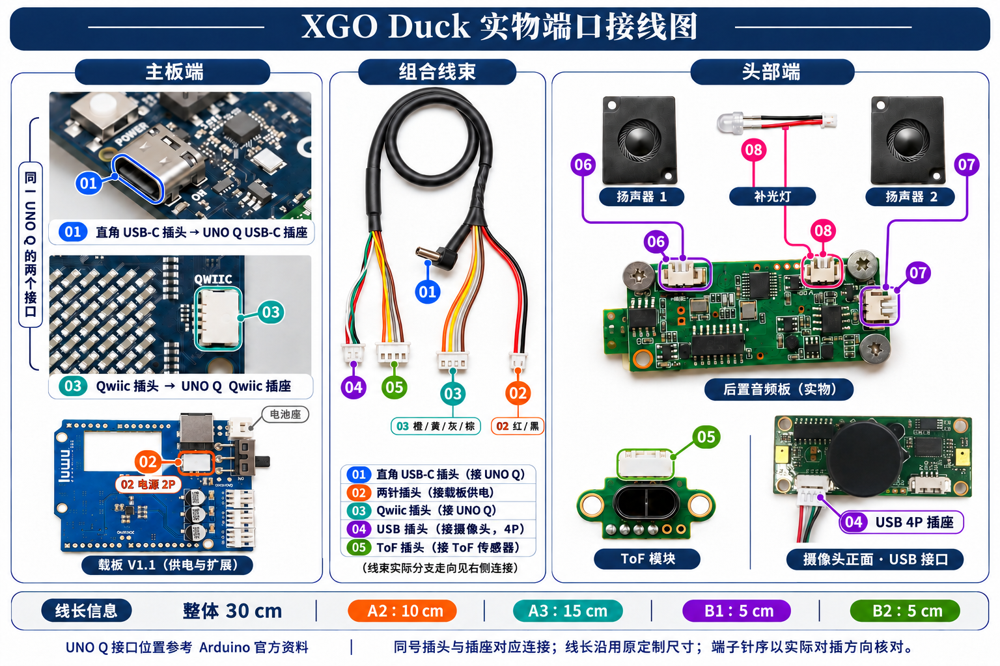
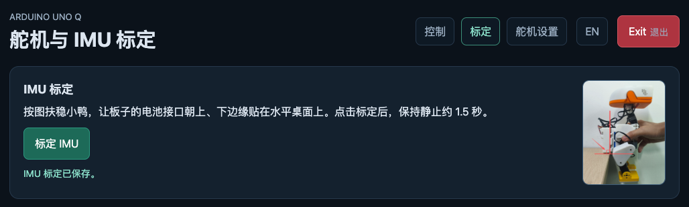
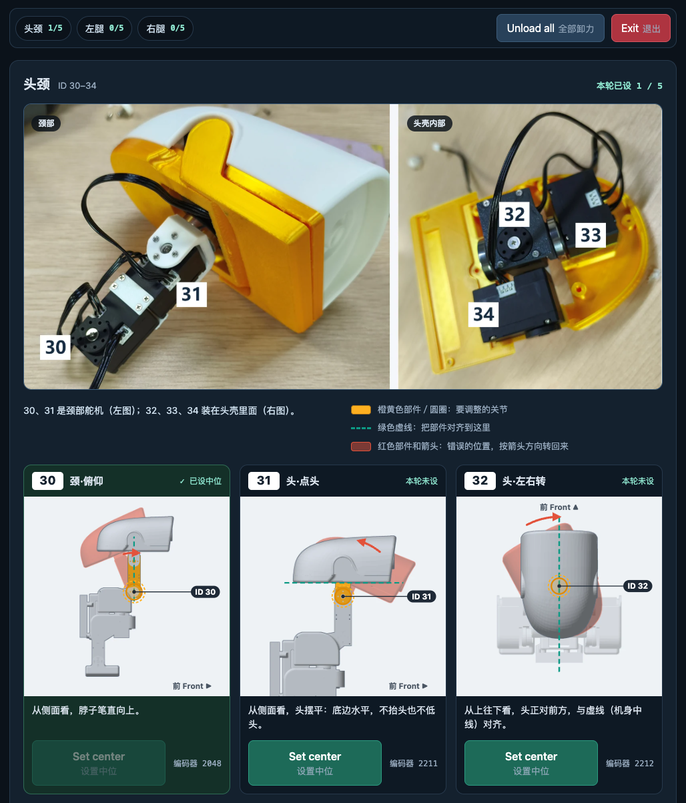
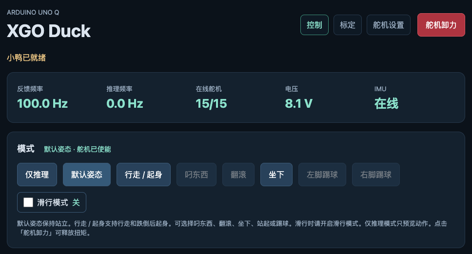
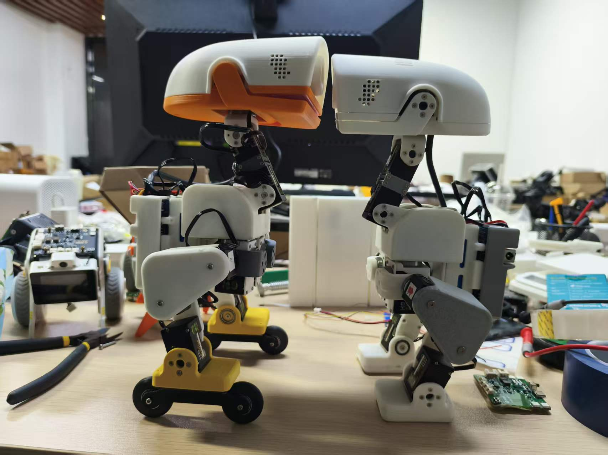
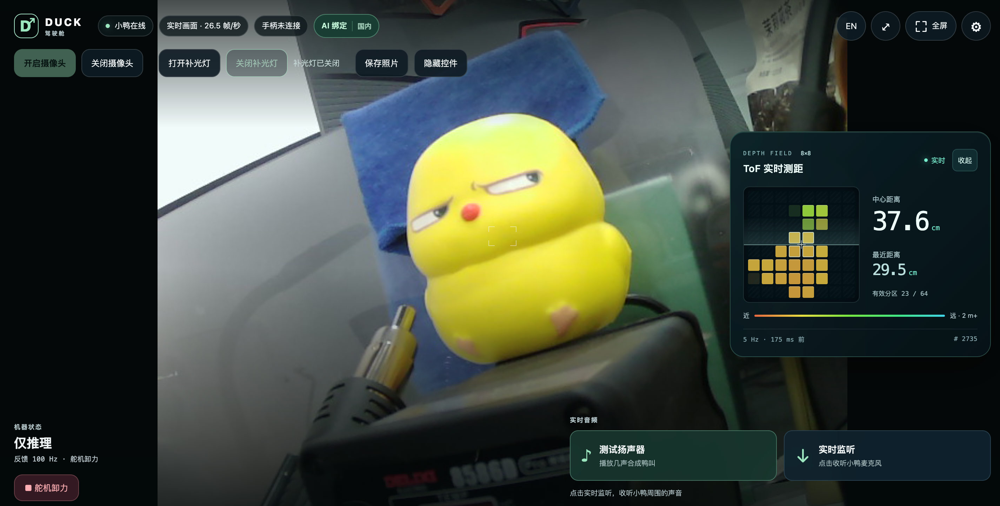

# XGO Duck AI

[English](README.md) · 简体中文

在 Arduino UNO Q 上运行小鸭的语音聊天、运动控制、USB 音视频和 ToF 测距。日常操作使用浏览器，不需要给小鸭连接屏幕。

先准备 Arduino UNO Q（官方 Debian 13）、扩展板、USB 数据线、电池和舵机。聊天需要 USB 麦克风和扬声器，摄像头和板载 Qwiic 接口上的 VL53L5CX ToF 可按需安装。

下面按官方开发者指南的七步顺序配置，使用本仓库的 XGO Duck AI 安装包和启动命令。

## XGO Duck 和 XGO Duck AI 怎么选

只需要网页遥控、舵机设置和标定，可以选 **XGO Duck（master）**。想让小鸭语音聊天、查看 USB 摄像头或使用 ToF 测距，选 **XGO Duck AI（本分支）**。 [查看 master 说明](https://github.com/LuwuDynamics/xgoduck_runtime_arduino/blob/master/README.md)

| 功能 | XGO Duck（master） | XGO Duck AI（本分支） |
| --- | --- | --- |
| 运动控制 | 网页遥控、舵机设置、标定和行走等动作 | 同样提供网页运动控制、舵机设置和标定 |
| 语音聊天 | — | 绑定账号并选择智能体后，国内版说「小鸭小鸭」，国际版说「Hey Ducky」。 |
| 音视频与测距 | — | USB 摄像头预览、拍照、麦克风监听、扬声器测试，以及可选 ToF 测距和前向避障 |
| 网页入口 | `http://<板子IP>:9527/` 打开运动控制 | `http://<板子IP>/` 打开驾驶舱和 AI 绑定，`:9527` 打开运动控制 |

两个版本都使用 2 Mbps Bridge。AI 版请下载第 3 步的 `xgoduck_ai.zip`，按第 4 步准备 USB Host、驾驶舱入口和开机自启。

## 1. 设置并连接 Wi-Fi

用 USB 数据线把 UNO Q 连到电脑，在 Arduino App Lab 完成首次设置。选择键盘布局、设置设备名、连接 Wi-Fi 并设置板端 Linux 登录密码。等待检查和更新完成，断开 USB 后按指南接好扩展板，再重开 App Lab 并连接开发板。 [官方图文步骤](https://www.xgorobot.com/duck-developer-guide/index.html)

## 2. 测试 LED，记录板子 IP

1. 在 App Lab 打开 **Inspirations → Color your LEDs**，点 **Run**。
2. 从底部状态栏打开示例网页，切换 LED 的开关和颜色，观察板上的对应 LED 是否响应。
3. 测试结束后点 **Stop**。打开右下角 Wi-Fi 图标里的 **Network Info**，记录自己的板子 IP。后续电脑与板子使用同一网络。 [官方图文步骤](https://www.xgorobot.com/duck-developer-guide/02-led-ip.html)

拿到 IP 后，可把下面这段交给有终端权限的 AI，检查后续安装需要的 SSH 连接。

```text
板子 IP 是 [填写]。请从我的电脑验证能否通过 Wi-Fi SSH 登录 arduino 用户。
登录后检查 Debian 版本、CPU 架构、可用空间和 Arduino App CLI 是否可用。
密码由我在终端提示中输入。
```

## 3. 导入 XGO Duck AI App

> **想让 AI 代装？** 现在就跳到[第 3～4 步的 AI 代装提示词](#ai-assisted-install)。AI 可以从下载 ZIP 开始，协助导入、配置和启动。

### 手动导入

1. 下载并保留 [XGO Duck AI 安装包 xgoduck_ai.zip](https://github.com/LuwuDynamics/xgoduck_runtime_arduino/raw/ai-chat-audio-video-tof/packages/xgoduck_ai.zip)。AI 版请使用此专用 ZIP，可用[配套 SHA-256 文件](https://github.com/LuwuDynamics/xgoduck_runtime_arduino/raw/ai-chat-audio-video-tof/packages/xgoduck_ai.zip.sha256)核对。
2. 在 App Lab 点 **Apps 旁的 ＋ → Import App → Import from computer**，选择下载的 ZIP。
3. 导入后点击 **XGO Duck AI** 卡片，保持应用停止，进入第 4 步。AI 版的初始化脚本会准备开发板库和 Bridge，配置完成后再点 **Run**。 [官网导入界面图解](https://www.xgorobot.com/duck-developer-guide/03-import-app.html)


## 4. 终端配置与启动

1. 先确认 Wi-Fi SSH 能连上。旧机更新时请扶稳并卸力，停止旧 App，备份 App 目录和 `data/`。准备共享 Router 前停止所有正在运行的 App。
2. 通过 Wi-Fi SSH 登录 UNO Q。用 `arduino-app-cli app list` 查看实际 App 目录。下面以 `~/ArduinoApps/xgoduck_ai` 为例。

   ```sh
   cd ~/ArduinoApps/xgoduck_ai
   bash tools/install-ai-support.sh
   sudo bash tools/router-2m.sh
   ```

3. 第一个脚本安装主机依赖、准备 USB Host、驾驶舱和开机自启，并预编译 MCU。第二个脚本把共享 Router 的 Bridge 串口设置为 **2 Mbps**。切换 USB Host 会断开电脑的 USB/ADB 连接。
4. 保持联网，在 App Lab 通过 **Network** 连接板子，打开 **XGO Duck AI → Run**。首次运行可能编译并上传 STM32 程序，需要等待依赖准备完成。后续通电会自动启动。 [AI 版详细安装与升级说明](docs/ai-chat.md)

<a name="ai-assisted-install"></a>

### 让 AI 代装第 3～4 步

这份提示词已在 Codex 和 DeepSeek Harness 中测试通过，均顺利完成 App 安装。预计用时 30 分钟到 1 小时，具体取决于下载速度。

复制下面的提示词，在自己的 AI 会话里填入 **板子 IP、SSH 用户名和密码**。能执行终端命令的 AI 就可以通过 Wi-Fi SSH 直接登录板子。已经导入的 App 可以从实际安装目录继续。

```text
请在我的 Arduino UNO Q 上完成 XGO Duck AI 的导入和启动。
板子 IP：[填写]。SSH 用户名：[填写，通常是 arduino]。SSH 密码：[填写板子的 Linux 登录密码]。
安装方式：[首次安装 / 更新]。服务区域：[国内 cn / 国际 global]。
用上面的凭据通过 Wi-Fi SSH 直接登录板子。不要把密码写进文件、命令历史或日志。
先核对系统、空间、App 列表和实际目录。App CLI 命令以 arduino 用户运行。
如未导入，下载下面的专用 ZIP，用同地址加 .sha256 的文件校验：
https://github.com/LuwuDynamics/xgoduck_runtime_arduino/raw/ai-chat-audio-video-tof/packages/xgoduck_ai.zip
板子下载失败时可在电脑下载并校验，再用 SCP 传过去。检查 arduino-app-cli app import --help，
支持时以 arduino 导入 ZIP，否则引导我在 App Lab 导入。复用已核对的安装。
更新时先请我扶稳小鸭并确认卸力，再停止旧 App，备份 App 目录和 data/，按 docs/ai-chat.md 迁移。
先确认其他正在运行的 App 可以停止，保持 Wi-Fi SSH，再停止所有 App。
按 sketch/sketch.yaml、provenance/toolchain.json、python/requirements.txt 准备依赖。
实机版本参考为 Router 0.11.0、App CLI 0.13.0、Python 基础镜像 0.12.0，复用兼容版本。
首次启动前，以 arduino 用户执行 arduino-cli core list，检查板上已安装的 arduino:zephyr。
如果缺失或与 sketch/sketch.yaml 不一致，先执行 arduino-cli core install arduino:zephyr@1.0.0
并复查版本。Sketch 编译成功后，上传仍可能读到旧板级 core 的参数，所以这项检查要在启动前完成。
核对 ARM64 工具链为 provenance/toolchain.json 指定的 1.0.1。
若板上下载工具链失败，在电脑按该文件的 url 下载官方 Linux ARM64 压缩包，
校验大小和 SHA-256 后用 SCP 传到板上。进入 App 目录，以 arduino 用户运行
python3 tools/prepare-ai-sketch.py --toolchain-archive <板上压缩包路径>，让脚本校验并填入下载缓存。
若下载板级 core 或拉取 Docker 基础镜像失败，检查报错和网络，必要时通过 Wi-Fi SSH
临时转发电脑已有的代理，只给失败的下载使用。安装完后撤销转发及临时代理配置。
国内下载 Python 依赖时，可在 App 目录运行以下命令。已有自定义源先保留：
python3 tools/configure-ai-python.py --index-url https://pypi.tuna.tsinghua.edu.cn/simple/
进入实际 App 目录，依次运行 bash tools/install-ai-support.sh 和 sudo bash tools/router-2m.sh。
核对 Router 的 ExecStart 使用 2000000，确认默认 App 后，用 arduino-app-cli app start "$PWD" 启动。
首次启动可能上传 STM32。检查驾驶舱、9527 的 /api/status 和 /api/voice/status。
如果已接 ToF，连续请求 9527 的 /api/tof/status，确认 state=ranging、fresh=true、
seq 递增且 valid_zones > 0。HTTP 200 只代表接口可访问。如果状态异常，用容器内
的 python /app/tools/read-tof.py --seconds 4 对照读数，区分后台、Bridge 和传感器问题。
没有安装 ToF 时记为未安装。如果还不确定是否接了 ToF，记为待确认。
如果舵机尚未接线，记录反馈待验证。启动失败先查看日志。汇报安装目录、组件版本和实际结果。
App 安装并启动成功后，提醒我回到本 README，按顺序完成第 5 步设置舵机并编号、
第 6 步组装 XGO Duck、第 7 步标定 IMU 和舵机并检查默认姿态、第 8 步绑定账号并选择智能体。
如果我已经完成了其中几步，指出下一项尚未完成的步骤。
```

## 5. 设置舵机并编号

[按官方图文完成舵机设置与编号](https://www.xgorobot.com/duck-developer-guide/05-servo-setup.html)

## 6. 组装 XGO Duck

[按官方图文组装 XGO Duck](https://www.xgorobot.com/duck-developer-guide/06-assembly.html)

[音视频安装教程（PDF）](docs/xgo-duck-av-installation.pdf) · [下载中英装配 PPTX（约 69 MB）](https://github.com/LuwuDynamics/xgoduck_runtime_arduino/raw/ai-chat-audio-video-tof/assembly/xgo-duck-assembly-zh-en-20261016.pptx)



## 7. IMU 标定和舵机标定

打开 `http://<板子IP>:9527/`，确认在线舵机为 **15/15**。用桌面或标定架支撑小鸭，点击顶部 **标定**。进入页面时舵机会卸力。

### 先标定 IMU

1. 在页面顶部看 **IMU 标定** 的姿势图。扶稳小鸭，让 UNO Q 竖直、电池接口朝上、板子下边缘贴在水平桌面上。若已经开始标定舵机，先点 **全部卸力（Unload all）**。
2. 点 **标定 IMU**，保持静止约 **1.5 秒**，等到 **IMU 标定已保存**。加速度偏移和陀螺仪零偏会一并保存，重启后自动加载。 [IMU 标定细节](docs/imu-calibration.md)



如果页面顶部没有 IMU 卡片，可在 **控制** 页底部完成 IMU 标定，舵机摆位可对照官方图解。 [官方标定图解](https://www.xgorobot.com/duck-developer-guide/07-calibration-control.html)

### 逐个设定舵机中位

1. 页面下方按 **头颈（30–34）**、**左腿（10–14）**、**右腿（20–24）** 分区。左右以小鸭自身为准。先看实物照片里的白色 ID 牌，找到要调的关节。
2. 按对应 ID 的零位参考图用手摆好关节，绿色虚线是对齐基准。点 **设置中位（Set center）**，等该项显示 **已设中位**，再标定下一个。照片和参考图都可以点击放大。
3. 确认本轮已设 **15/15** 后，点 **全部卸力（Unload all）**，再点 **退出（Exit）**。使用标定架时，在卸力后取下小鸭。已保存的中位会留在舵机里。 [关节图示与按钮说明](docs/calibration-guide.md)



### 回到控制页检查默认姿态

两项标定都完成后，把小鸭放在平整表面并扶稳。回到 **控制** 页，在 **模式** 区点击 **默认姿态（Default pose）**。等舵机上力并站稳，再对照下面的实物照片检查头颈、腿和脚的位置。



轮脚和普通脚小鸭的默认站姿参考。



## 8. 绑定账号，选择智能体

1. 电脑或手机与小鸭连接同一网络，打开 **`http://<板子IP>/`**，无需端口和页面后缀。

   

2. 点击顶部 **AI 绑定**，点击 **国内版** 或 **国际版**即可保存选区并重连语音。窗口会显示当前服务区域和绑定状态，再打开对应的平台：

   | 设备选区 | 唤醒词 | 绑定与管理平台 |
   | --- | --- | --- |
   | `cn` 国内版 | **小鸭小鸭** | [agent.xgorobot.com/devices](https://agent.xgorobot.com/devices) |
   | `global` 国际版 | **Hey Ducky** | [agent.luwudynamics.ai](https://agent.luwudynamics.ai/) |

3. 登录平台，在「设备」中点击「添加设备」。按提示开启蓝牙，选择 `XGO-Duck` 开头的设备，完成配网和账号绑定，再选择要使用的智能体。
4. 回到驾驶舱打开 **AI 绑定**，确认语音在线后，说页面上当前选区对应的唤醒词。


网页蓝牙需使用支持 Web Bluetooth 的 Chrome / Edge。iPhone / iPad 可用对应的小程序或 App 完成添加：

| 国内微信小程序 | 国际版 App |
| --- | --- |
|  |  |
| 用微信扫码 | [打开 App 下载页](https://agent.luwudynamics.ai/download) |

国内、国际账号和设备绑定相互独立。切换服务器会保存选区并重连语音，保持对话语言、音量和运动设置；首次切到另一侧需要在那里单独绑定。只是点击平台链接不会切换服务器。设备已绑定其他账号时，应先在原账号中解绑。

如果绑定后语音没上线，可以复制这段提示词让 AI 协助排查。

```text
板子 IP：[填写]，我选择的服务区域：[国内 cn / 国际 global]。
请读取驾驶舱的绑定状态和 9527 的 /api/voice/status，检查服务区域和语音连接。
告诉我卡在配网、绑定还是语音连接，并引导我在相应平台完成下一步。
账号登录、蓝牙授权、绑定和换区由我操作。
```

### 开机提示音

后续通电会自动准备 USB Host，启动网页、聊天和运动服务，**无需每次打开 App Lab 或点击 Run**。完成配网、账号绑定并接好 USB 音频设备后，会依次听到两段启动鸭叫：

| 顺序 | 含义 | 示例音效 |
| --- | --- | --- |
| ① | 联网成功 | [试听第一段鸭叫](assets/startup-network.wav?raw=true) |
| ② | 语音服务已连接，聊天就绪 | [试听第二段鸭叫](assets/startup-voice.wav?raw=true) |

如果还未绑定，联网鸭叫之后会连续三遍播报「请打开小鸭驾驶舱，完成设备绑定」。

听到语音服务就绪的鸭叫后，说 **AI 绑定 → 开机自启与唤醒** 中显示的唤醒词。听到唤醒鸭叫后就可以说话。启动音示例可在当前手机或电脑上试听，实际启动音由小鸭扬声器播放。

## 日常使用

- **界面语言：**每次打开或刷新时跟随访问设备的浏览器系统语言，中文显示中文，其余显示英文；顶部切换按钮仅临时生效。
- **音频测试：**首页「实时音频」中，左侧「测试扬声器」播放约 3 秒合成鸭叫，播放时可点击停止；右侧「实时监听」收听小鸭麦克风。
- 驾驶舱的「更多动作」可转头、回中、张嘴、闭嘴或切换到默认姿态。「鸭叫」可通过小鸭的扬声器播放七种叫声。
- 电脑上按住 **W/S** 前进或后退、**A/D** 侧移、**Q/E** 转向。松开按键或按 **空格** 停止移动。
- 国内版说「小鸭小鸭」，国际版说「Hey Ducky」唤醒聊天。在平台中管理智能体，在驾驶舱「设置 → 扬声器」调整音量。
- **音视频：**驾驶舱可开启/关闭摄像头、控制补光灯、保存照片和实时监听麦克风。
- ToF 正常测距时显示 8×8 实时距离，默认在 15 cm 内减速、10 cm 停止。未接 ToF 或 ToF 已离线时，可以重新发出前进指令，此时没有测距避障。传感器仍显示测距中但读数过期或无效时，暂停前进。[避障说明](docs/forward-avoidance.md)

## 常见问题

### 1. 小鸭走不稳或发抖

1. 打开 9527 的 **标定** 页，按[第 7 步](#7-imu-标定和舵机标定)重新标定 IMU 和全部 15 个舵机。新版标定页顶部可以标定 IMU，下方有舵机实物编号和各关节的零位参考图。
2. 扶稳小鸭，打开 **舵机设置**，点 **扫描所有 ID**。逐个选中舵机，将 **KP 设为 5、KD 设为 10**，点 **写入 KP/KD（Set KpKd）**，再点 **读取** 核对。新版页面会分别显示保存值和运行值。

本项目基于 Pollen Robotics 的 [Microduck](https://github.com/pollen-robotics/microduck)。[硬件](https://github.com/LuwuDynamics/xgoduck_hardware) · [训练代码](https://github.com/LuwuDynamics/xgoduck_rl)
