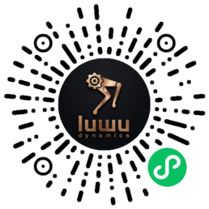

# XGO Duck AI App: installation and headless operation

> You can also tap China/International in the cockpit’s **Link AI** window to save the region and reconnect voice immediately. First-time setup may run before choosing a region; select it in the web page after the first Run. The CLI option below remains supported. Phone provisioning does not change the region automatically.

## AEC playback headroom and interruption stop (0.2.36)

**Live acceptance has not passed:** 12 dB headroom improved the echo-only bench recording, but real cloud replies still reappeared as user speech. The user accepted the hardware-volume audition without digital boost; the current debugging baseline is `output_gain_db: 0` and `aec_output_headroom_db: 0`. The optional headroom control is not a completed AEC fix.


`aec_output_headroom_db` adds optional 0–18 dB attenuation, default 0, only while real AEC and an open, enabled capture stream are active. Playback becomes quieter: an existing +6 dB boost with 12 dB headroom yields -6 dB effective digital gain. AEC-off, idle wake feedback and the original web media keep their original gain. The setting cannot restore clipped microphone samples.

Volume, boost and attenuation are combined before a single saturation step; AEC still receives the exact speaker PCM. One dual-mic bench comparison improved echo-only level reduction from about 3 dB to 26 dB. This is specific to the tested placement and speech sample; simultaneous human speech and live interruption need separate acceptance. Lower hardware capture controls read back correctly but did not remove overload, so no capture-gain change is made the default. Configure on the board, then reconnect chat:

```bash
python3 tools/configure-ai.py --aec-output-headroom-db 12
```

The verified cloud abort packet now flushes decoder/PCM/DAC audio and mouth targets immediately. Normal completion still drains the entire reply. No duplicate abort/listen:start resets the cloud's incoming interruption. Reply generations keep old drain waiters from ending a new reply. Server VAD/ASR, motion, ONNX, MCU and original web pages are unchanged.

For the first upgrade, stop the old App, install and start the new version, then run the headroom command above. Both processes must load the new schema before new fields are saved: an old process can treat an unknown field as invalid and write defaults. Later changes to this value reconnect chat only.

## Local AEC reference continuity (0.2.35)

Local AEC uses the existing WebRTC backend and the Mini Program's automatic-interruption / `self.set_aec` switch. The setting persists and may reconnect chat when changed. Enabled devices continuously upload echo-cancelled capture during playback; the server keeps its existing VAD/ASR and interruption guards. No local VAD is added.

Normal TTS start and the transition back to listening retain render-reference history for delayed microphone samples. Explicit interruption and playback timeout still flush audio/reference and stop mouth animation. `audio_playback` under `/api/voice/status` adds `aec_enabled`, `aec_backend`, `aec_frames` and `aec_reference_resets`. Volume, buffer durations, microphone selection and web pages remain unchanged. This addresses reference timing; physical echo suppression and USB disconnects require separate acceptance.

## Short conversation cues (0.2.34)

The send and reply-complete cues use the local RIG-Omni `message_send.ogg` / `over.ogg` assets. Both last 0.30 seconds, with an additional 6 dB attenuation and 5/8 ms fade-in/out. Compared with the previous WAVs, RMS levels are about 7.8 dB and 11.3 dB lower, respectively. Outputs are 16 kHz mono 16-bit PCM; sources and processing parameters are recorded in `provenance/audio-cues.json`.

Only these two local WAVs are replaced. They retain the existing local playback queue that excludes cues from mouth animation. Files are read on each playback, allowing updates without reflashing the MCU.

Compared with 0.2.34, the send cue has 2× the PCM amplitude (+6.02 dB) and the reply-complete cue has 3× (+9.54 dB). Both retain their 0.30-second duration and fades.

> **Current control layer:** motion is pinned to master [`b401d85`](https://github.com/LuwuDynamics/xgoduck_runtime_arduino/commit/b401d85d20bb5bfd0237242a8a5ab6847fc962a2), including eight policies, matching web/MCU control and Bridge reconnection. Voice actions, mobile/gamepad ownership, speech-mouth exclusion, hardware-center migration and the independent ToF task remain. Ordinary forward/backward limits are 0.2/0.18 m/s. See [validation](ai-validation.md).

The 0.2.33 section below records the previous archive integration. `provenance/motion.json` identifies the current source; its hardware-center migration workflow still applies.

## Matching web and hardware centers (0.2.33)

- All eight stable web files are copied unchanged. Policy/filter math, all five models, `wire.py` and MCU headers also match. Controller retains AI/gamepad source ownership; its other 30 methods have matching AST fingerprints. Only ToF's include/start lines overlay the stable sketch. Sources are recorded in `provenance/motion.json`.
- Update the App and compile/upload its matching MCU sketch together using Run, then hard-refresh the browser. Updating pages or Python alone is incompatible. Ordinary Walk is selected by default; Roller starts off and requires the corresponding roller-equipped hardware.
- Hardware centers live in the servos, with encoder center 2047. Enter Calibration to unload all joints, manually place each at its mechanical center and click **Set center & hold**, then exit. Servo setup includes Reset Mid, KP/KD readback and separate protection-switch/current broadcasts.
- Preserve old `data/zero_pos.json` as a backup; it is no longer applied. Nondefault or damaged software-zero files block Hold / Policy / voice arming until the 15 hardware centers are acknowledged. Only successful MCU replies are recorded in private `data/hardware-centers.json`; partial/failed acknowledgements, stale replies and failed writes cannot complete migration. The old file is never overwritten.
- Already hardware-centered robots whose old zeros are all 2047 retain compatibility. New installs without legacy files follow the archive's original calibration workflow. Do not replace legacy zeros with 2047 to skip migration or run the historical software-zero conversion commands below.
- A web Roller switch retires queued voice/phone actions and returns ownership to the page. Existing voice action deadlines/input renewal, chat and media services are retained; no chat tab is added to the supplied layout.

Version 0.2.33 has been compiled on UNO Q, uploaded to the matching STM32 and started. All eight web files passed HTTP hash verification. Mechanical centering and physical standing/walking remain unverified. USB Hub re-enumeration and a stalled command channel occurred during deployment; successful startup does not establish that either issue is fixed. See the validation record.

## Historical software-zero migration (0.2.31–0.2.32; not for 0.2.33)

Update the Python controller, `wire.py` and STM32 sketch together. Replacing only Python or the models is insufficient. The first Run compiles/uploads the matching MCU sketch. This baseline uses per-robot software zeros in `data/zero_pos.json`.

- Preserve this robot's existing software calibration when already using the baseline workflow.
- When migrating from 0.2.29/0.2.30 after all 15 servos were hardware-centered, stop the App and run `python3 tools/migrate-hardware-centers.py --from-hardware-centers` from the App root. It creates 15 software zeros at 2047 to keep using those hardware centers. It sends no servo commands and refuses to overwrite existing software calibration; verify any existing file before migrating.
- If the previous centering workflow is unknown, recalibrate each joint through the restored Calibration page. Never use another robot's calibration or treat factory defaults as measured zeros.

Support the robot and check Default pose before testing Walk / get up. Source restoration and automated tests do not establish physical walking stability.


[中文说明](ai-chat.md) · [English README](../README.md) · [Validation record](ai-validation.md)

This is an open-source App for a user-owned **Arduino UNO Q**, rather than a preinstalled OS image. Complete installation with a computer once. The board can then start the App automatically and use the phone for Wi-Fi provisioning and account binding. Remote control uses cloud MCP. The matching stable web pages, existing audio/video and Doubao interfaces, calibration, gamepad and servo setup remain available.

## Choose a cloud explicitly

One App supports both services. Select the region **locally on the board**. Phone provisioning, Wi-Fi SSID and language cannot change it. Without a selection, the state is `awaiting_cloud_config` and neither chat cloud is contacted.

| `cloud_region` | Wake word | OTA service | Client |
| --- | --- | --- | --- |
| `cn` | 小鸭小鸭 | `https://xl-api.xgorobot.com/xiaolu/ota/` | Domestic WeChat Mini Program |
| `global` | Hey Ducky | `https://xl-api.luwudynamics.ai/xiaolu/ota/` | International Android / iOS App |

| WeChat Mini Program (`cn`) | International App (`global`) |
| --- | --- |
|  |  |
| Scan with WeChat | [Open the download page](https://agent.luwudynamics.ai/download) |

The images are the existing Luwu-OS AI Chat Pro assets; [source and hashes](../provenance/onboarding-assets.json). The App QR decodes to the linked download page. The Mini Program code requires WeChat. Accounts, bindings and agents belong to their respective services. Conversation language is independent of region. Duck MCP remote control requires a client release containing the `XGO-Duck / Duck.RemoteMove` adapter; these public QR destinations do not imply that local client changes have been published.

## First installation

1. Install [Arduino App Lab](https://www.arduino.cc/en/uno-q). Connect UNO Q to the computer using a USB-C **data** cable. Complete the board name, Wi-Fi and Linux password setup described in the [UNO Q manual](https://docs.arduino.cc/tutorials/uno-q/user-manual/). The board needs internet access for system packages, Arduino libraries, containers and Python dependencies.
2. Check `ssh arduino@<board-ip>` using the Linux password you chose. Also verify App Lab Network access. There is no shared password supplied by this project. Prepare a powered USB-C Host hub for the USB microphone, speaker and optional camera. **Install over Wi-Fi/SSH because USB detection may interrupt the computer's USB/ADB connection.**
3. Get the `ai-chat-audio-video-tof` branch and package it on the computer:

   ```sh
   git clone --branch ai-chat-audio-video-tof https://github.com/LuwuDynamics/xgoduck_runtime_arduino.git
   cd xgoduck_runtime_arduino
   python3 tools/package-ai-app.py
   ```

   Import `dist/xgoduck_ai.zip` as a **new App** named `xgoduck_ai` in App Lab. The examples below assume `/home/arduino/ArduinoApps/xgoduck_ai`; substitute the actual path if the imported directory differs. Alternatively, clone directly on the board over SSH:

   ```sh
   mkdir -p ~/ArduinoApps
   git clone --branch ai-chat-audio-video-tof https://github.com/LuwuDynamics/xgoduck_runtime_arduino.git ~/ArduinoApps/xgoduck_ai
   ```

4. Stop the old Duck App. Two Duck Apps cannot share Bridge, servos or ports 9527/9528. Keep the old installation. With both Apps stopped, preserve this robot's optional `data/gamepad-bindings.json`. Bringing legacy `data/zero_pos.json` requires the hardware-centering migration above. For a robot already migrated with this release, preserve its `data/hardware-centers.json` and corresponding legacy file together. The ZIP excludes private state and calibration and does not migrate them automatically.
5. In the **UNO Q Debian 13 ARM64 host shell**, as `arduino`, choose one region and install host support. These commands do not run in the App container or on the Mac:

   ```sh
   cd ~/ArduinoApps/xgoduck_ai
   python3 tools/configure-ai.py --region global --language en
   # For the domestic Mini Program instead:
   # python3 tools/configure-ai.py --region cn --language cn
   python3 tools/configure-ai.py --show
   bash tools/install-ai-support.sh
   ```

   The installer first resolves the pinned MCU build dependencies as `arduino`, patches the Bridge cache, compiles and verifies the ELF without uploading. It then uses sudo for system packages and the host helper. It creates `data/native/`, installs root-owned helper code in `/usr/local/lib/xgoduck-ai-support/`, enables `xgoduck-ai-hardware.service`, and sets this directory as the official default App. It runs and enables `xgoduck-ai-usb-startup.service` ahead of App CLI on boot. It disables the old user media service to avoid audio/port conflicts, retaining existing Doubao settings. **Stop all Apps and install over Wi-Fi/SSH.** USB detection may restart the shared router. The later Run step starts the App and handles MCU upload. Rerun the installer after changing App paths or updating helper code.

   The installer disables the previous gamepad and USB role services, including `xgoduck-ai-usb-host.service`. Their unit files and the old App are retained for rollback.

   Host setup also installs and enables the nginx mobile entrance. Open `http://<board-ip>/` directly; no explicit port or page suffix is needed. On an existing installation, run `sudo bash tools/install-mobile-web.sh` independently while the App continues running.
6. Set the original 2 Mbps Bridge rate and start the App:

   ```sh
   sudo bash tools/router-2m.sh
   arduino-app-cli app start "$PWD"
   ```

   You can also click Run over App Lab Network after preparing Bridge. The installer already ran `tools/prepare-ai-sketch.py`, which resolves libraries, patches Bridge/RPClite and performs a compile-only ELF check. There is no need to Run, fail, Stop and repair the cache manually. To rebuild only the MCU cache, run `python3 tools/prepare-ai-sketch.py` as `arduino`. Keep the App stopped and torque off during setup. Router speed is a system-wide setting; see the [technical reference](technical_reference.md#running) before using an App with another Bridge baud rate.

Keep the board online until its first build and both business processes are running. **Run builds and starts the whole App and may compile/upload its MCU sketch.** Although this branch preserves STM32 source, Run is not a Python-only update command. Once installed as the default App, subsequent boots do not require clicking Run. Verify a normal reboot, then a cold boot without Wi-Fi. Reflashing the OS, deleting caches or removing the App requires the corresponding preparation again.

Finish assembly, unique servo IDs and calibration according to the [hardware guide](https://github.com/LuwuDynamics/xgoduck_hardware) and main README before enabling motion.

USB detection completes **before the App container is created**. Duck tries Host and waits up to 5 seconds for USB audio or video interfaces to enumerate. It keeps Host if it detects one and switches to Device otherwise, including when only an empty hub is attached. The boot service pauses the USB serial path watcher, proxy and Arduino router before switching roles and restores a previously running router after selecting the role. USB/FunctionFS transitions can disturb UART reception, and restarting the router replaces Docker's mounted socket and resets the MCU. The App entry verifies the current USB role. An App restart keeps a manual selection made in the cockpit. A full board reboot runs USB detection again.

Switching back to Device restores previously active or enabled ADB and serial-monitor units without changing their enable/mask settings. Writing only the USB mode while leaving ADB running can cause repeated ADB restarts in Host mode. Keep the old Host boot scripts disabled and do not switch USB modes during motion. This startup workaround does not replace the system kernel. Support setup installs missing dependencies without proactively upgrading packages that are already installed.

### Toolchain and bundled App ZIP

The toolchain compiles STM32 C/C++ into firmware on UNO Q Linux; chat and motion do not load it at runtime. A factory image may contain `arm-zephyr-eabi 0.16.8`. This project's Arduino Zephyr core `1.0.0` requires toolchain `1.0.1`. The installer manages these versions and retains older installations; users need not choose a version themselves.

The normal App ZIP is about 9.5 MB and Arduino CLI downloads build dependencies on first installation. The optional bundled ZIP is about 107 MB and includes the unchanged official **Linux ARM64** archive (97.3 MB, approximately 774 MB unpacked). The installer checks its size and SHA256 and stages it for Arduino CLI. Other Arduino libraries, system packages, containers and Python dependencies still need internet access. Updates can use the small ZIP once the correct toolchain is cached.

To package on a computer, download the **linux-aarch64** archive even if the computer is a Mac:

```sh
curl -fL --retry 3 -o /tmp/xgoduck-toolchain-1.0.1.tar.xz \
  https://github.com/zephyrproject-rtos/sdk-ng/releases/download/v1.0.1/toolchain_gnu_linux-aarch64_arm-zephyr-eabi.tar.xz
python3 tools/package-ai-app.py \
  --toolchain-archive /tmp/xgoduck-toolchain-1.0.1.tar.xz \
  --output dist/xgoduck_ai_with_toolchain.zip
```

See [`provenance/toolchain.json`](../provenance/toolchain.json) for the pinned version, source and checksum. The packager rejects a wrong archive and retains all contents, including `share/licenses`. The large archive is excluded from Git.

For a GitHub `unexpected EOF` with the normal package, restore network access and rerun setup. Alternatively download the archive on the computer, SCP it to the board, and run in the board's App directory:

```sh
python3 tools/prepare-ai-sketch.py --toolchain-archive /tmp/xgoduck-toolchain-1.0.1.tar.xz
bash tools/install-ai-support.sh
```

Preparation does not upload firmware or start the App. A later `/bin/arm-zephyr-eabi-g++: no such file or directory` error can be caused by the earlier failed toolchain download; resolve that dependency failure first.

### Python dependency download failures

Host setup creates a local `uv.toml` in this App: `cn` defaults to the Tsinghua PyPI mirror and `global` to official PyPI. This only selects the Python package index; it does not change the chat endpoint, region or binding. Existing manual settings and explicit mirror overrides are retained. The file is excluded from distributed ZIPs.

If Run first reports `Failed to fetch .../simple/...` or a download timeout and then `No module named onnxruntime`, repair the package download first. Run `python3 tools/configure-ai-python.py` in the board's App directory, then Run again. An explicit HTTPS mirror can be selected with `--index-url https://<reachable-mirror>/simple/`. The first successful Run still needs the container and other dependencies; the toolchain ZIP does not include a Python virtual environment.

## Phone discovery, Wi-Fi and binding

An offline, unbound or cloud-check-failing board advertises a name such as **`XGO-DuckABCD`**, with a suffix from its persistent device ID. A screen, microphone or speaker is unnecessary. Sign into the matching client from the table, open Add Device, grant the platform's Bluetooth permissions and select the board.

Scan Wi-Fi and send the SSID/password. The existing BluFi service (FFFF / FF01 / FF02) carries Wi-Fi settings only. Open networks and WPA/WPA2 Personal credentials are supported; configure enterprise networks or captive portals separately in Linux. Successful provisioning returns the stable device ID, which the client binds to the account on **its own server**. Select an agent there. The board checks binding on **its locally selected cloud**, obtains MQTT credentials and starts chat/MCP.

Advertising stops once the board is online and binding checks succeed, after an active phone setup session finishes. Wi-Fi loss reopens provisioning. Temporary cloud failures retain a known binding from the same endpoint and retry; they are not treated as an unbind. If the wrong client region was used, Wi-Fi may still connect while the selected cloud remains unbound. Use the matching client or explicitly change the board's region.

Without USB audio, the cloud MCP service remains available with `waiting_audio`. Plugging devices in reopens the session. The microphone and speaker can be separate USB devices. ALSA plug converts their audio formats.

The China region uses “小鸭小鸭” (`python/models/xiaoya.onnx`). The international region uses “Hey Ducky” (`python/models/hey_ducky.onnx`). Changing the region reconnects voice and loads its model. Both models use normalized 16 kHz mono audio, a **0.50** detection threshold, a two-second window, an 80 ms hop, and a two-second cooldown. Only identical mel windows reuse embeddings in the 32-entry cache. [小鸭小鸭 model and wake cue](../provenance/xiaoya-wakeword.json) · [Hey Ducky model](../provenance/hey-ducky-wakeword.json)

When Duck detects the wake word, it plays the fixed 0.92-second duck call while connecting to the voice service. It buffers the first utterance, including up to 360 ms before detection, and sends the buffered frames in order once the voice channel is ready.

## Settings, region changes and updates

`data/voice_config.json` contains local settings. Common fields are:

```json
{
  "enabled": true,
  "cloud_region": "global",
  "language": "en",
  "volume": 60,
  "enable_wakeword": true,
  "enable_aec": false,
  "enable_camera": true,
  "remote_motion_enabled": false,
  "input_device": null,
  "input_auto_gain": null,
  "input_gain_db": 0,
  "output_gain_db": 0,
  "tts_mouth_enabled": true,
  "output_device": null,
  "camera_device": null,
  "ota_url": ""
}
```

Missing fields use defaults. Select a cloud explicitly. Prefer a stable USB audio key or ALSA card ID and a `/dev/v4l/by-id/` camera path. An explicitly configured HTTPS `ota_url` overrides the region for a custom server. Custom servers still use the wake word associated with the conversation language, “小鸭小鸭” for Chinese and “Hi Luka” for English. `configure-ai.py --region ...` clears the override and preserves other settings. It reports malformed configuration files for repair.

Stop the App before changing regions:

```sh
cd ~/ArduinoApps/xgoduck_ai
arduino-app-cli app stop "$PWD"
python3 tools/configure-ai.py --region cn --language cn
arduino-app-cli app start "$PWD"
```

Use `--region global` for the international service. Add/bind the device and configure its agent in the destination client. The old region's account binding is not deleted automatically. Device identity, calibration, mappings and volume remain intact. Binding caches are checked against OTA endpoint and device ID, and credentials from another endpoint cannot be reused. Changing language alone never changes cloud.

Before updating, stop the App and back up all of `data/`. Update source/models while preserving `data/` and dependency caches. For a Git installation, pull this branch; for a ZIP installation, replace program files while retaining local state. Rerun the helper installer if helper code changes, then Run and verify the default App path. Packages exclude identities, cloud credentials, Wi-Fi passwords, Doubao secrets and calibration.

Private state lives in `data/voice-state/` (0700, private files 0600). The installer seeds a persistent ID from the permanent WLAN MAC when available; otherwise it generates and retains a local ID. Neither Docker's NIC nor a scan-randomized MAC is used. Keep the entire directory on upgrades and never distribute one bound board's state to other boards.

OTA reports MAC addresses in lowercase to match manager online-status and MCP queries. The saved factory identity and BluFi binding MAC remain unchanged. OTA returns matching signed MQTT credentials; never rewrite a signed client ID locally. If an older version is bound and MQTT-connected but appears offline in the phone client, update to `0.2.3` and restart the App to refresh credentials. Unbinding is unnecessary.

To return to a retained old Duck App, edit its path below, then stop the new App and restore the default:

```sh
duck_previous_app="/home/arduino/ArduinoApps/your-old-duck-directory"
cd ~/ArduinoApps/xgoduck_ai
arduino-app-cli app stop "$PWD"
arduino-app-cli properties set default "$duck_previous_app"
sudo systemctl disable --now xgoduck-ai-hardware.service xgoduck-ai-usb-startup.service
sudo rm -f /etc/systemd/system/arduino-app-cli.service.d/xgoduck-ai.conf
sudo systemctl daemon-reload
```

Re-enable only the services used by the old installation: `sudo systemctl enable --now duck-gamepad.service` and/or `systemctl --user enable --now duck-device-test.service`. If it previously used the USB Device boot default, restore `sudo systemctl enable duck-usb-device.service` and reboot once. Start the old App with App Lab or `arduino-app-cli app start "$duck_previous_app"`. If no default App was previously set, use `arduino-app-cli properties set default none` instead. Both Apps and their data remain intact. The old Duck also uses 2 Mbps Bridge; change router speed only when switching to an App that requires another baud rate.

To remove the added port-80 entrance, delete `/etc/nginx/sites-enabled/xgoduck-mobile`, then run `sudo nginx -t && sudo systemctl reload nginx`. Previous site configuration is backed up under `/var/backups/xgoduck-mobile-web/`. Disable nginx itself only if it is not used by another site.

## Runtime, web and MCP

There are two persistent business processes: `python/main.py` owns the original 50 Hz policy, Bridge, motion and web9527; `python/voice_process.py` owns headless AI Chat Pro, MCP and original media9528 in threads. The separate privileged host helper handles USB, gamepads and BluFi. Capture tools run on demand. Authenticated 9530/9531 IPC listens only on the container loopback. Chat never opens Bridge/UART. A chat crash withdraws motion and restarts chat; parent exit cleans up chat and capture processes.

The web entry is still `http://<board-ip>:9527/`, with the original media/diagnostic service on 9528. Web audio takes ownership after chat releases its devices and chat resumes afterwards. Camera frames and persistent volume are shared. Host is prepared on boot; App or chat restarts do not switch USB again.

`self.audio_speaker.set_volume` saves 0–100% volume shared with the web. AEC defaults off and can be enabled with `self.set_aec`; its real effectiveness needs hardware testing.

An idle wake-word detection plays a local confirmation sound before connecting to the cloud, using the shared volume setting. Slow or failed network handshakes do not delay this feedback. The cue drains before chat capture starts, so the listening transition cannot cut it short.

For a weak USB microphone, set `"input_auto_gain": true` in `data/voice_config.json` and restart the App to enable the sound card's automatic gain. `false` disables it; the default `null` preserves the device's own setting. Unsupported microphones remain usable. The setting applies to chat/wake-word capture and existing web recording; the volume slider continues to control the speaker.

**Dual-microphone capture (0.2.28).** The host helper reads actual USB capture capabilities instead of trusting virtual PCM channel counts inside the container. Mono devices remain mono. Stereo capture defaults to `"input_channel_mode": "auto"`: one stable channel feeds wake detection, AEC and Opus; the other must stay approximately 6 dB stronger for 0.5 seconds before selection changes. This is channel selection, not beamforming. Explicit `left`, `right` and `average` modes are available; do not average unverified microphone polarities, which can cancel speech.

USB microphone `0c45:636b` defaults to 48 kHz when its descriptor supports it, with ALSA resampling to the model's 16 kHz. Other devices retain automatic selection. `input_sample_rate` accepts `16000`, `48000` or `null` (automatic). Wake and chat request 320 ms input buffering. The wake callback only copies/counts data; its worker discards blocks older than 500 ms and rebuilds the wake window after gaps or overflows. `/api/voice/status` exposes channel levels/selection in `microphone`, wake counters in `wake_capture`, and separate chat counters in `audio_playback`. Existing installations need the updated host helper as well as Python code. The web UI and STM32 are unchanged. Capture buffering does not fix an entire USB hub disconnect; investigate kernel events separately.

When hardware capture volume is already at its limit, set `"input_gain_db": 6` to approximately double wake-word and chat input amplitude. The range is 0–12 dB; the default 0 adds no boost. Settings persist and the running chat automatically reopens its audio session. Gain is applied once after AEC and before Opus encoding for chat, and once before wake inference. Saturation prevents PCM integer wraparound. Software gain also amplifies background noise; reduce it if loud nearby speech clips. Existing web recording and speaker volume do not use this software gain. Read `input_gain_db` from `/api/voice/status` to inspect the setting.

When hardware speaker volume is already 100%, set `"output_gain_db": 6` to approximately double digital amplitude for chat, wake cues and existing web playback. The range is 0–12 dB, default 0, independent of microphone gain. The running chat reopens its session and applies the saved setting. The 0–100 volume control remains active, with digital mute at 0. Hardware attenuation is not duplicated; unavailable mixer controls use software volume. Saturation prevents PCM wraparound and AEC receives the actual output samples. Near-full-scale audio can clip; reduce gain if it distorts. Actual sound-pressure improvement depends on the speaker and amplifier. The status endpoint also reports `output_gain_db`.

Chat requests a **1000 ms network-content prebuffer and 500 ms hardware output latency**. With current 60 ms frames this is 17 frames, or 1020 ms of audio content, rather than a fixed one-second wall-clock wait. Short answers flush their partial prebuffer at TTS stop. The device may round the hardware request; read `audio_playback.output_latency_ms` in `/api/voice/status` for the actual value. Larger buffers increase playback delay.

Completion waits for the last submitted DAC samples before the next listening turn. Interruption clears both software queues and unplayed hardware output; cancelled decode, PLC and cue work cannot refill the queue. Real-time callbacks defer console logs. `audio_playback` separates network/PCM water levels, PortAudio `output_underflows`, input overflows and PCM starvation counts. Network buffering alone does not establish that the hardware output remained supplied. Existing web audio pages and APIs are preserved.

**Current speech-mouth algorithm (2026-11-05).** Linux computes DC-removed 25/120/300 ms RMS every 10 ms and emits targets at 50 Hz. Base B=clip(Em/max(El,0.015),0,1) uses medium-term energy; short onset P=clip((Es-Em)/(0.7*max(Em,0.015)),0,1) has gain 0.7. Add signed medium variation M=clip((Em-El)/max(El,0.015),-1,1) at gain 0.35. V=clip((Es-0.006)/0.012,0,1); u=V*clip(0.08+0.27B+0.7P+0.35M,0,1); angle=-3°+33°*u. Attack/release remain 25/70 ms, bounded to -3–30° and 150°/s. Normal speech completion restores an original zero rest target to -3°; deliberately selected other mouth targets retain their existing priority. Manual mouth commands accept -3–30°. Mouth targets lead the DAC playback timestamp by 100 ms; other joints, audio playback/decoding/AEC/volume/buffering and the DAC clock are unchanged.

**Jaw variation (0.2.20).** Each 20 ms speaker-PCM block combines current, 80 ms and 320 ms RMS power with weights 0.6/0.3/0.1. Relative energy changes add syllable contrast; gentle 3.2/5.1 Hz mixed rhythms keep sustained vowels from becoming a fixed open pose. An additional energy-scaled opening of up to 2° keeps the average opening visible without removing the rhythm. Attack/release smoothing is 35/60 ms, retaining 0–12° and 90°/s limits. Current silence immediately requests closure, rather than allowing long-window energy to hold the jaw open. Energy and phase remain continuous across 60 ms frames. Existing DAC timing, stale-target rejection and enabled-body guards remain. Inspect `tts_mouth.envelope` for window RMS, rhythm and target angle.

**TTS jaw motion (0.2.15).** `"tts_mouth_enabled": true` is the default. Each 20 ms window of actual speaker PCM contributes a DC-removed RMS envelope and a small zero-crossing component, with smoothing and a 0–12° limit. This is gentle animation rather than phoneme recognition. Targets use the DAC timestamp, including the current approximately 540 ms output latency; network prebuffering does not move the mouth early. The audio callback only appends bounded data; analysis and IPC run on a worker thread in the chat process. Adjacent frames are sent together; when IPC is slow, only the latest two frames are kept and expired data is discarded. Inspect `last_lead_ms`, `dropped_frames`, `ipc_errors` and `last_error` for diagnostics.

Jaw targets apply only in Policy/Hold with body servos already enabled and fresh feedback/commands, outside get-up, pick and roll. The animation changes only the jaw target. Explicit mouth actions and manual mouth control take priority. Completion, interruption, session loss, shutdown or a roughly 180 ms mouth-lease timeout clears pending targets and restores the pre-speech mouth target, normally closed; retired utterances cannot resume. Chat remains usable while disarmed. Set the flag to `false` to disable; inspect `tts_mouth_enabled` and `tts_mouth` at `/api/voice/status`. The restored policies and matching STM32 sketch run in the motion process.

The App starts in inference-only mode with torque off. After servo setup and calibration, send voice action commands directly. `Duck.RemoteMove` uses the separate `Duck.EnableRemoteMotion` setting, which is off by default. Voice moves/turns last 0.1–10 seconds. Suggested ordinary voice commands are 0.2 m/s forward/backward, 0.15 m/s sideways, +1 rad/s for left turns and -1 rad/s for right turns, usually for 2–3 seconds. From 0.2.11, use a smaller turn rate only when the user explicitly requests slower motion. The ±1 rad/s limit, original web Q/E settings and phone remote limits are unchanged. Voice limits match the existing web joystick: ±0.4 m/s forward/backward, ±0.3 m/s sideways and ±1 rad/s turning. `Duck.RemoteMove` retains its 0.1 m/s and 0.5 rad/s limits, 0.1–1 second leases, a per-controller sequence and a newer stop on release. Late commands cannot revive a stopped lease. `Duck.GetStatus` reports readiness/control ownership; `Duck.Stop` keeps balance and `Duck.TorqueOff` explicitly releases torque.

Place the Duck with room to get up, then say “stand up.” `Duck.Stand` requests the original balance and get-up policy at zero directional speed. The original web Policy button can also explicitly start balance. Acceptance is not confirmation of standing: check `Duck.GetStatus.movement_ready`. Stand reports failure if standing feedback is not confirmed within five seconds.

Holding a phone direction key can start the same zero-speed stand sequence from inference-only, torque-off, default pose or a seated hold. Once standing is confirmed, Duck moves on a fresh direction renewal. Releasing the key ends travel. Duck can turn its head while holding a seated pose, and sitting down still requires stable standing.

`Duck.DefaultPose` selects the dashboard's `hold` mode to enable torque and hold the preset joint angles. It checks MCU and IMU feedback before execution. Its reply confirms mode selection.


**Temporary STM32 feedback loss.** In Hold or Policy, Linux pauses new targets after 150 ms without fresh STM32 feedback. The STM32 holds the last targets while its IMU and Bridge are healthy. When valid feedback confirms that torque is still enabled, Duck automatically resumes its current control mode and stays seated if it was sitting. Travel speed is cleared during the pause and cancelled actions require a new command. If the STM32 released torque, resolve the fault before arming again. Calibration and servo setup have separate timeouts.

**Router compatibility (0.2.41).** Every two seconds the STM32 re-registers its four Bridge routes in case the Router lost them. Routers 0.5.4 through 0.10.x answer that with `RouteAlreadyExists` while the routes are intact, and 0.2.37–0.2.40 treated it as a failure: the Bridge reconnected every 2.26 s, dropped servo setup, calibration and Hold / Policy, and servo scans stopped after a few IDs. 0.2.41 accepts that answer as "already registered" (Router 0.11.0 answers success), so Routers 0.8.0 through 0.11.0 behave the same. Verified on a board with Router 0.9.0: no reconnects and a full 254-ID scan in 119 s. Update the App and compile/upload its matching MCU sketch together using Run.

Frequent jaw targets use a private 0600 Unix datagram socket with the per-App token and session/utterance/sequence checks. Sends do not await HTTP replies; bounded queues, expired-data discard and DAC scheduling remain. MCP and other controls retain authenticated loopback HTTP. The audio callback only enqueues, and jaw updates never enable body servos.

Phone direction commands require Policy mode, enabled motors, fresh feedback from the ten leg joints and IMU, MCU command age at most 150 ms, recovery phase `walk`, and body tilt below 15 degrees continuously for one second. Pick and roll also require stable standing. If posture or communication is lost during travel, velocity goes to zero and the balance or recovery policy handles posture. Once the Duck is ready, release the direction key and press it again. MCP errors describe the permission, posture or communication problem.

The standing check applies before starting a new movement. An active Move/Turn or renewal by the same phone controller permits normal gait tilt without repeating the one-second standing test. Motors, fresh feedback/commands, `walk` recovery phase and a known tilt below the original 55-degree fall threshold remain required. Entering recovery or losing these conditions cancels velocity. After stopping or changing controllers, pass the standing check again.

**Ten seconds and ordered actions (0.2.9).** Request a 10-second walk with one `Duck.Move(seconds=10)` call. Timing starts when execution begins. Further voice actions are queued in arrival order, returning `execution.status=queued` without replacing the current action. At most four actions may wait; the current action's remaining duration plus pending action durations may total at most 30 seconds. Additional standing waits are outside this motion-duration limit. `GetStatus` separates `motion_action`, `queued_actions` and the latest four `recent_actions`; acceptance or queuing is not physical completion.

Consecutive Move/Turn actions use the ongoing gait guard. Other queued actions recheck standing before execution and may wait up to five seconds to settle. Failed standing, falls/recovery outside an intentional roll, feedback or motor-enable loss, chat loss, web/gamepad takeover and App shutdown cancel pending actions. They do not resume automatically. Stop/TorqueOff clear the entire queue, and requests issued before Stop but arriving late cannot restart motion. Phone direction commands use short leases.

From a seated hold, a kick, pick, roll or walk request runs the dashboard's stand transition and waits for stable feedback before starting the requested action. An enabled Duck can sit directly from a stable Default pose. Voice head commands can run during remote travel. Conflicting leg commands run in sequence. Releasing a phone direction ends that lease, and a still-held direction can send fresh input after the leg action finishes.

**Connection success cues (0.2.18).** Once per App start, confirmed networking plays `greet`; a bound, live voice-service MQTT connection plays `wheee`. Both reuse the local `Duck.Quack` renderer with an extra 3× software gain, saturating before existing speaker gain. Ordinary MCP duck calls and TTS keep their gain. Networking feedback works before account binding: before chat starts it briefly uses the existing audio ownership gate, releases ALSA, then allows chat to start. An existing chat session uses its current output stream. Missing speakers or busy web/TTS audio defer the cue without blocking startup; polling, disconnections and configuration refresh do not repeat a completed cue within the same start. Inspect `connection_sounds` in `/api/voice/status`. No servos are activated or moved.

**Duck calls (0.2.16).** MCP `Duck.Quack` takes one required `kind`: `greet` (ordinary quack/greeting), `inquire` (curious), `alarm` (alert), `peck`, `chirp`, `coo` (soft) or `wheee` (happy). Say “quack like a duck” or “make a happy duck sound”. One bounded call lasts at most two seconds; stable device identity and rotating variants shape its voice. Synthesis runs locally without new ONNX files or cloud TTS. The Apache-2.0 Rust recipes from [MicroDuck](https://github.com/pollen-robotics/microduck/tree/d7560ef059c73fab4177eb247c1774013f6feb9d/sounds) are adapted to NumPy; license, modification notice and source hashes ship with the App.

Calls share the chat codec's USB output, volume and speaker gain. An existing answer gets up to one second to finish, otherwise the tool reports busy; concurrent calls are rejected. Wake listening and capture pause during the call, and early TTS events resume in order afterwards. Completion waits for PCM and DAC tail to drain; it cannot prove the external speaker is powered or audible. User interruption, reset, shutdown or timeout cancels playback. Inspect `duck_sound` in `/api/voice/status` for the latest state/reason. The original web UI and TTS mouth animation are preserved; a duck call does not activate or move servos.

**Voice roll (0.2.14).** Once the Duck is standing steadily, “roll over once” calls parameterless `Duck.Roulade`, using `xgoduck_roulade.onnx`. After preparation, the roll runs for about 1.7 seconds from the first submitted target. Entry checks standing, feedback and ownership. During the roll, the original controller handles tilt; the roll ends if feedback, motor enable or the chat session is lost. Completion or Stop ends the roll, restores smoothing and resets action filtering, retaining the original balance/get-up policy. Following queued actions may wait up to five seconds for this intentional roll's recovery and standing; timeout clears the queue without retrying the roll. `completed` confirms that the command window ended, not a measured full physical rotation. Existing web buttons and phone directional remote behavior are unchanged.

**Photo authentication (0.2.9).** Camera requests use the same lowercase `Device-Id` as OTA credential issuance, fixing device/token identity mismatches. The persisted device identity, binding, Client-Id and signed token are preserved; no rebinding is required. Missing camera, network and model-service failures remain visible errors.

`Duck.GetStatus.motion_action` and `[motion-access]` logs record the requested velocity, action state, command elapsed time and cancellation reason. `completed` means the timed command ended; the board does not measure physical displacement. Acceptance alone cannot confirm that the Duck walked a particular number of steps. Older voice versions capped translation at 0.1 m/s, which may produce only small posture changes; compare an ordinary forward command at the web W key's 0.2 m/s for 2–3 seconds.

`Duck.GetStatus` exposes the current motion lease as `motion_action`, which is `null` while idle. Top-level `action` is reserved for reply instructions by the existing cloud and must not contain robot state. If an older App speaks “None/null” after a status query, update to `0.2.7` and restart chat or the App, preserving all of `data/`; rebinding is unnecessary.

Remote control is **client → matching cloud → MCP → chat process → motion process**. Phone Bluetooth is for provisioning; existing Bluetooth gamepad support remains. Fresh servo/IMU feedback and ownership checks apply. Gamepad, calibration and servo setup take precedence. Web mode selection retires the phone's old controller; lease expiry, missing chat heartbeats beyond 0.8 seconds or revoking remote permission stops velocity while keeping balance.

**Feedback per action (0.2.21).** A missing unrelated servo no longer vetoes all MCP actions. Move/Turn require the ten leg joints; head requests require only the axes whose goals change; mouth commands and TTS jaw motion require ID 34. Pick requires all joints. Roulade requires legs and head, plus the mouth if it must return to zero. Stand also requires any head/mouth joint it resets. Status reports unrelated missing IDs in `feedback_warning`, per-action readiness in `action_feedback_ready` and per-head-axis readiness in `head_feedback_ready`. The original `full_robot_ready` remains a diagnostic aggregate. Actions still check ownership, enable state, posture and fresh IMU and communication feedback.

Queue entry validates the session, parameters, ownership and capacity without reading servo feedback. Immediate and queued commands share one execution gate. Runtime monitoring uses the existing feedback stream for the joints required by that action, with no extra UART polling, response wait or whole-robot veto. Errors describe observed missing IDs, invalid IMU data, stale MCU feedback or no received feedback. Missing valid feedback does not prove an overheated, overloaded, disconnected or damaged servo: the current firmware discards device-error packets without reporting their cause. A silent device may never return an error code.

The model's `head1`–`head4` goals are neck pitch, head pitch, head yaw and head roll. Default assembly maps these to IDs 30–33 and uses ID 34 for the independent mouth; verify any hardware with reassigned IDs. Supply at least one axis to `SetHead`; omitted axes retain their goals at execution time. Left/right head turning needs only `head3`; do not zero or saturate the other axes to fill parameters. An unchanged goal does not require that axis again; changing or resetting it does. `SetHead` holds the pose and needs a subsequent command to return to neutral. TTS jaw targets share the motion process and the existing all-servo feedback loop; speaking does not reserve the head or stop mouth feedback.

## Status and recovery

```sh
arduino-app-cli properties get default
systemctl is-enabled xgoduck-ai-hardware.service arduino-app-cli.service
systemctl is-active xgoduck-ai-hardware.service
sudo journalctl -u xgoduck-ai-hardware.service -b -n 80 --no-pager
curl -fsS http://127.0.0.1:9527/api/voice/status | python3 -m json.tool
```

`awaiting_cloud_config` means choose a region locally; `awaiting_network` means provision Wi-Fi; `awaiting_binding` means check the matching client/account; `checking_binding` or `cloud_error` means inspect internet/DNS/time/service reachability. `waiting_audio` permits MCP while waiting for USB audio. A helper or identity error calls for checking the current App path and reinstalling host support, while retaining the saved device ID.

For missing Bluetooth discovery, check helper startup, existing binding/advertisement state and actual radio errors. If autostart fails, check the default App, completed first build, App Lab console and official daemon logs. If 9528 is busy after reboot, check the old media service. Provisioning code does not repair OS Wi-Fi or Bluetooth driver faults.

The helper can advertise even if App dependencies are not yet ready. If the official daemon failed before Python on a first offline boot, successful phone provisioning permits one retry only for this App while it remains the default. A manually stopped App that already ran is not restarted by that recovery path.

For automated checks and packaging:

Install `python/requirements.txt`, `dbus-next==0.2.3` and `fastapi==0.118.0` in your local test environment first. The ARM64 Docker image includes these test dependencies.

```sh
python3 -m unittest discover -s tests -v
docker build --platform linux/arm64 -f tools/ai-test.Dockerfile -t xgoduck-ai-sdk-test:0.2.0 .
docker run --rm --platform linux/arm64 --network none -v "$PWD:/app" xgoduck-ai-sdk-test:0.2.0
docker run --rm --platform linux/arm64 --network none -v "$PWD:/app" xgoduck-ai-sdk-test:0.2.0 python -W error::ResourceWarning -m unittest discover -s tests -v
python3 tools/package-ai-app.py
```

Local and ARM64 userspace tests cover lifecycle, binding/region changes, real private D-Bus GATT, BluFi CRC/fragments, Wi-Fi rollback, MCP leases, standing guards, missing audio and web audio handoff. A second UNO Q has passed support installation, normal-reboot autostart, Host/device enumeration and motion-communication checks; the user has confirmed binding/online status, wake feedback and spoken chat. Power-off/offline cold boot, a complete phone Wi-Fi provisioning run, live AEC and the new physical standing/remote flow still require device acceptance. See the [validation record](ai-validation.md).

Official references: [initial setup](https://docs.arduino.cc/tutorials/uno-q/user-manual/), [SSH](https://docs.arduino.cc/tutorials/uno-q/ssh/), [ZIP import](https://blog.arduino.cc/2026/02/04/introducing-the-latest-arduino-app-lab-release/), [App specification](https://github.com/arduino/arduino-app-cli/blob/main/docs/app-specification.md), [default App command](https://github.com/arduino/arduino-app-cli/blob/main/cmd/arduino-app-cli/properties/properties.go).
