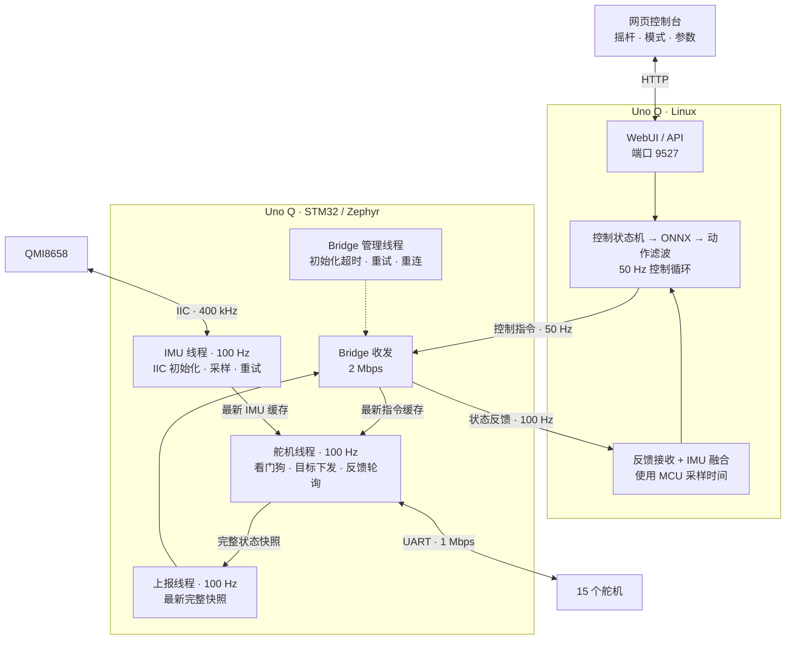

# 程序框图

Arduino Uno Q 的 Linux 侧负责网页、状态处理和 ONNX 推理；STM32 侧负责 IMU 采样、舵机控制及反馈上报。

Sit/Stand 与 Walk、Get-up、Pick、Roulade 共用 50 Hz 控制循环。Sit/Stand 的 scale 独立固定为 1.1，腿部与头部 α 继续使用普通模型的网页设置。坐下保持发送 `[1, 0, 0]`，站起发送 `[0, 0, 0]` 并在 1 s 后回到行走；跌倒恢复会取消坐站状态，并在恢复后返回所选行走策略。

left_kick / right_kick 分别使用 `xgoduck_ballkick_left.onnx` / `xgoduck_ballkick_right.onnx`，同样运行于 50 Hz 控制循环。速度、头部和身体姿态指令全部置零，运行 0.4 s 后返回所选行走策略。两套踢球策略独立固定为 scale 0.8、腿部 α 0、头部 α 0，网页普通模型滑块和 Roulade 临时滤波不修改踢球参数，踢球参数也不修改其他模型。期间继续使用原有跌倒检测，跌倒会取消踢球并进入默认位姿保持、爬起、返回行走的流程。

## 线程与时序

Linux 策略推理与目标更新周期为 20 ms（50 Hz）。Pick 相位和跌倒/站稳计数使用同一控制周期；Kick 0.4 s、Stand 1 s 和默认位姿保持 1 s 仍按原时长运行。STM32 舵机与 IMU 保持 100 Hz。

Zephyr 的优先级数值越小，优先级越高。

| STM32 线程 | 优先级 | 周期或触发方式 | 职责 |
| --- | --- | --- | --- |
| `duck_control100` | 3 | 10 ms | 舵机总线的唯一访问者；执行指令、看门狗、目标写入和反馈轮询 |
| `duck_imu100` | 4 | 10 ms | 独占 IIC；完成 IMU 初始化、读取及故障重试 |
| Bridge 库接收线程 | 5 | 有数据时处理，空闲休眠 1 ms | 解析 RPC 和调用指令回调；重试期间继续处理积压数据 |
| `duck_bridge_init` | 6 | 启动或断连时重试；就绪后每 2 s 检查连接 | 握手、注册、连接监测和恢复 |
| `duck_report100` | 7 | 完整状态快照就绪时，目标 100 Hz | 发送状态；每 10 次状态上报发送一次诊断数据 |

- IMU 线程只在复制缓存时持有短锁，IIC 操作不持有舵机线程需要的锁。IIC 超时或重新初始化不会阻塞舵机循环。
- 舵机线程读取最新 IMU 缓存，再生成完整状态快照。上报队列容量为 1，忙时用新快照覆盖待发送快照，避免状态不断积压。
- 舵机回复齐全后提前结束等待；缺失回复时最多等待 6 ms。Linux 的目标值在 50 Hz 控制循环中更新，STM32 使能时按 100 Hz 下发当前目标。
- Linux 按 MCU 的 IMU 时间戳融合；重复的 IMU 样本不重复积分，关节反馈仍正常更新。

腿部和头部舵机的 KP/KD 不在上电初始化、使能、模式切换或校准时自动覆盖。仅嘴部 ID34 固定写入临时 KP=10、KD=20；网页显式设置单个舵机永久增益的功能保留。校准后的中位保持沿用该舵机原有增益。

## Bridge 恢复与卸力

- 每次 RPC 的锁等待和回复等待共用 1 s 截止时间。初始化失败后按 250、500、1000、2000 ms 退避，之后保持 2000 ms 重试。
- 重试复用已有传输、解码器和线程；丢弃迟到的旧 RPC 回复。接收线程在初始化期间仍处理数据，避免积压通知挡住握手回复。
- 正常运动控制不再使用指令 TTL 超时卸力；未收到新指令时继续下发最后目标。80 字节指令包中的旧 TTL 字段保留但不生效。
- IMU 读数失效、缓存超过 500 ms 或 Bridge 未就绪时，STM32 退出正常使能状态。Linux 同步使用 500 ms 的 IMU 数据过期阈值；主机反馈接收超时仍为 150 ms。校准和调试模式保留独立的 250 ms 主机心跳保护。
- 调试模式的心跳检查在舵机操作结束后重新读取当前时间，避免扫描等待回复期间的新心跳造成无符号时间差下溢、误退出调试模式。
- Bridge 恢复后，Linux 回到 `shadow`，需要重新显式使能运动。
- 系统的 `arduino-router` 服务停止脚本会复位 STM32。完整重启该服务后仍需重新运行 App，以加载 MCU 应用并刷新容器 socket 挂载；通信中断重试针对 MCU 应用继续运行的情况。

## 验证记录

- 左右脚踢球已在本地使用真实 ONNX 模型完成状态切换检查，覆盖全零指令、0.4 s 返回行走、固定 scale 0.8 / 腿头 α 0 与网页及 Roulade 参数隔离、跌倒爬起、动作互锁、卸力取消、反馈丢失和 Bridge 重连取消；网页交互已完成模拟 DOM 检查。实际踢球动作由操作者手动验证。
- 早期 50 Hz 推理版本已在目标设备编译、上传并重启。10 s MCU 采样窗口内，IMU 与舵机轮询均为 100 Hz；网页反馈约 99.9 Hz，ONNX 推理约 50 Hz，15 个舵机在线。
- 上一版 Router 进程暂停 5 s 后恢复，Bridge 在约 2 s 内自动恢复上报；IMU 和舵机循环无超周期，始终保持卸力。
- 交付前完成 10 项回归检查，覆盖 500 ms IMU 数据过期边界、取消指令 TTL 后的报文兼容性、行走 vx 边界及滚轮模式兼容性。验证脚本不随运行工程分发。
- 使用舵机设置页面相同接口完整扫描 0–253，共检查 254 个 ID，找到 10–14、20–24、30–34 共 15 个舵机；扫描期间未退出调试模式，ID 10、20、34 的位置和增益读取正常。
- 正常指令 TTL 已取消，IMU 数据过期阈值为 500 ms；普通行走 vx 为 -0.18～0.20，网页摇杆与键盘均受此范围限制，滤波为 0.75 × 旧值 + 0.25 × 目标值。当前设备验证保持卸力，未包含使能后的实际行走。
