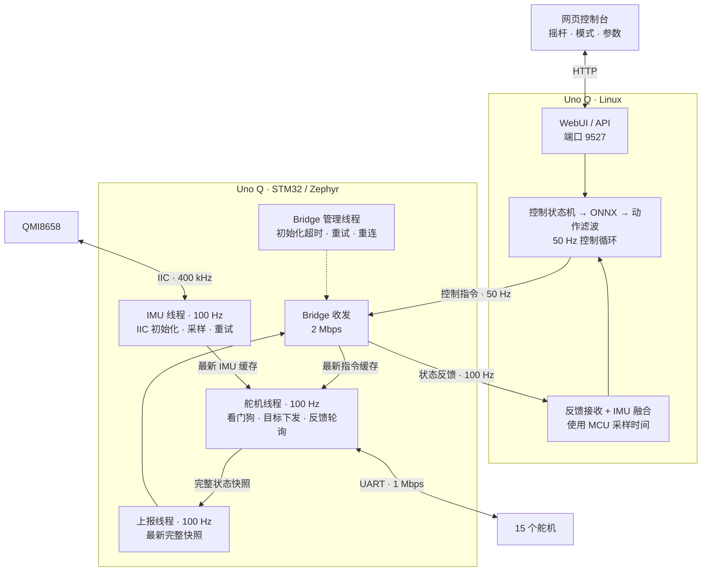

# 程序框图

Arduino Uno Q 的 Linux 侧负责网页、状态处理和 ONNX 推理；STM32 侧负责 IMU 采样、舵机控制及反馈上报。

Sit/Stand 与 Walk、Get-up、Pick、Roulade 共用 50 Hz 控制循环。Sit/Stand 的 scale 跟随普通模型设置，默认 1.0，腿部与头部 α 继续使用普通模型的网页设置。坐下保持发送 `[1, 0, 0]`，站起发送 `[0, 0, 0]` 并在 1 s 后回到行走；跌倒恢复会取消坐站状态，并在恢复后返回所选行走策略。

left_kick / right_kick 分别使用 `xgoduck_ballkick_left.onnx` / `xgoduck_ballkick_right.onnx`，同样运行于 50 Hz 控制循环。速度、头部和身体姿态指令全部置零，运行 0.4 s 后返回所选行走策略。两套踢球策略独立固定为 scale 0.8、腿部 α 0、头部 α 0，网页普通模型滑块和 Roulade 临时滤波不修改踢球参数，踢球参数也不修改其他模型。期间继续使用原有跌倒检测，跌倒会取消踢球并进入默认位姿保持、爬起、返回行走的流程。

## 线程与时序

Linux 策略推理与目标更新周期为 20 ms（50 Hz）。Pick、Roulade、Sit/Stand 和左右踢腿共用 0.2 s 准备阶段：当前 Walk 保持运行，每个周期只在空闲预算中预热目标模型；Stand 准备时继续保持坐姿。准备结束并完成至少一次预热后，控制循环切换模型，清空新动作的历史；Sit → Stand 保留同一模型的历史。

停止、模式切换和跌倒恢复立即取消准备，不等待 0.2 s。恢复判断先于动作激活，避免准备到期时覆盖同一周期检测到的跌倒。准备超过 0.5 s 仍未完成时取消请求。Roulade 1.7 s、Kick 0.4 s、Stand 1 s 从第一条有效动作目标下发后计时，使能指令不计入；Pick 相位只在成功下发动作后推进。实际翻滚期间继续忽略姿态触发恢复，结束后恢复原有跌倒检测。

STM32 舵机与 IMU 保持 100 Hz。`/api/status` 提供准备状态与翻滚时序摘要，逐帧翻滚记录可通过 `/api/roulade-timing` 读取，不在实时控制路径写日志文件。

Zephyr 的优先级数值越小，优先级越高。

| STM32 线程 | 优先级 | 周期或触发方式 | 职责 |
| --- | --- | --- | --- |
| `duck_control100` | 3 | 10 ms | 舵机总线的唯一访问者；执行指令、看门狗、目标写入和反馈轮询 |
| `duck_imu100` | 4 | 10 ms | 独占 IIC；完成 IMU 初始化、读取及故障重试 |
| Bridge 库接收线程 | 5 | 有数据时处理，空闲休眠 1 ms | 解析 RPC 和调用指令回调；重试期间继续处理积压数据 |
| `duck_bridge_init` | 6 | 启动或断连时重试；就绪后每 2 s 检查连接 | 握手、注册、连接监测和恢复 |
| `duck_report100` | 7 | 完整状态快照就绪时，目标 100 Hz | 发送状态；每 10 次状态上报发送一次诊断数据 |

- IMU 线程只在复制缓存时持有短锁，IIC 操作不持有舵机线程需要的锁。IIC 超时或重新初始化不会阻塞舵机循环。
- 舵机线程读取最新 IMU 缓存，再生成完整状态快照。上报队列容量为 1，忙时用新快照覆盖待发送快照，避免状态不断积压。
- 舵机回复齐全后提前结束等待；缺失回复时最多等待 6 ms。Linux 的目标值在 50 Hz 控制循环中更新，STM32 使能时按 100 Hz 下发当前目标。
- Linux 按 MCU 的 IMU 时间戳融合；重复的 IMU 样本不重复积分，关节反馈仍正常更新。

腿部和头部舵机的 KP/KD 不在上电初始化、使能、模式切换或校准时自动覆盖。仅嘴部 ID34 固定写入临时 KP=10、KD=20；网页 Set KpKd 使用原有操作码 5，一次写入所选舵机的 EEPROM 0x15/0x16 和运行时寄存器 50/51，并在两组值均回读一致后报告成功，页面与请求格式不变。校准后的中位保持沿用该舵机原有增益。

Roulade 播放期间腿部和头部 α 临时固定为 0.05，结束后恢复原来的值；scale 继续跟随普通模型的 Action scale 设置。

## Bridge 恢复与卸力

- 每次 RPC 的锁等待和回复等待共用 1 s 截止时间。初始化失败后按 250、500、1000、2000 ms 退避，之后保持 2000 ms 重试。
- 重试复用已有传输、解码器和线程；丢弃迟到的旧 RPC 回复。接收线程在初始化期间仍处理数据，避免积压通知挡住握手回复。
- 正常运动控制不再使用指令 TTL 超时卸力；未收到新指令时继续下发最后目标。80 字节指令包中的旧 TTL 字段保留但不生效。
- IMU 读数失效、缓存超过 500 ms 或 Bridge 未就绪时，STM32 退出正常使能状态。Linux 同步使用 500 ms 的 IMU 数据过期阈值；主机反馈接收超时仍为 150 ms。校准和调试模式保留独立的 250 ms 主机心跳保护。
- 调试模式的心跳检查在舵机操作结束后重新读取当前时间，避免扫描等待回复期间的新心跳造成无符号时间差下溢、误退出调试模式。
- Bridge 恢复后，Linux 回到 `shadow`，需要重新显式使能运动。
- 系统的 `arduino-router` 服务停止脚本会复位 STM32。完整重启该服务后仍需重新运行 App，以加载 MCU 应用并刷新容器 socket 挂载；通信中断重试针对 MCU 应用继续运行的情况。

## IMU 标定与电压

IMU 标定入口位于控制页 IMU and servos 栏目底部，开始前卸载电机。站立标定采集 1.5 s 原始数据，至少需要 90 个有效样本，保存加速度偏差 `[0, 0, -9.8] - mean(acc)` 和陀螺仪均值；之后分别加上加速度偏差、减去陀螺仪均值。加速度波动的合成标准差上限为 0.30 m/s²，单次读数相对均值的最大偏差上限为 1.0 m/s²；角速度合成标准差上限为 1.125 °/s，最大偏差为 4.5 °/s，各轴均值绝对值上限为 12 °/s。姿态检查不变。保存文件位于运行时缓存，标定失败或取消时保留原记录。页面失败提示为红色 `Error: Slight movement. Please recalibrate.`。

普通 Walk 有前进指令（`vx > 0`）时，标定后的 X 加速度额外加上 `+1.5 m/s²`，前进同时旋转也以前进补偿为准；否则，有后退指令（`vx < 0`）或旋转指令（`wz != 0`）时额外加上 `-1.5 m/s²`。同时后退和旋转只补偿一次，指令归零后立即取消。不依赖加速度正负，不累加到后续样本，也不写入标定文件；Skating、其他动作、爬起及标定采样期间不应用该补偿。已移除固定的 X 加速度增益。

舵机反馈从 0x38 读取 7 字节，最后一字节是 0x3E 电压，单位 0.1 V。STM32 约每秒通过独立 DQV1 报文上报；100 Hz 状态包 ABI 保持不变。网页 Voltage 显示在线有效舵机电压的中位数，过期读数显示空值。
