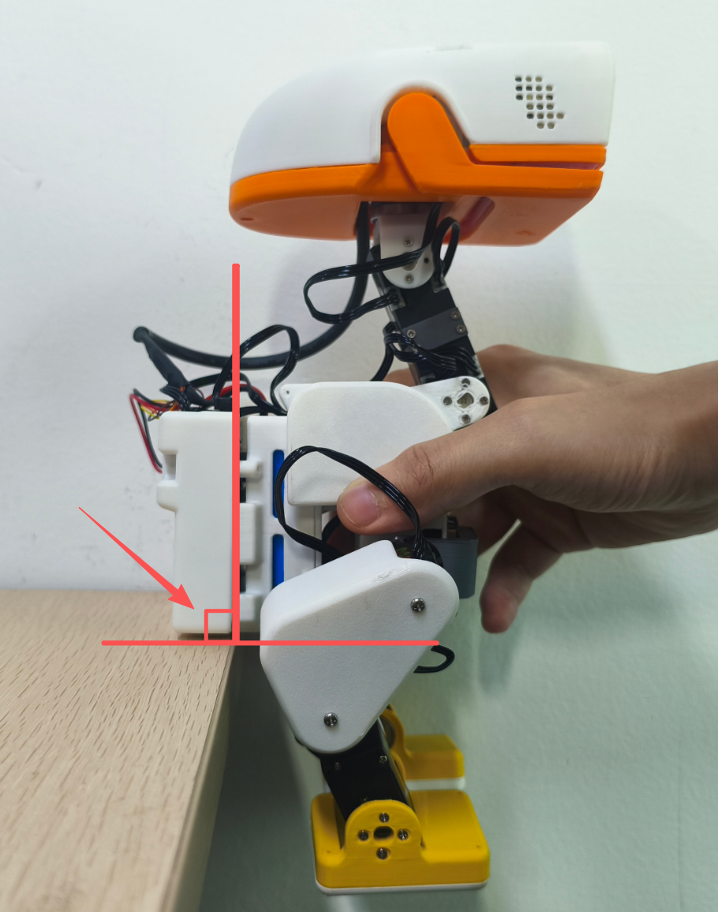

# 站姿 IMU 标定 / Standing IMU calibration

打开 `http://<板子IP>:9527/calibrate.html`，在页面顶部找到 **IMU 标定**。如果已经设过舵机中位，先点 **Unload all / 全部卸力**。按图支撑小鸭，让板子的电池接口朝正上方，下边缘贴住水平桌面。点 **标定 IMU**，保持静止约 1.5 秒，等页面显示已保存。

Open `http://<board-ip>:9527/calibrate.html` and find **IMU calibration** at the top. Click **Unload all** if you have already set any servo centers. Support Duck with the battery connector pointing up and the bottom edge of the board against a level tabletop. Click **Calibrate IMU** and keep the board still for about 1.5 seconds until the page reports that it saved the result.

至少需要 90 个不同的 MCU IMU 样本。抖动、反馈中断或方向偏离竖直超过 45° 会使标定失败。采样时请保持页面在前台，点击 **Exit** 可取消。失败或取消时保留旧结果。也可在 **Control → IMU and servos** 中标定，先点 **Torque off**，再点 **Calibrate IMU**。

加速度采用固定偏移 `[0, 0, -9.8] - mean(raw_acc)`，单位 m/s²。陀螺仪减去同一段静止采样的平均值。偏移直接用于滤波、策略观测和跌倒恢复。接口 `/api/status` 中的 `acc`、`gyro` 是原始读数，`acc_corrected`、`gyro_corrected` 是修正后读数。

AI 版将版本 2 记录保存在 App 的 `data/imu-calibration.json`。保存后立即生效，重启时自动加载。重标成功后旧文件保存在 `imu-calibration.previous.json`，**Reset IMU calibration** 则将已保存的文件移到 `imu-calibration.disabled.json`。旧版旋转记录需用网页重标。更换板子或调整安装方向后重新标定。

The App needs at least 90 unique IMU samples. Motion, interrupted feedback or a board tilted more than 45° from upright rejects the run. Keep the page in the foreground during sampling. Click **Exit** to cancel. Failed or cancelled runs preserve the previous result. You can also use **Control → IMU and servos**. Click **Torque off** before **Calibrate IMU** there.

Accelerometer correction adds the fixed offset `[0, 0, -9.8] - mean(raw_acc)` in m/s². Gyro correction subtracts the stationary mean. Use `acc_corrected` and `gyro_corrected` in `/api/status` to check the result. The raw readings are available as `acc` and `gyro`.

The AI App saves version 2 records in `data/imu-calibration.json`, applies them immediately and reloads them on restart. Successful recalibration saves the previous file as `imu-calibration.previous.json`. **Reset IMU calibration** moves the active file to `imu-calibration.disabled.json`. Recalibrate after upgrading from a rotation-based record, changing the board or changing its mounting orientation.
