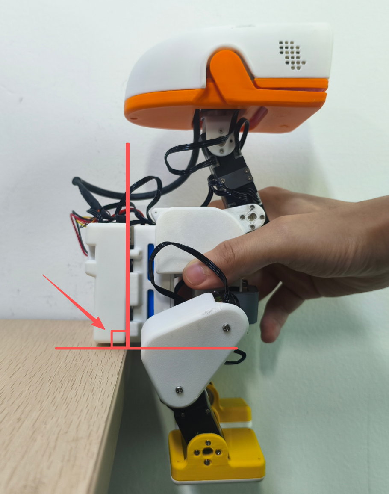

# 站姿 IMU 标定 / Standing IMU calibration

打开 `http://<板子IP>:9527/calibrate.html`，在统一标定流程中找到 **IMU 标定**。如果舵机仍在上力，先点 **全部卸力**。按图支撑小鸭，让板子的电池接口朝正上方，下边缘贴住水平桌面。点一次 **标定 IMU**，保持静止直到页面显示已保存。首次通过约需 2 秒。

Open `http://<board-ip>:9527/calibrate.html` and find **IMU calibration** after the ID 30 neck calibration step. Click **Unload all** if any servo is still holding. Support Duck with the battery connector pointing up and the bottom edge of the board against a level tabletop. Click **Calibrate IMU** once and hold still until the page confirms the save. A first-attempt success takes about 2 seconds.

每次先静置 0.5 秒，再采集 1.5 秒，至少需要 90 个不同的 IMU 样本。如果这段读数有晃动或尖峰，程序会丢弃整段，最多自动重试 10 次。页面显示当前重试次数。方向偏离竖直超过 45°、读数中断或陀螺仪零偏超限时会直接提示原因。只有整段合格才会替换上次的标定。保持页面在前台，点击 **退出** 可取消。

加速度采用固定偏移 `[0, 0, -9.8] - mean(raw_acc)`，单位 m/s²。陀螺仪减去同一段静止采样的平均值。偏移直接用于滤波、策略观测和跌倒恢复。接口 `/api/status` 中的 `acc`、`gyro` 是原始读数，`acc_corrected`、`gyro_corrected` 是修正后读数。

AI 版将版本 2 记录保存在 App 的 `data/imu-calibration.json`。保存后立即生效，重启时自动加载。重标成功后旧文件保存在 `imu-calibration.previous.json`。旧版旋转记录需用网页重标。更换板子或调整安装方向后重新标定。

Each attempt allows 0.5 seconds to settle and collects at least 90 distinct IMU samples over 1.5 seconds. If movement or a spike exceeds a limit, the App discards that window and automatically retries up to 10 times. The page shows the retry count. A tilt beyond 45° from upright, interrupted readings or excessive gyro bias ends the run with a specific message. Only a passing window replaces the previous calibration. Keep the page in the foreground and click **Exit** to cancel.

Accelerometer correction adds the fixed offset `[0, 0, -9.8] - mean(raw_acc)` in m/s². Gyro correction subtracts the stationary mean. Use `acc_corrected` and `gyro_corrected` in `/api/status` to check the result. The raw readings are available as `acc` and `gyro`.

The AI App saves version 2 records in `data/imu-calibration.json`, applies them immediately and reloads them on restart. Successful recalibration saves the previous file as `imu-calibration.previous.json`. Recalibrate after upgrading from a rotation-based record, changing the board or changing its mounting orientation.
